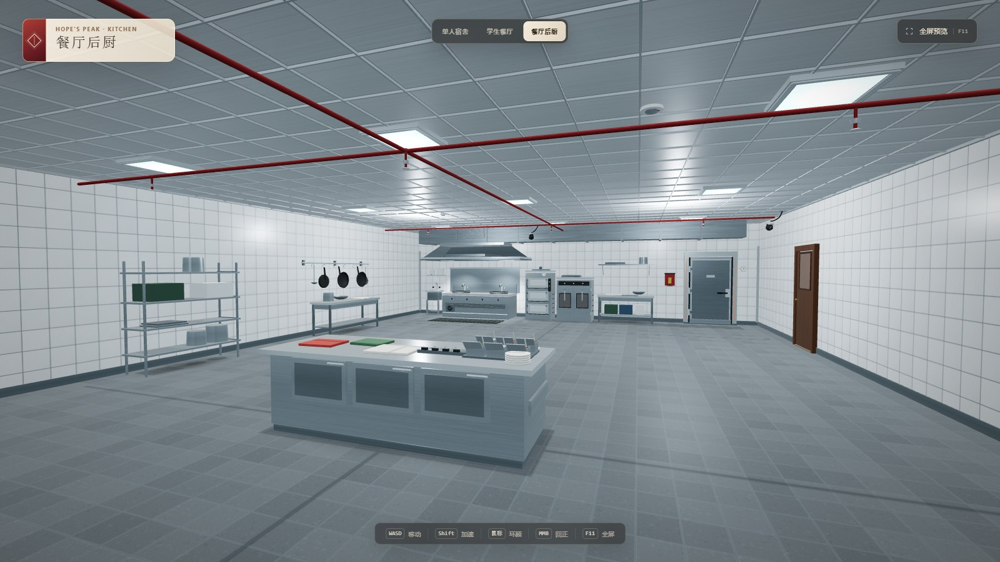
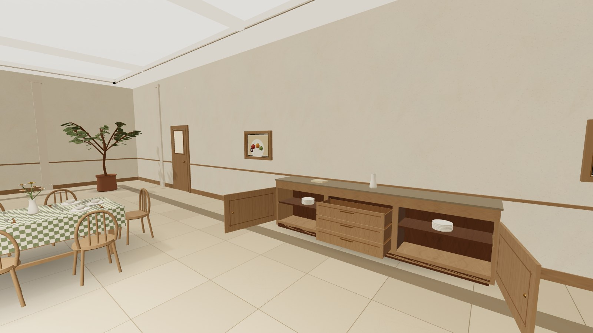
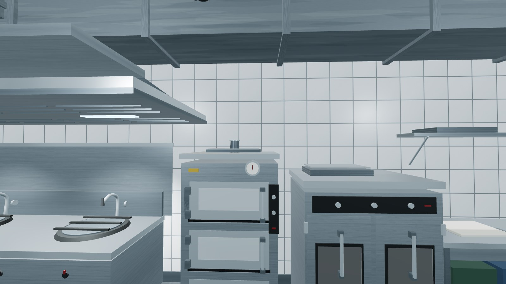
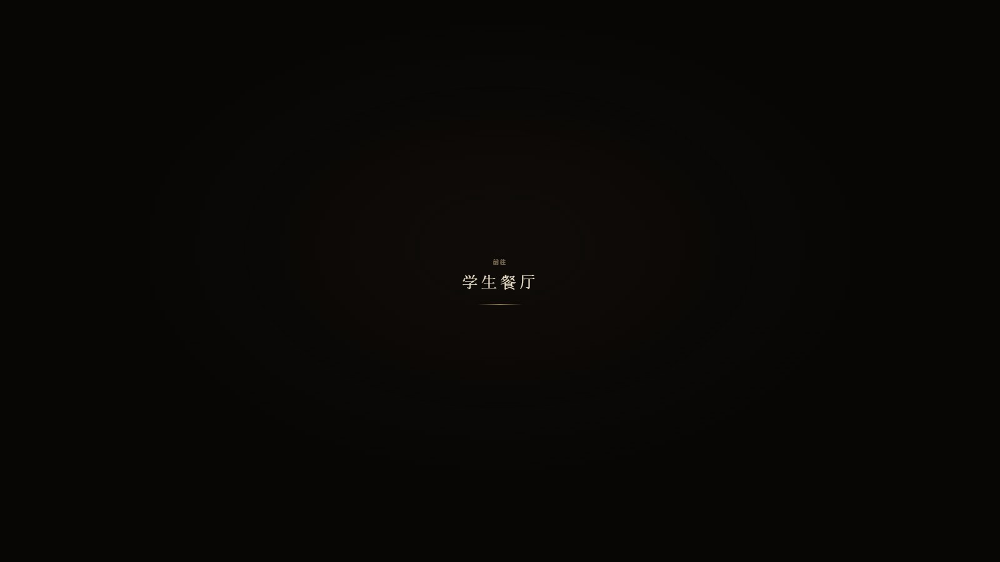
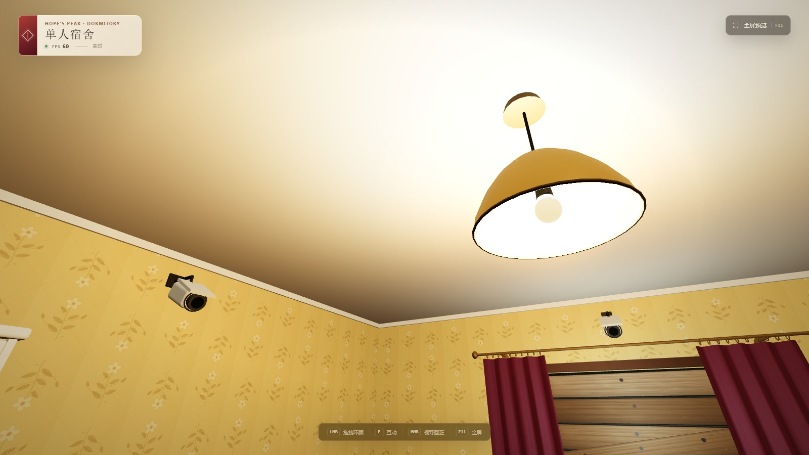
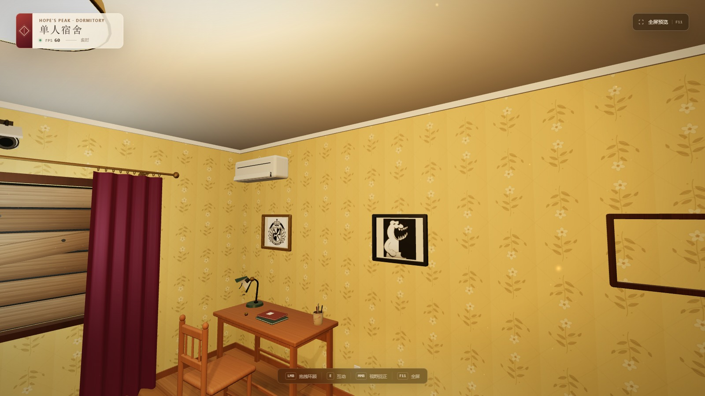

# 弹丸论破同人 · 3D 场景集

三个纯静态、可离线运行的 Three.js 场景，**在同一个页面里顶部切换**：

| 场景 | 预览地址 | 内容 |
| --- | --- | --- |
| **学生餐厅** | **https://guanying37.github.io/single-dorm/#dining** | 36 × 22 m 大厅，10 张餐桌 / 60 座，8 幅美食画、两座挂钟、可交互餐具柜 |
| **学生餐厅后厨** | **https://guanying37.github.io/single-dorm/#kitchen** | 12 × 22 m 商用厨房，中央岛台、烹饪线、三联水槽、冷库门、货梯、回餐厅门与两台老式 CRT |
| **单人宿舍** | **https://guanying37.github.io/single-dorm/** | 黄色墙纸、封死的窗、可开启的衣橱与抽屉 |

> `/dining/` 会自动跳转到 `/#dining`，`/kitchen/` 会跳转到 `/#kitchen`。页面使用 ES Modules，必须通过 HTTP(S) 访问；直接双击 `index.html`（`file://`）不会加载 Three.js 模块。




## 学生餐厅

供重要学生使用、装修良好但不奢华的餐厅。**无人物、无文字、无音频、无 CDN、无网络请求**；几何、程序化贴图与全部灯光在浏览器内生成。

- **场地**：36.0 × 22.0 m，净高 4.2 m，约 792 ㎡；暖白灰泥墙、900 mm 石材地砖与深色收边、浅跌级天花与横向梁。
- **家具**：10 张 1.8 × 1.0 m 橡木餐桌、60 把曲木椅、60 套五件餐具（盘、碗、筷、勺、叉）；奶油/鼠尾草方格桌布；每桌白瓷花瓶插 3~5 枝花（花瓣周向不重叠、花蕊可见、茎入瓶）。
- **陈设**：8 幅美食主题画像（立体浅浮雕，非位图绘制）；北墙复古挂钟（木框、白盘、罗马数字、钟摆、时间可调）；东墙大天鹅时钟；东西两侧壁挂扬声器（装饰，不播放音频）。
- **门与预留空间**：正门双开但**已锁定，不能打开**，后续再改为交互切到走廊（已挂 `sceneId: 'corridor'`）；正门后 2.7 m 走廊预留段仍在（地毯 + 端墙边柜 + 壁灯，不放第二道门）；**后厨门会黑屏切场到后厨**。
- **交互**：餐具柜左右门与三层抽屉；全部带动态碰撞体，不穿模。餐桌碰撞拆成「桌面 + 6 把椅子」独立体，四个无椅角可走近。
- **设备**：10 组 4000K 线性 LED、3 台嵌入式空调、6 台半球监控。
- **性能**：约 51–63 draw calls（随柜门/抽屉开合变化）、35.7 万三角面、13 张程序化贴图/场景；单张静态烘焙阴影；无后处理；自适应分辨率；**测试机 1920×1080 硬件渲染实测约 59–60 FPS**。

### 操作

| 输入 | 行为 |
| --- | --- |
| `W A S D` | 平移（眼高固定 1.80 m） |
| `Shift` | 加速（5.2 → 11.0 m/s，与后厨移动速度一致） |
| 鼠标拖动 / 全屏鼠标 | 环顾；全屏进入指针锁定并隐藏光标 |
| 右键 | 固定 / 解锁视线 |
| 中键 | 平滑回正 |
| `E` | 与门、柜门、抽屉互动 |
| `F11` / 右上按钮 | 全屏 |

非全屏时左上角实时显示 FPS；全屏时隐藏装饰性 HUD，只保留准星、交互提示与 Toast。

### 预览

| | |
|---|---|
|  |  |
|  |  |

更多：[学生餐厅说明](single-dorm/dining/README.md) · [建模任务书](single-dorm/dining/BRIEF.md)

## 学生餐厅后厨

学生餐厅的服务后台：**12.0 × 22.0 m，净高 3.25 m，264 ㎡**，恰为前厅 792 ㎡ 的 **1/3**；22 m 进深与餐厅一致。冷白 LED 平板灯、白色满铺墙砖、600 铝扣板、镀锌排烟风管和不锈钢设备；**无人物、无文字、无自绘二维画作、无音频、无 CDN、无网络请求**。

- **门与切场**：后厨东墙有与餐厅同款的**橡木/磨砂玻璃/黄铜把手**回餐厅门（铰链镜像，z=-7）；餐厅侧后厨门在**东墙 z=6.3、靠正门一端**（甜点画与东南角盆栽之间）。点击任一侧黑屏显示目的地，切场落点在各自门内并回正视角。
- **动线**：回餐厅门/出餐口 → 中央岛台 → 烹饪区 → 西侧挂杆/货梯 → 冷库 → 南侧清洗/售饭台；设备前操作位 ≥1.2 m。
- **设备**：3 × 1 m 双层岛台；双头猛火灶（锅具已移除，保留空锅圈）+ 鼓风机、三门蒸箱、双门烤箱、大型排烟罩/风管；三联水槽 + 高压花洒 + 垃圾处理器；保温售饭台 + 打菜勺；1.3 m 冷库门（防凝露加热丝）；1.7 m 货梯门；2.4 m 出餐口双开防撞门 + 传菜台 + 暖光交接廊。
- **天花/安防**：15 盏 LED 防爆平板灯、9 个喷淋、3 个烟感、4 台带黑线缆的半球监控。
- **监控母题**：墙面老式 CRT（凸弧屏、淡绿荧光、扫描线、支架 + 录像机）与备餐台旁落地分屏 CRT；无文字、无人物。
- **交互/控制**：WASD、Shift、鼠标、右键固定、中键回正；眼高 1.80 m、俯仰 ±83°、零侧滚；**走路 5.2 m/s、跑步 11.0 m/s**；19 个碰撞体，11 m/s 跑动仍不穿模；轻微步伐起伏。
- **性能**：23–43 draw calls、3.4–3.9 万三角面、13 张程序化贴图；单张 2048² 静态阴影、无后处理。

<table>
  <tr>
    <td></td>
    <td></td>
  </tr>
  <tr>
    <td></td>
    <td></td>
  </tr>
</table>

更多：[后厨说明](single-dorm/kitchen/README.md) · [场景简报](single-dorm/kitchen/BRIEF.md) · [验收记录](single-dorm/kitchen/VALIDATION.md)

## 单人宿舍

温暖明亮的单人宿舍：黄色花纹墙纸、白色床品、红色门厅地毯，以及一扇被六块旧木板和铁钉彻底封死的窗。全部几何与程序化贴图在浏览器内实时生成，仅两张参考画使用本地 WebP。


<table>
  <tr>
    <td></td>
    <td></td>
  </tr>
  <tr>
    <td></td>
    <td></td>
  </tr>
</table>

详细说明见 [单人宿舍 README](single-dorm/README.md)。

## 目录结构

```
single-dorm/
├─ index.html                # 同一页面：单人宿舍 / 学生餐厅 / 餐厅后厨
├─ dorm.html                 # 单人宿舍独立页（备用）
├─ styles.css                # 三个场景共用的预览 UI
├─ serve.py                  # 本地预览服务器（自动开浏览器）
├─ start-preview.cmd         # Windows 一键启动
├─ src/
│  ├─ hub.js                 # 三场景外壳、切换、输入、全屏、FPS
│  ├─ main.js                # 独立宿舍页的入口（dorm.html 使用）
│  └─ ...                    # 宿舍场景模块
├─ dining/                   # 学生餐厅
│  ├─ index.html             # 自动跳转 /#dining
│  ├─ standalone.html        # 餐厅独立页（备用）
│  ├─ dining.css
│  ├─ README.md
│  ├─ BRIEF.md               # 已确认的建模任务书
│  ├─ src/
│  │  ├─ main.js             # 独立餐厅页入口
│  │  ├─ scene.js            # 场景装配、灯光、碰撞、交互调度
│  │  ├─ room.js             # 外壳、三扇门、走廊预留段、墙面线条
│  │  ├─ furniture.js        # 餐桌、椅、桌布、餐具、花、餐具柜
│  │  ├─ decor.js            # 天花设备、画像、两座钟、绿植、扬声器
│  │  ├─ textures.js         # 程序化材质贴图
│  │  ├─ materials.js        # 自然色 PBR 材质
│  │  ├─ player.js           # 第一人称移动、跑步晃动
│  │  ├─ collision.js        # 圆形玩家 vs AABB / OBB
│  │  ├─ config.js           # 尺寸、桌位、时钟、初始机位
│  │  └─ utils.js            # 几何合并、静态批处理
│  └─ preview/               # 预览截图
├─ kitchen/                  # 学生餐厅后厨
│  ├─ index.html             # 自动跳转 /#kitchen
│  ├─ README.md / BRIEF.md / scene-spec.yaml / asset-list.md / VALIDATION.md
│  ├─ preview/               # 14 张后厨预览 JPG
│  └─ src/
│     ├─ scene.js            # 装配、灯光、环境、碰撞、阴影
│     ├─ room.js             # 墙地顶、出餐口、冷库、货梯、排烟、喷淋、监控
│     ├─ equipment.js        # 岛台、灶、蒸箱、烤箱、水槽、售饭台、挂杆
│     ├─ props.js            # 两台老式 CRT、支架、线缆
│     ├─ player.js           # 第一人称移动、碰撞、步伐起伏
│     ├─ textures.js / materials.js
│     └─ config.js / geometry.js
├─ assets/art/               # 宿舍参考画
├─ preview/                  # 宿舍预览截图
└─ vendor/                   # Three.js（本地副本，MIT）
```

## 本地运行

最简单的方式：双击 **`single-dorm/start-preview.cmd`**。脚本会启动本地服务器并自动打开同一页面的场景预览。

也可以手动启动任意静态服务器：

```powershell
cd single-dorm
python -m http.server 8123 --bind 127.0.0.1
# 同一页面（默认宿舍）: http://127.0.0.1:8123/
# 直接进入餐厅:         http://127.0.0.1:8123/#dining
# 直接进入后厨:         http://127.0.0.1:8123/#kitchen
# 旧地址 /dining/、/kitchen/ 会自动跳转
```

或 `npx serve . -l 8123`。

> **不要直接双击 `index.html`**。页面使用 ES Modules，`file://` 协议会被浏览器 CORS 拦截，场景不会加载；现在三个场景页都会显示「需要通过本地服务器打开」的提示。若提示端口被占用，说明服务器已在运行，直接打开上面的地址即可。

## 发布

`main` 分支保存工程源码；`gh-pages` 分支保存站点根目录（内容即 `single-dorm/`），由 GitHub Pages 托管。三个场景在同一页面：

- `/` → 三场景预览（默认单人宿舍，顶部切换学生餐厅 / 餐厅后厨）
- `/#dining` → 直接进入学生餐厅
- `/#kitchen` → 直接进入餐厅后厨
- `/dining/`、`/kitchen/` → 自动跳转到对应 hash
- `/vendor/` → 本地 Three.js

更新站点：把 `single-dorm/` 的内容同步到 `gh-pages` 分支根目录后推送。

## 校区概念平面

根据手绘草图整理的概念户型图（Canvas，非施工图）：

- 页面：[single-dorm/school-plan/](single-dorm/school-plan/)
- 说明：[school-plan/README.md](single-dorm/school-plan/README.md)
- 本地地址：http://127.0.0.1:8123/school-plan/

内容：1F/2F 四翼贴主走廊；生活区 1F 餐厅/后厨/医务/洗衣/杂物/楼梯/电梯，2F 10 间男生宿舍 + 8 间女生宿舍（女生独立无窗厕所，男生用洗浴室）；休憩区 1F 运动/器材、2F 画室；研究教室 10 间；3F 礼堂环形走廊 + 四角 4 部客梯与楼梯间。


## 制作 Skill

本仓库还维护一套可复用的「弹丸论破风格 ADV 3D 场景」skill：

- 源文件：[skills/danganronpa-adv-3d/README.md](skills/danganronpa-adv-3d/README.md)
- 主入口：[skills/danganronpa-adv-3d/SKILL.md](skills/danganronpa-adv-3d/SKILL.md)
- 内容：场景/资产生产线计划、美术方向、场景简报、固定机位/移动机位两套 reference、模块化 kit、家具/道具族、灯光配方、运行时接入、性能预算、验收清单，以及简报/规格/资产清单/交接模板。当前餐厅与宿舍只作为 examples。

已安装到本机用户级 skill 目录：`~/.dsh/skills/danganronpa-adv-3d`，下次会话可直接加载。

## 许可

场景代码可自由用于学习与非商业同人创作。`vendor/` 下的 Three.js 遵循 MIT 协议（见 `single-dorm/vendor/THREE-LICENSE.txt`）。《弹丸论破》相关角色与设定版权归 Spike Chunsoft 所有。
