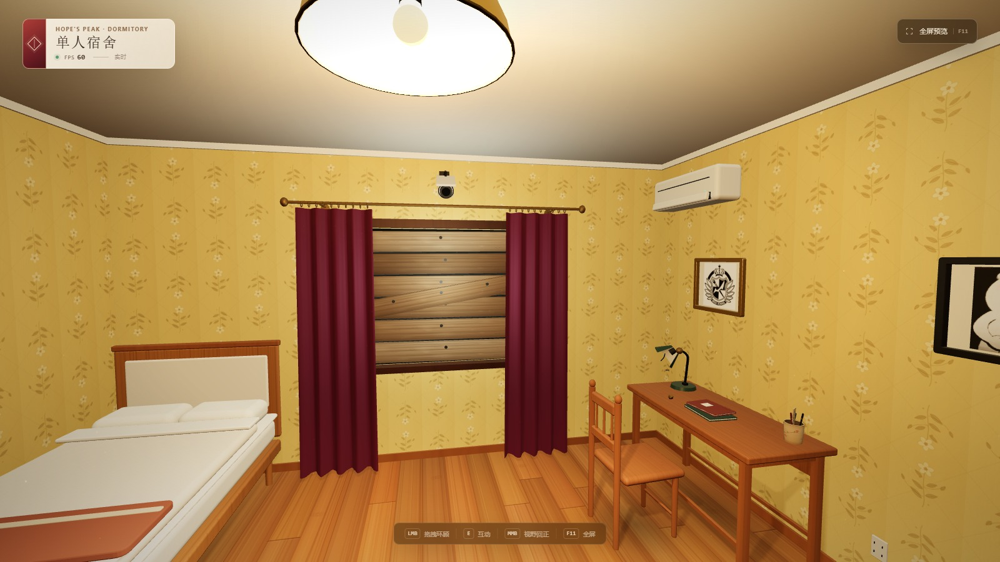
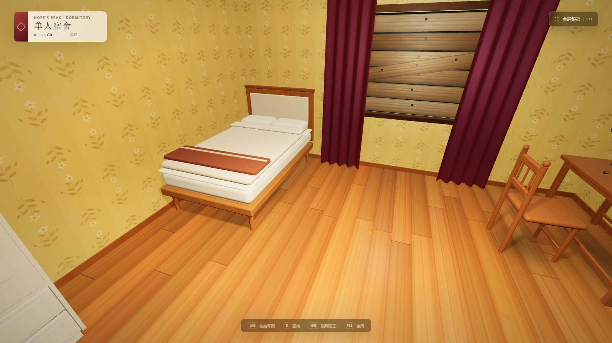
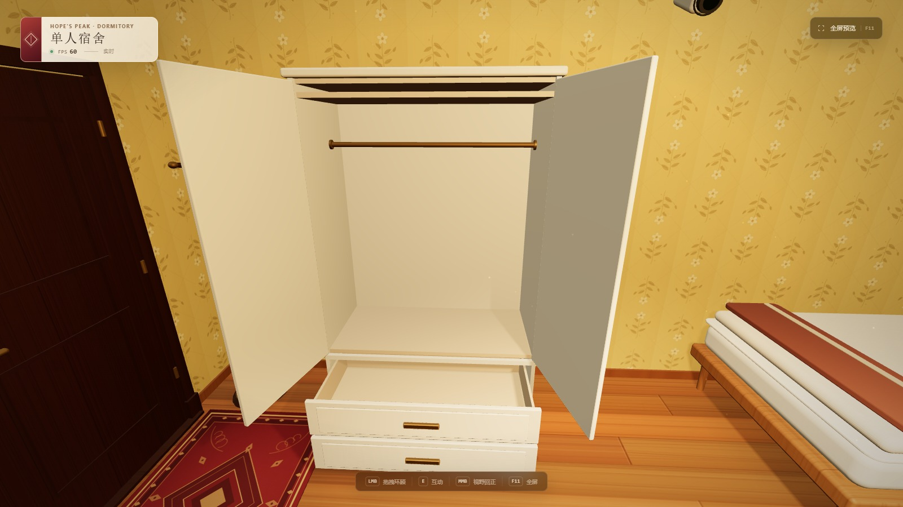

# single-dorm · 单人宿舍 3D 场景

弹丸论破风格的同人 3D 场景：一间温暖明亮的单人宿舍 —— 黄色花纹墙纸、白色床品、红色门厅地毯，以及一扇被六块旧木板和铁钉彻底封死的窗。全部几何与程序化贴图在浏览器内实时生成，**无 CDN、无网络请求**，仅两张参考画使用本地 WebP。

基于 Three.js 的纯静态实现，开箱即用。

## 在线预览

**https://guanying37.github.io/single-dorm/**

> 页面使用 ES Modules，必须通过 HTTP(S) 访问；直接双击 `index.html`（`file://`）无法加载模块。



## 场景内容

- 程序化墙纸、木地板、地毯与床品材质，全部在 `src/textures.js` 内用 Canvas 生成
- 封死的窗（六块旧木板 + 铁钉）、吊灯、投影、四壁监控、可开启的衣橱与抽屉
- 两张用户提供的画作作为参考图（`assets/art/*.webp`）
- 固定站位的自由环顾 + 预设机位切换

<table>
  <tr>
    <td></td>
    <td></td>
  </tr>
  <tr>
    <td></td>
    <td></td>
  </tr>
</table>

## 目录结构

```
single-dorm/
├─ index.html            # 入口
├─ styles.css            # 页面与 HUD 样式
├─ src/
│  ├─ main.js            # 引导、交互、机位
│  ├─ scene.js           # 渲染器、灯光、后期
│  ├─ room.js            # 房间结构：墙、地板、天花板、封窗
│  ├─ furniture.js       # 家具：床、书桌、衣橱、抽屉
│  ├─ materials.js       # 材质定义
│  ├─ textures.js        # 程序化贴图（Canvas）
│  ├─ optimize.js        # 合并/裁剪等渲染优化
│  └─ utils.js
├─ vendor/               # Three.js（本地副本，MIT）
├─ assets/art/           # 参考画 WebP
└─ preview/              # 预览截图
```

## 本地运行

```powershell
cd single-dorm
python -m http.server 8123 --bind 127.0.0.1
# 打开 http://127.0.0.1:8123/
```

或使用任意静态服务器：

```powershell
npx serve single-dorm -l 8123
```

## 发布

- `main` 分支保存工程源码；`gh-pages` 分支保存站点根目录（内容即 `single-dorm/`），由 GitHub Pages 直接托管
- 站点更新方式：把 `single-dorm/` 的内容同步到 `gh-pages` 分支根目录后推送
- 版本以 Release 形式提供，附带可直接下载的源码压缩包

## 许可

场景代码本源代码可自由用于学习与非商业同人创作。`vendor/` 下的 Three.js 遵循 MIT 协议（见 `single-dorm/vendor/THREE-LICENSE.txt`）。《弹丸论破》相关角色与设定版权归 Spike Chunsoft 所有。
