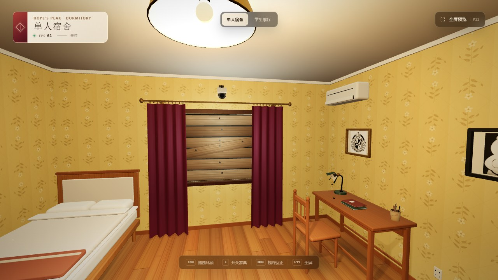
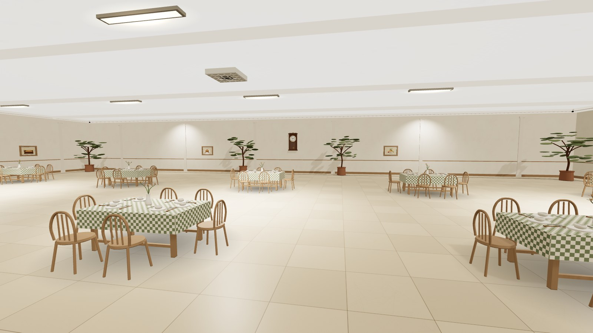
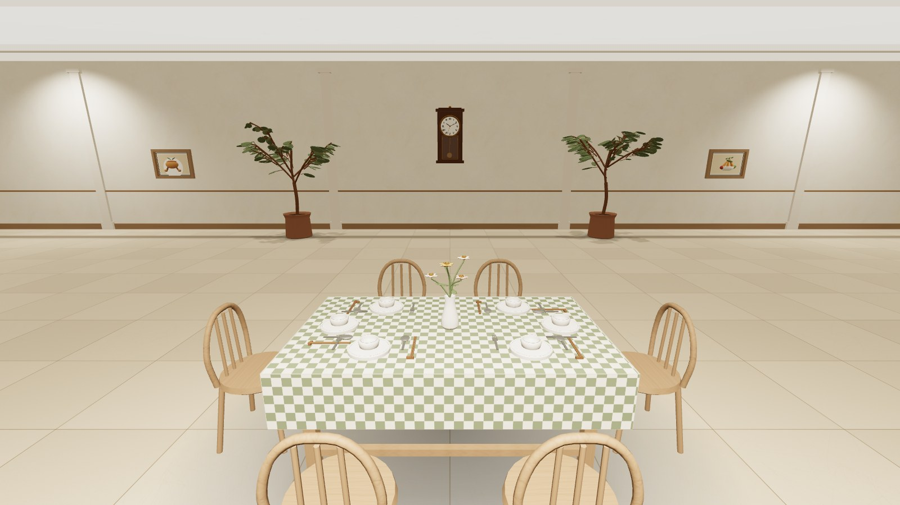
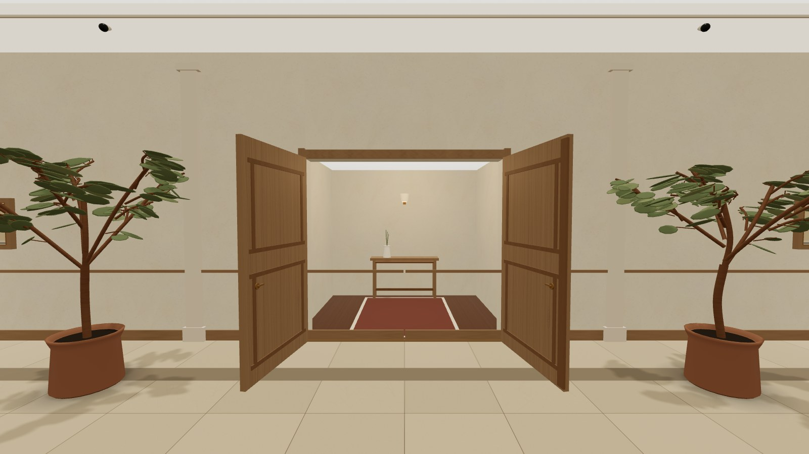

# 弹丸论破同人 · 3D 场景集

两个纯静态、可离线运行的 Three.js 场景，**在同一个页面里顶部切换**：

| 场景 | 预览地址 | 内容 |
| --- | --- | --- |
| **学生餐厅** | **https://guanying37.github.io/single-dorm/#dining** | 36 × 22 m 大厅，10 张餐桌 / 60 座，8 幅美食画、两座挂钟、可交互餐具柜 |
| **单人宿舍** | **https://guanying37.github.io/single-dorm/** | 黄色墙纸、封死的窗、可开启的衣橱与抽屉 |

> `/dining/` 会自动跳转到 `/#dining`。页面使用 ES Modules，必须通过 HTTP(S) 访问；直接双击 `index.html`（`file://`）不会加载 Three.js 模块。





## 学生餐厅

供重要学生使用、装修良好但不奢华的餐厅。**无人物、无文字、无音频、无 CDN、无网络请求**；几何、程序化贴图与全部灯光在浏览器内生成。

- **场地**：36.0 × 22.0 m，净高 4.2 m，约 792 ㎡；暖白灰泥墙、900 mm 石材地砖与深色收边、浅跌级天花与横向梁。
- **家具**：10 张 1.8 × 1.0 m 橡木餐桌、60 把曲木椅、60 套五件餐具（盘、碗、筷、勺、叉）；奶油/鼠尾草方格桌布；每桌白瓷花瓶插 3~5 枝花（花瓣周向不重叠、花蕊可见、茎入瓶）。
- **陈设**：8 幅美食主题画像（立体浅浮雕，非位图绘制）；北墙复古挂钟（木框、白盘、罗马数字、钟摆、时间可调）；东墙大天鹅时钟；东西两侧壁挂扬声器（装饰，不播放音频）。
- **门与预留空间**：正门双开，通向 2.7 m 走廊预留段（地毯 + 端墙边柜 + 壁灯，不放第二道门）；后厨门、卫生间门锁定，保留 `sceneId` 切换钩子。
- **交互**：正门开关、餐具柜左右门与三层抽屉；全部带动态碰撞体，不穿模。餐桌碰撞拆成「桌面 + 6 把椅子」独立体，四个无椅角可走近。
- **设备**：10 组 4000K 线性 LED、3 台嵌入式空调、6 台半球监控。
- **性能**：约 51–63 draw calls（随柜门/抽屉开合变化）、35.7 万三角面、13 张程序化贴图/场景；单张静态烘焙阴影；无后处理；自适应分辨率；**测试机 1920×1080 硬件渲染实测约 59–60 FPS**。

### 操作

| 输入 | 行为 |
| --- | --- |
| `W A S D` | 平移（眼高固定 1.80 m） |
| `Shift` | 加速（2.6 → 6.2 m/s，跑步视点起伏更强） |
| 鼠标拖动 / 全屏鼠标 | 环顾；全屏进入指针锁定并隐藏光标 |
| 右键 | 固定 / 解锁视线 |
| 中键 | 平滑回正 |
| `E` | 与门、柜门、抽屉互动 |
| `F11` / 右上按钮 | 全屏 |

非全屏时左上角实时显示 FPS；全屏时隐藏装饰性 HUD，只保留准星、交互提示与 Toast。

### 预览

| | |
|---|---|
|  |  |
|  |  |

更多：[学生餐厅说明](single-dorm/dining/README.md) · [建模任务书](single-dorm/dining/BRIEF.md)

## 单人宿舍

温暖明亮的单人宿舍：黄色花纹墙纸、白色床品、红色门厅地毯，以及一扇被六块旧木板和铁钉彻底封死的窗。全部几何与程序化贴图在浏览器内实时生成，仅两张参考画使用本地 WebP。


<table>
  <tr>
    <td></td>
    <td></td>
  </tr>
  <tr>
    <td></td>
    <td></td>
  </tr>
</table>

详细说明见 [单人宿舍 README](single-dorm/README.md)。

## 目录结构

```
single-dorm/
├─ index.html                # 同一页面：单人宿舍 / 学生餐厅
├─ dorm.html                 # 单人宿舍独立页（备用）
├─ styles.css                # 两个场景共用的预览 UI
├─ serve.py                  # 本地预览服务器（自动开浏览器）
├─ start-preview.cmd         # Windows 一键启动
├─ src/
│  ├─ hub.js                 # 双场景外壳、切换、输入、全屏、FPS
│  ├─ main.js                # 独立宿舍页的入口（dorm.html 使用）
│  └─ ...                    # 宿舍场景模块
├─ dining/                   # 学生餐厅
│  ├─ index.html             # 自动跳转 /#dining
│  ├─ standalone.html        # 餐厅独立页（备用）
│  ├─ dining.css
│  ├─ README.md
│  ├─ BRIEF.md               # 已确认的建模任务书
│  ├─ src/
│  │  ├─ main.js             # 独立餐厅页入口
│  │  ├─ scene.js            # 场景装配、灯光、碰撞、交互调度
│  │  ├─ room.js             # 外壳、三扇门、走廊预留段、墙面线条
│  │  ├─ furniture.js        # 餐桌、椅、桌布、餐具、花、餐具柜
│  │  ├─ decor.js            # 天花设备、画像、两座钟、绿植、扬声器
│  │  ├─ textures.js         # 程序化材质贴图
│  │  ├─ materials.js        # 自然色 PBR 材质
│  │  ├─ player.js           # 第一人称移动、跑步晃动
│  │  ├─ collision.js        # 圆形玩家 vs AABB / OBB
│  │  ├─ config.js           # 尺寸、桌位、时钟、初始机位
│  │  └─ utils.js            # 几何合并、静态批处理
│  └─ preview/               # 预览截图
├─ assets/art/               # 宿舍参考画
├─ preview/                  # 宿舍预览截图
└─ vendor/                   # Three.js（本地副本，MIT）
```

## 本地运行

最简单的方式：双击 **`single-dorm/start-preview.cmd`**。脚本会启动本地服务器并自动打开同一页面的餐厅预览。

也可以手动启动任意静态服务器：

```powershell
cd single-dorm
python -m http.server 8123 --bind 127.0.0.1
# 同一页面（默认宿舍）: http://127.0.0.1:8123/
# 直接进入餐厅:         http://127.0.0.1:8123/#dining
# 旧地址 /dining/ 会自动跳转到 /#dining
```

或 `npx serve . -l 8123`。

> **不要直接双击 `index.html`**。页面使用 ES Modules，`file://` 协议会被浏览器 CORS 拦截，场景不会加载；现在两个页面都会显示「需要通过本地服务器打开」的提示。若提示端口被占用，说明服务器已在运行，直接打开上面的地址即可。

## 发布

`main` 分支保存工程源码；`gh-pages` 分支保存站点根目录（内容即 `single-dorm/`），由 GitHub Pages 托管。两个场景在同一页面：

- `/` → 双场景预览（默认单人宿舍，顶部切换到学生餐厅）
- `/#dining` → 直接进入学生餐厅
- `/dining/` → 自动跳转到 `/#dining`
- `/vendor/` → 本地 Three.js

更新站点：把 `single-dorm/` 的内容同步到 `gh-pages` 分支根目录后推送。

## 许可

场景代码可自由用于学习与非商业同人创作。`vendor/` 下的 Three.js 遵循 MIT 协议（见 `single-dorm/vendor/THREE-LICENSE.txt`）。《弹丸论破》相关角色与设定版权归 Spike Chunsoft 所有。
