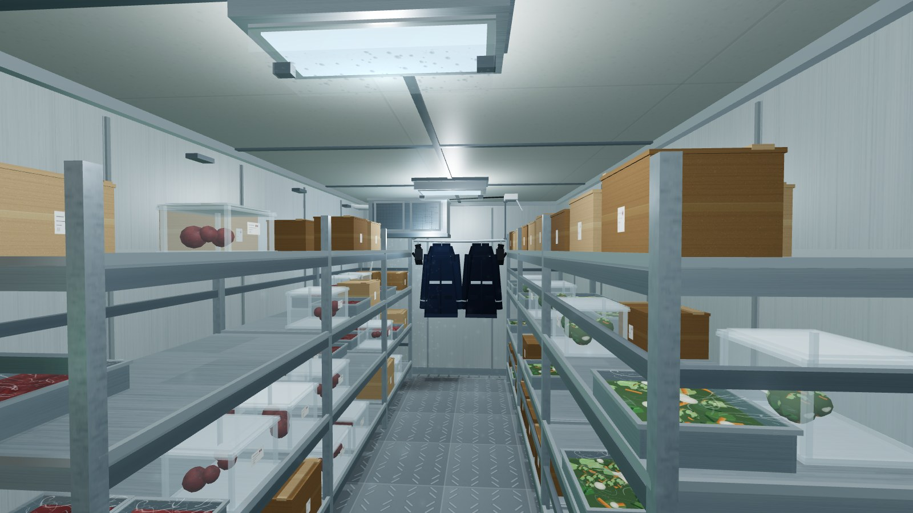

# 后厨冷库储藏室

弹丸论破同人 · 3D 场景集里的第 4 个场景：**与餐厅后厨北墙冷库门相通的步入式冷库**。纯静态、可离线运行的 Three.js 场景，无人物、无文字、无音频、无 CDN、无网络请求；全部几何与贴图在浏览器内程序化生成。



## 打开方式

```powershell
# 在 single-dorm 目录
python -m http.server 8123 --bind 127.0.0.1
# 合并预览并直接进冷库
http://127.0.0.1:8123/#coldstore
# 或从同页顶部切到「冷库储藏室」
http://127.0.0.1:8123/
# 独立入口（自动跳转）
http://127.0.0.1:8123/coldstore/
```

页面使用 ES Modules，必须通过 HTTP(S) 打开；`file://` 会显示明确提示。

## 与后厨的连通

| 方向 | 位置 | 提示 | 落点 |
| --- | --- | --- | --- |
| 后厨 → 冷库 | 后厨北墙 `x=4.6` 冷库门 | 进入冷库 | 冷库门内 `(0.26, 2.3)`，面向通道 |
| 冷库 → 后厨 | 冷库南墙 `x=0.5` 重门 | 进入餐厅后厨 | 后厨门外 `(4.6, -10.15)`，面向厨房 |

点击门扇或按 `E` 触发黑屏切场（与「餐厅 ↔ 后厨」同一套过渡），落点在门内、视角回到水平。后厨侧只新增一个不可见拾取体，原模型与画面未改动。

## 空间

- **2.7 × 5.6 × 2.45 m，15.12 ㎡**：进深与单人宿舍一致，只收窄、压低，形成一条单通道。
- 两侧 **0.72 m 深、4 层、3 跨**重型不锈钢防滑货架，中间 **1.26 m** 通道，单人搬运可转身；动线只有「门 → 通道 → 尽头」一条。
- 南墙 1.3 × 2.2 m 厚重不锈钢保温门：防凝露加热丝、加粗防滑把手、内侧红色应急拉杆 + 绿色荧光底条、压力平衡阀、底部与门口结霜。
- 门西侧：老式灰白 **CRT 荧光监控**（弧面玻璃、扫描线、库内/门外双画面 + 两枚无刻度指针表）+ **黄铜指针式温湿度计**。
- 北墙角：**蒸发器冷风机**（双风扇、金属网罩、深色盘管腔、滴水盘、冷凝水管）+ 挂杆上的**两件加厚防寒服**与**两副防寒手套**。
- 天花：加厚聚氨酯保温板吊顶、**2 盏防潮防爆 LED 冷库灯**（透明防尘罩 + 冷凝水霜）、**温度传感器**、**1 台带除雾加热圈的监控摄像**（对准入口与货架）。
- 地面：铝制防滑花纹地台 + 四周排水沟 + 不锈钢格栅 + 地漏。
- **冷气粒子**：370 个点精灵，分「蒸发器出风口」与「通道悬浮」两层，缓慢下沉、漂移、循环，无音效。

## 操作

| 输入 | 行为 |
| --- | --- |
| `W A S D` | 前后左右移动（眼高恒定 1.80 m） |
| `Shift` | 加速（1.9 → 3.9 m/s） |
| 鼠标拖动 / 全屏鼠标 | 环顾（俯仰 ±83°，永不侧倾） |
| 右键 | 固定 / 解锁视线 |
| 中键 | 平滑回正 |
| `E` / 单击 | 进出冷库（门） |
| `F11` / 右上按钮 | 全屏 |

移动时只有轻微步伐起伏（±1.1 cm，跑动 ±2.1 cm）与横向摆动，眼高与地平线不变；0.30 m 玩家半径、0.06 m 子步进，货架边缘、门框、CRT 搁板与挂衣区都有独立碰撞体。

## 性能

- 静态合批 **40 批 / 48,670 三角面**；渲染 **43–70 draw calls / 约 5.3 万三角面**（随机位变化）。
- 16 张程序化贴图，单张 ≤512²，约 11 MB；一张 1024² 静态烘焙阴影；无后处理。
- 1600×900 实测 59–60 FPS，四场景常驻同页、切换不重载。

## 文件

```
coldstore/
├─ index.html              # 自动跳转 /#coldstore
├─ BRIEF.md                # 场景简报
├─ scene-spec.yaml         # 场景规格（移动机位 / 灯光 / 资产 / 预算）
├─ asset-list.md           # 资产清单（复用 / 新增 kit / one-off）
├─ VALIDATION.md           # 验收记录（移动、碰撞、传送、性能）
├─ preview/*.jpg           # 13 张预览
├─ tools/
│  ├─ check.mjs            # 加载与控制台检查
│  ├─ motion-test.mjs      # 移动 / 碰撞 / 视角 / 四场景切换
│  ├─ portal-test.mjs      # 冷库 ↔ 后厨双向点击传送
│  └─ capture.mjs          # 确定性截图
└─ src/
   ├─ config.js            # 尺寸、门、货架、天花设备、碰撞体、移动参数
   ├─ textures.js          # 16 张程序化贴图（保温板/铝花纹/不锈钢/肉菜/膜/霜/CRT…）
   ├─ materials.js         # 20+ 材质族
   ├─ room.js              # 房间壳、门、CRT 支架、温湿度计、天灯、冷风机、摄像、挂杆
   ├─ furniture.js         # 4 层货架 + 食物盆/储物盒/纸箱/备用盆
   ├─ props.js             # CRT 荧光屏、扫描带、两层冷雾
   ├─ scene.js             # 装配、灯光、碰撞、接触阴影、交互、统计
   └─ player.js            # 第一人称移动（零侧倾、固定眼高、轻步伐）
```

## 制作依据

按仓库内 `skills/danganronpa-adv-3d` 的场景生产线执行：先写简报与规格，再建房间壳与模块化货架；单一垂直主光负责全部投影；固定/移动机位分别验收（本场景为移动机位）。详见 [BRIEF.md](BRIEF.md) 与 [VALIDATION.md](VALIDATION.md)。
