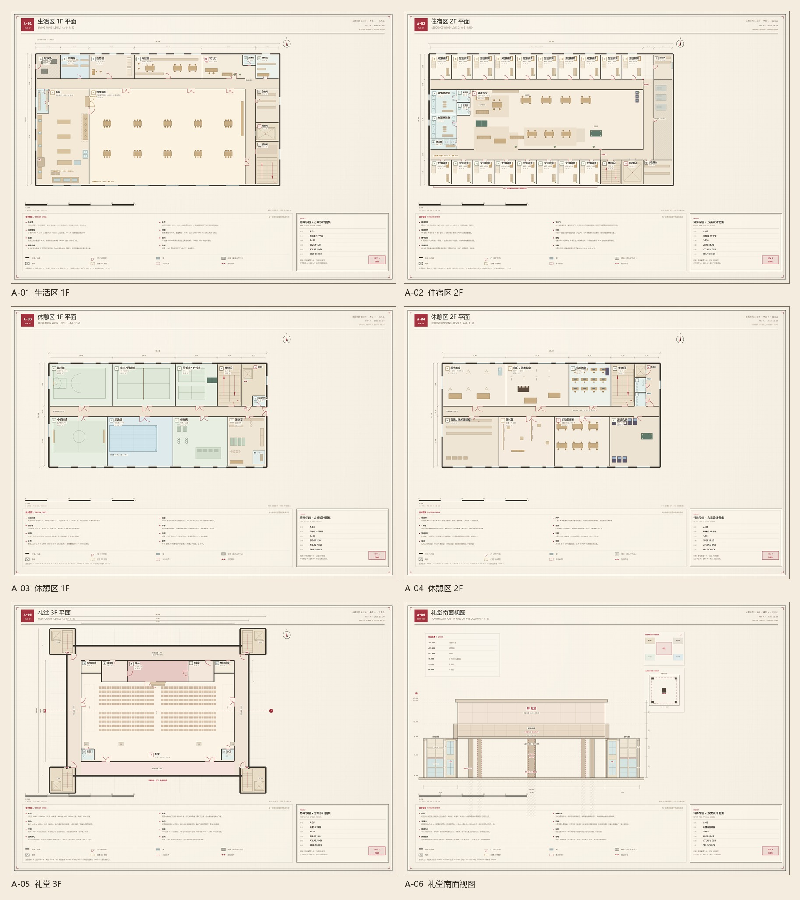

# 特殊学园 · 建筑设计图集

依据 6 张手绘设计草图，并对照已经建成的 Three.js 场景重绘的 **Canvas 2D 方案设计图集**。不是施工图，但所有平面、南面视图均按米制绘制，并带独立比例尺、尺寸链、房间面积与自检记录。



全页预览：[preview/page.jpg](preview/page.jpg)

A2 打印版（6 页）：[preview/special-school-design-atlas-A2.pdf](preview/special-school-design-atlas-A2.pdf)

## 打开方式

纯静态、经典脚本，不依赖 Three.js 或网络：

```powershell
# 直接双击也可以
single-dorm/design-atlas/index.html

# 或走本地服务器
cd single-dorm
python -m http.server 8123 --bind 127.0.0.1
# http://127.0.0.1:8123/design-atlas/
```

页面支持：

- 点击任意图纸放大，滚轮 / 按钮缩放，拖拽平移，Esc 关闭；放大时按 **4× 重新绘制**，文字保持清晰；
- 单张「下载 PNG」，或一次下载 6 张；
- `打印 / 导出 A2`：A2 横向、100% 比例，一张图纸一页；
- 每张图左下角有独立比例尺；标题栏带图号、图名、比例、日期与自检章。

## 图纸目录

| 图号 | 图纸 | 比例 | 文件 |
|---|---|---|---|
| A-01 | 生活区 1F 平面 | 1:150 | [PNG](preview/A-01_living-1f.png) |
| A-02 | 住宿区 2F 平面 | 1:150 | [PNG](preview/A-02_residence-2f.png) |
| A-03 | 休憩区 1F 平面 | 1:150 | [PNG](preview/A-03_recreation-1f.png) |
| A-04 | 休憩区 2F 平面 | 1:150 | [PNG](preview/A-04_recreation-2f.png) |
| A-05 | 礼堂 3F 平面 | 1:150 | [PNG](preview/A-05_auditorium-3f.png) |
| A-06 | 礼堂南面视图 | 1:150 | [PNG](preview/A-06_south-view.png) |

## 已建 3D 模型如何嵌入

| 模型 | 实际尺寸 | 在图中的位置 |
|---|---|---|
| 学生餐厅 | 36.0 × 22.0 m，净高 4.2 m | A-01 的 D，含 10 桌 60 座 |
| 后厨 | 12.0 × 22.0 m，净高 3.25 m | A-01 的 C，西侧操作线 / 中央岛台 / 南侧清洗 |
| 冷库 | 2.7 × 5.6 m，净高 2.45 m | A-01 的 C 西北角，带保温门 |
| 单人宿舍 | 4.8 × 5.6 m，净高 2.8 m | A-02 的 A–J、O–V，每间按此模数 |

## 自检：发现并修正的不合理处

1. **餐厅 + 后厨放不进 52 m 旧轮廓。** 生活楼改为 **56.4 × 30.4 m**：12 m 后厨 + 36 m 餐厅 + 2.4 m 东走廊 + 5.16 m 东侧房间。
2. **1F 的 I/J 与 2F 的 W/X 必须同轴。** 两层的楼梯、电梯核心统一落在东南角；1F 东走廊贯通北门厅。
3. **B 冷藏库与 C 后厨隔着公共走廊。** B 改为“收货冷藏库”，C 内另设已建 **2.7 × 5.6 m** 冷库，并加 1.2 m 服务门。
4. **1F 没有公共卫生间。** 北门厅东侧补 **3.0 × 2.4 m** 无障碍卫生间；2F 仍集中 K/L 淋浴与 Y/Z 厕所。
5. **2F 十间男生宿舍正好 49.08 m。** N 杂物间放东北角，东侧让出 2.4 m 纵向走廊。
6. **礼堂四角核心与环廊打架。** 四角做成 6 × 6 m 外挂塔，K–N 电梯 + G–J 楼梯；楼梯只向下，环廊 3.0 m 连续。
7. **礼堂原图没有座席与卫生间。** 补 **10 排 × 44 座 = 440 座**、无障碍座、男女卫生间、后台准备室与舞台飞塔。
8. **休憩区 2F 的 J 原图漏注。** 暂定 **J 多功能教室**，与 I 美术馆、K 游戏机房形成可调整的公共教学带。

另外：

- 2F 东侧 1F 屋面以上补设备平台（检修不上人）；
- 2F 东南角补女生储物；
- 1F A 垃圾场保留西墙铁栏门，C 内货梯 / 服务门补齐；
- 礼堂环廊高窗、舞台防火幕、观众席侧廊为方案性补齐。

## 统一尺度

- 平面与南面视图：**1:150**；图纸幅面：A2 横向（594 × 420 mm）。
- 外墙 **300 mm**，内墙 **120 mm**；走廊净宽 **2.40 m**。
- 宿舍开间 **4.80 m**，进深 **5.60 m**；每间 **26.88 ㎡**。
- 门宽：宿舍 0.90 m，普通房间 1.20 m，公共门 1.80–2.40 m。
- 尺寸单位：米（m）；面积：平方米（㎡），保留一位小数。
- 平面统一北向上，不旋转；比例尺与图形严格同比例。

## 文件结构

```text
design-atlas/
├─ index.html                  # 图集主页（6 张 Canvas）
├─ export.html                 # 单张导出页：?sheet=a01 … a06
├─ styles.css
├─ src/
│  └─ atlas.js                 # 绘图引擎 + 6 张图 + 灯箱 / 下载 / 打印
├─ preview/
│  ├─ overview.jpg             # 2 × 3 总览
│  ├─ A-01_living-1f.png
│  ├─ A-02_residence-2f.png
│  ├─ A-03_recreation-1f.png
│  ├─ A-04_recreation-2f.png
│  ├─ A-05_auditorium-3f.png
│  └─ A-06_south-view.png
└─ README.md
```

### 重新导出单张 PNG

打开：

```text
design-atlas/export.html?sheet=a01
...
design-atlas/export.html?sheet=a06
```

页面只画一张 1800 × 1273 的图，可直接截图或用浏览器“另存为图片”。

## 方案深度说明

- 这是**方案设计图**，不是施工图；结构柱、楼面梁、机电井道为控制性表达。
- A-06 按手绘第四张的南面视图重绘：3F 礼堂大正方形下方只有五根支撑柱——四角 1×1 小柱 + 中心 2×2 大柱（4 倍面积）；中心柱内藏电梯（仅标注，不制作，上层地板不表达）；两侧为休闲区 / 教学区楼梯（各 8 格，下 4 格 1F、上 4 格 2F）与旁侧电梯；环廊外墙无门、窗全部封死。
- 1F/2F 的餐厅、后厨、冷库、宿舍按已建 3D 模型尺寸嵌入；其余房间按草图关系与统一模数补齐。
- 研究教室区、未开放区未在这 6 张手绘图中给出详细房间，本图集不作臆造；仅保留既有概念图 [school-plan](../school-plan/)。
- 礼堂座席、卫生间、设备平台、储物间属于“自己补齐”的内容，已在图中用红色图例或文字注明。
- 施工前需结构、机电、消防专业复核，尤其是礼堂 38 m 跨支撑柱与楼面梁、440 座疏散与舞台防火幕。

## 许可

与仓库其余场景代码一致，可自由用于学习与非商业同人创作。《弹丸论破》相关角色与设定版权归 Spike Chunsoft 所有。
