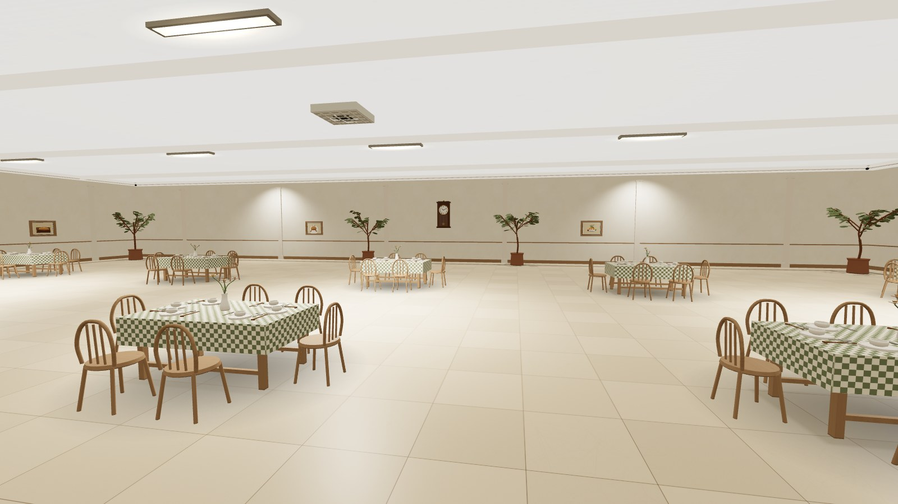
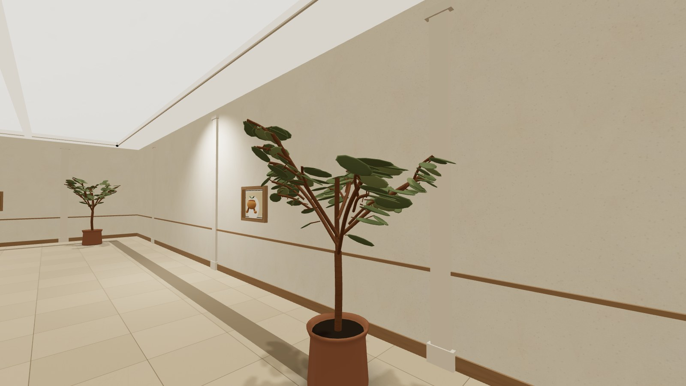
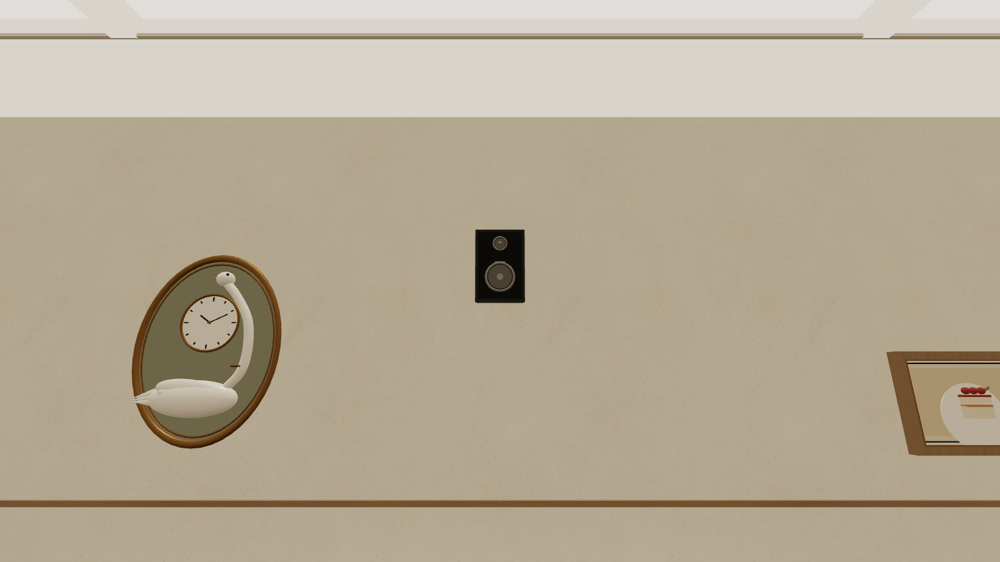

# 学生餐厅 · 3D 场景

供重要学生使用、装修良好但不奢华的餐厅。纯静态 Three.js 场景，**无人物、无文字、无音频、无 CDN、无网络请求**；墙体、石材、木纹、桌布、桌花与全部灯光都在浏览器内程序化生成。

- 在线预览：**https://guanying37.github.io/single-dorm/#dining**
- 同页单人宿舍：https://guanying37.github.io/single-dorm/
- 建模任务书：[BRIEF.md](BRIEF.md)



## 本地预览打不开？

- **不要直接双击 `dining/index.html`**：ES Modules 在 `file://` 下会被 CORS 拦截，场景不会加载。页面会提示「需要通过本地服务器打开」。
- 双击 **`single-dorm/start-preview.cmd`**，或在 `single-dorm/` 目录运行：
  ```powershell
  python -m http.server 8123 --bind 127.0.0.1
  ```
  然后打开 **http://127.0.0.1:8123/#dining**。旧地址 `/dining/` 会自动跳到这个地址。
- 如果提示端口被占用，通常说明服务器已经在运行，直接打开上面的地址即可。
- 仍然白屏时，按 F12 看 Console：确认所有请求都是 `127.0.0.1`，没有 `file://` 或 404。

## 场景清单

| 项目 | 规格 |
| --- | --- |
| 大厅 | 36.0 × 22.0 m，净高 4.2 m，约 792 ㎡ |
| 地面 | 900 × 900 mm 暖灰米色磨光石材，距墙 0.9 m 处 0.3 m 宽深色收边 |
| 墙面 | 暖白灰泥，无壁纸；0.15 m 橡木踢脚、1 m 橡木椅线、白色壁柱 |
| 天花 | 浅跌级 + 4 道横梁 + 周圈叠级；10 组 4000K 线性 LED |
| 设备 | 3 台嵌入式中央空调、6 台半球监控 |
| 餐桌 | 10 张 1.8 × 1.0 × 0.75 m 橡木桌；2 排 × 5 列；桌间净距 ≈ 3.8–3.9 m |
| 座椅 | 60 把曲木餐椅（每桌 6 把：长边 2 + 2，短边 1 + 1） |
| 桌面 | 奶油/鼠尾草方格桌布（5 cm 格，垂边 0.32 m）；每座盘、碗、筷、勺、叉五件；白瓷花瓶插 3–5 枝花（共 39 枝） |
| 画像 | 8 幅 0.96 × 0.72 m 立体浅浮雕美食画（非位图） |
| 挂钟 | 北墙复古挂钟（木框、白盘、罗马数字、钟摆）；东墙大天鹅时钟 |
| 门 | 正门双开 2.8 × 2.6 m（锁定）；后厨门 1.0 × 2.2 m 在**东墙 z=6.3、靠正门一端**（甜点画与东南角盆栽之间）；卫生间门单开 1.0 × 2.2 m |
| 预留空间 | 正门后 3.2 × 2.7 m 走廊段（地毯 + 端墙边柜 + 壁灯，无第二道门）；正门当前锁定，保留 `sceneId: 'corridor'`；后厨/卫生间同样保留钩子 |
| 交互家具 | 西墙餐具柜 3.6 × 0.55 × 0.98 m；2 门 + 3 抽屉 |
| 扬声器 | 东西墙各 1 只壁挂扬声器（装饰，不播放音频） |
| 碰撞 | 桌面 1.9 × 1.1 m + 6 把椅子各自独立的碰撞体，桌子四个无椅角可走近 |
| 绿植 | 8 盆陶盆绿植（四角、正门两侧、挂钟两侧）；主干 → 5 主枝 → 20 次枝 → 叶柄 → 叶片，每片叶都有可见枝干连接 |



> 绿植为「主干 → 主枝 → 次枝 → 叶柄 → 叶片」的层级结构；叶片不是漂浮的贴片，每片叶子都通过短叶柄接到次枝上。



> 东西墙各一只壁挂扬声器，带独立高低音单元与金属支架；只做陈设，不播放音频。

## 操作

| 输入 | 行为 |
| --- | --- |
| `W A S D` | 平移；眼高固定 **1.80 m**，带轻微步行起伏 |
| `Shift` | 加速（**5.2 → 11.0 m/s**，与后厨一致）；跑步时视点起伏、侧倾与横向摆动明显增强 |
| 鼠标拖动（非全屏） | 环顾 |
| 鼠标移动（全屏） | 指针锁定环顾，光标隐藏 |
| 右键 | 固定 / 解锁视线 |
| 中键 | 0.6 s 平滑回正 |
| `E` | 与准星/指针指向的门、柜门、抽屉互动 |
| `F11` / 右上按钮 | 全屏 |

- 俯仰限制 ±83°，无侧翻、无倒置；水平 360° 无上限。
- 玩家为半径 0.30 m 的圆柱，与墙体 AABB、家具/门/抽屉 OBB 实时碰撞；开门、拉抽屉时碰撞体同步移动。
- 非全屏显示实时 FPS；全屏隐藏装饰性 HUD 与 FPS，只保留准星、交互提示和 Toast。

## 交互

| ID | 类型 | 行为 |
| --- | --- | --- |
| `door.main` | 双开正门 | **锁定，不能打开**；点击提示「正门 · 暂未开放（预留走廊切换）」；保留 `sceneId: 'corridor'` 钩子 |
| `door.kitchen` | 后厨门 | 位于**东墙 z=6.3、靠正门一端**；**黑屏切场到后厨场景**（`sceneId: 'kitchen'`）；落点在厨房门内并回正视角 |
| `door.restroom` | 卫生间门 | 锁定；提示「卫生间 · 暂未开放」，保留 `sceneId: 'restroom'` |
| `sideboard.door.left/right` | 餐具柜门 | 100° 开合 |
| `sideboard.drawer.1/2/3` | 餐具柜抽屉 | 拉出 0.34 m |

时钟时间由 config 初始化，可在控制台调试（同一页面预览）：

```js
window.__PREVIEW__.setClock(10, 10, 32);
```

## 嵌入接口

`src/scene.js` 导出无 DOM 依赖的 `DiningHallScene`，可脱离预览页使用：

```js
import { DiningHallScene } from './src/scene.js';

const hall = new DiningHallScene({ renderer });
scene.add(hall.scene);
hall.update(dt, elapsed);
hall.toggleInteractive('sideboard.drawer.1');
hall.setClock(10, 10, 32);
```

同一页面预览暴露三场景接口：

```js
window.__PREVIEW__ = {
  scene, camera, renderer, dorm, dining, kitchen, kitchenControls,
  getScene(), setScene('dorm' | 'dining' | 'kitchen'),
  setView({ x, z, yaw, pitch }),
  getView(), resetView(), transitionToScene(next, label),
  toggle(id), setFrozen(bool), setClock(h, m, s),
  getInteractives(), getStats(),
};
```

独立页 `dining/standalone.html` 仍暴露旧的 `window.__DINING__` 接口。`window.__PREVIEW_READY__`、`window.__DINING_READY__`、`window.__KITCHEN_READY__` 都会在首帧完成后置为 `true`。

## 性能与实现

| 指标 | 当前值 |
| --- | --- |
| Draw calls | 51–63（随柜门/抽屉开合变化） |
| 三角面 | ≈ 35.7 万 |
| 程序化贴图 | 13 张（单张 ≤ 1024²） |
| 阴影 | 1 张 2048² 定向光深度图，**只烘焙一次**，方向垂直向下与天花灯具一致 |
| 后处理 | 无 |
| 实测帧率 | **59–60 FPS @ 1920 × 1080**（硬件渲染测试机） |
| 源码（餐厅模块 HTML/CSS/JS，不含 three） | ≈ 158.7 KB；同页外壳另约 51 KB |

- 60 把椅、60 套餐具、39 枝花、画像浮雕、植物叶片全部在构建期按材质合并为静态批次；场景稳定后不再产生几何。
- 门扇、抽屉、钟摆、指针为独立动画对象，但不参与阴影投射，因此开门/拉抽屉不会触发阴影重烘焙。
- 自适应 `devicePixelRatio`：低于 44 FPS 时逐级降至 0.70；FPS 读数只在非全屏 UI 中显示。
- 不使用 Bloom/SSAO/后处理链；环境反射由程序化 equirect 图经 PMREM 生成。

## 文件结构

```
dining/
├─ index.html          # 自动跳转 /#dining（同一页面预览）
├─ standalone.html     # 餐厅独立页（备用/调试）
├─ dining.css          # 共享 UI 之上的少量覆盖
├─ README.md
├─ BRIEF.md            # 建模任务书 / 验收对照
├─ preview/            # 8 张预览截图
└─ src/
   ├─ main.js          # 独立页入口；三场景页由 ../src/hub.js 驱动
   ├─ scene.js         # 场景装配、灯光、静态阴影、碰撞、交互调度
   ├─ room.js          # 地面/墙体/天花/三扇门/走廊预留段/墙面线条
   ├─ furniture.js     # 桌、椅、桌布、餐具、花瓶与花、餐具柜
   ├─ decor.js         # 天花设备、画像浅浮雕、两座钟、绿植、扬声器
   ├─ textures.js      # 程序化石材/灰泥/木纹/方格布/亚麻/辉光
   ├─ materials.js     # 自然色 PBR 材质
   ├─ player.js        # 第一人称移动、跑步晃动、回正
   ├─ collision.js     # 圆形玩家 vs AABB / OBB
   ├─ config.js        # 尺寸、桌位、门、画、钟、初始机位
   └─ utils.js         # 几何合并与静态批处理
```

## 部署与主宿舍联动

学生餐厅现在与单人宿舍、餐厅后厨位于**同一个页面**：`single-dorm/index.html` 由 `src/hub.js` 驱动，顶部「单人宿舍 / 学生餐厅 / 餐厅后厨」切换，三个场景常驻内存、只渲染当前场景。

- 餐厅地址：`/#dining`；旧地址 `/dining/` 会自动跳转。
- 独立调试页：`dining/standalone.html`（仍可单独打开）。
- 餐厅 `src/scene.js` 与 `player.js` 被 `src/hub.js` 直接复用；`dining/index.html` 不再是主入口。
- 两边共用 `single-dorm/styles.css`，视觉语言一致。
- gh-pages 根目录即 `single-dorm/`，无需额外构建。

## 专业取舍与已知边界

1. **尺度**：标准足球场半场约 3570 ㎡；若按字面执行，10 张桌会摊到 15 m 以上间距，与「1.5 m 净距」「初始视角看见大部分布置」冲突。因此采用 **36 × 22 m（792 ㎡）**，保留大空间感，桌距仍远超 1.5 m。可在 `config.js` 的 `HALL` / `TABLES` 中调整。
2. **画像**：本轮没有收到「如图」的位图附件；按「不自行绘图」采用 **0.06 m 深立体浅浮雕**（盘、面包、鱼、果、瓶等低模）。若提供正式画作，可把 `decor.js` 的 `buildRelief` 替换为贴图平面。
3. **阴影**：为保证 30 FPS 底线，只保留 **1 张定向光静态阴影**，方向垂直向下，与天花灯具一致；3 盏聚光灯只负责光池、不投阴影；动态门/抽屉不参与阴影烘焙。宿舍只保留吊灯主光，删除 `windowSpill` 与侧向 fill；垂直定向光作为吊灯投影代理。
4. **新增陈设**：餐具柜用于承载「柜门/抽屉」交互；8 盆绿植用于填充 792 ㎡ 的周边空区；正门后走廊段改为「边柜 + 壁灯」，不再在门后放第二道门；东西墙各增加一只装饰扬声器。均为可删除的独立构建函数。
5. **正门/后厨/卫生间**：正门已按要求锁定，后续再改为交互切到走廊；后厨已建成为独立 `kitchen` 场景，`door.kitchen` 在东墙靠正门一端并黑屏切场过去；卫生间仍未建模，门锁定并保留 `sceneId`。
6. **无窗**：按原案执行，全部为人工照明；未添加窗外环境。
7. **碰撞**：餐桌从一个大方块改为「桌面 + 6 把椅子」独立碰撞体，四个无椅角可以走近，不再被整块桌位挡住。

## 验收自检

- [x] 10 桌 × 6 椅 × 5 件餐具；每桌花瓶与 3–5 枝花；方格桌布
- [x] 8 幅美食画像、复古挂钟、天鹅时钟
- [x] 3 台空调、10 组 LED、6 台监控、3 扇门
- [x] 无人物、无文字、无音频、无外部请求、无字体文件
- [x] 全屏 + 指针锁定 + 光标隐藏 + 右键固定 + 中键回正 + 拖动环顾
- [x] 60 FPS 目标下的静态批处理、单张阴影、无后处理
- [x] 门 / 柜门 / 抽屉动态碰撞，无穿模
- [x] 餐桌碰撞拆分为桌面 + 椅子，桌角可走近
- [x] 与单人宿舍在同一个页面顶部切换
- [x] 1920 × 1080 硬件渲染实测 59–60 FPS
