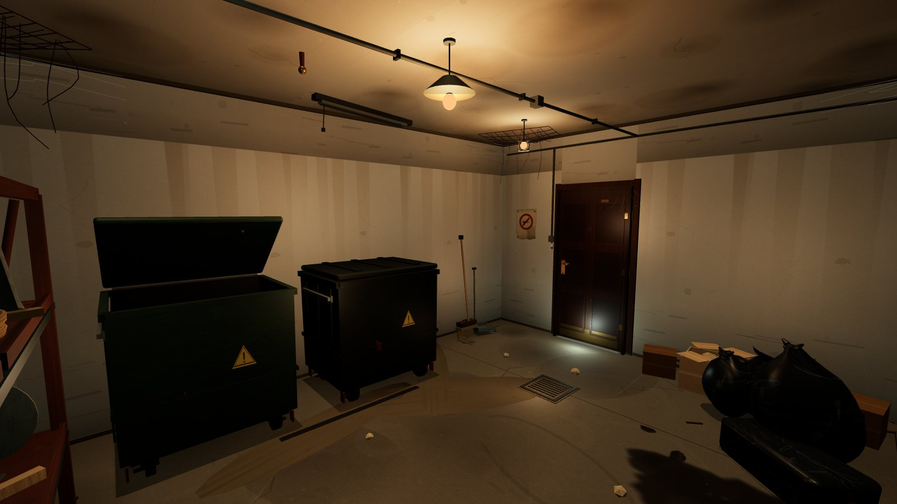

# 垃圾处理场 · 3D 场景

> 生活区 1F 的后勤垃圾房：**4.32 × 5.40 m、净高 2.90 m、23.33 ㎡、严格 4 : 5**。两台带轮工业垃圾桶、监控死角里的生锈货架、墙根一滩暗色液体、六个黑色大号垃圾袋与一堆废纸箱，还有门边那块泛黄的“禁止吸烟”牌。
>
> 同页入口：**http://127.0.0.1:8123/#garbage**（顶部第 6 个 tab）。
> 独立页：**http://127.0.0.1:8123/garbage/standalone.html**
> `garbage/index.html` 会自动重定向到 `/#garbage`。



## 场景内容

| 方位 | 内容 |
| --- | --- |
| 空间 | 4.32 × 5.40 × 2.90 m；比例 4 : 5；脏白涂料墙、水泥地、脏白顶；0.24 m 墙厚 |
| 北墙 | 1.58 × 0.42 × 1.84 m 四层生锈角钢货架：油漆罐、玻璃罐、瓶、喷壶、开盖纸箱、手电钻、锤子、扳手、锯片、螺丝刀、折叠防水布、绳圈、倒扣铁桶、拖把头 |
| 西北角 | 枪机监控 + 老式 CRT 四分屏 + 小监视屏 + 录像机，全部挂在同一墙角；镜头朝东南，**货架在镜头死角** |
| 东墙 | 两台 660 L 级四轮工业垃圾桶（深绿 / 近黑），桶身 1.14 × 0.88 × 1.02 m，四只万向脚轮；桶体是通向下方焚烧炉的投放口，内部**没有可取出的内桶/垃圾袋**，底部以 0.56 m 高的**螺栓钢封盖 + 提环 + 热缝**密封；深绿桶盖半开，近黑桶盖可交互，开盖后向墙侧倾靠；黄色三角警示贴、锈铭牌、U 形拉手 |
| 南墙 | 1.02 × 2.12 m 黑棕色木门（六块凹板、黄铜执手 / 锁芯 / 门镜 / 三只合页 / 铜踢脚），门下 1.2 cm 冷光缝；门东侧 0.42 × 0.50 m 泛黄撕边“禁止吸烟”图形牌；门西侧顶灯开关 |
| 西墙 | 墙根 1.45 × 1.02 m 暗色不明液体（油膜反光、朝地漏拖尾）；低处锈蚀通风格栅 |
| 西南角 | 黑色大号垃圾袋 ×6（立放 / 倒伏 / 敞口）、废纸箱 ×5（开盖 / 受潮 / 闭合）；扫把与铁皮簸箕斜靠东墙 |
| 天花 | 绿搪瓷罩白炽吊灯、门边笼式裸灯、接触不良的冷白灯管（三频闪烁）、损坏斜挂灯管、3 片锈铁丝网、6 处蛛网、锈水管 + 红阀门、明装线管/接线盒、喷淋 |
| 地面 | 水泥地、油渍 / 拖痕 / 纸屑、0.36 m 方形地漏；门口冷光水洼 |

## 操作

| 输入 | 行为 |
| --- | --- |
| `W A S D` | 移动（眼高固定 1.80 m） |
| `Shift` | 加速（2.4 → 4.8 m/s） |
| 鼠标 | 环顾（俯仰 ±83°，零侧倾）；点击画面捕获鼠标 |
| 右键 | 固定 / 解锁视线 |
| 中键 | 平滑回正 |
| `E` | 与门、顶灯开关、近黑垃圾桶盖互动 |
| `ESC` | 释放鼠标 |

## 交互

| id | 类型 | 行为 |
| --- | --- | --- |
| `door.garbage` | 锁定门 | 提示「垃圾处理场门 · 暂未开放（预留走廊切换）」；`sceneId: corridor` |
| `light.switch` | 开关 | 两盏白炽灯开/关；关灯后仍有故障灯管、监控绿光、门缝冷光与红点 |
| `bin.b` | 开合 | 近黑工业垃圾桶盖开/合；铰链在靠墙一侧，开盖后向墙倾靠（-1.65 rad），不扫过通道；桶盖不投影，碰撞体保持静态 |

## 性能

- 静态合批 **49 批 / 31,872 三角面**；hero 视角 **73 draw calls / 34,516 三角面**；全场景最高 **88 draw calls / 37,664 三角面**。
- 21 个程序化纹理对象（单张 ≤512²，地板 512×640），1 张 2048² 静态烘焙阴影；无后处理、无 Bloom/SSAO。
- **1600 × 900 · NVIDIA GTX 1060 3GB · ANGLE D3D11：空载 60 FPS**；同机并行构建其他场景时实测 50–56 FPS（主机负载所致）。
- 11 个碰撞体、0.30 m 玩家半径、0.06 m 子步进；巡场 + 四次冲撞穿透 **0**。
- 监控死角几何探针：镜头轴—货架夹角 **52.6°**，镜头半角 34°，`blind: true`。

## 运行

```powershell
# single-dorm 目录
python -m http.server 8123 --bind 127.0.0.1
# 同页：http://127.0.0.1:8123/#garbage
# 独立页：http://127.0.0.1:8123/garbage/standalone.html
```

不要双击 `index.html` 或 `standalone.html`（ES Modules 会被 `file://` 拦截）；页面会显示“需要通过本地服务器打开”的提示。

## 目录

```text
garbage/
├─ index.html             # 自动跳转 /#garbage
├─ standalone.html        # 独立预览页
├─ BRIEF.md               # 场景简报
├─ scene-spec.yaml        # 场景规格
├─ asset-list.md          # 资产清单
├─ VALIDATION.md          # 验收记录
├─ preview/               # 13 张 1600×900 JPG + check-report.json + fps.json
├─ tools/
│  ├─ check.mjs           # 加载/交互/碰撞/盲区/性能总检
│  ├─ capture.mjs         # 13 个定帧截图
│  └─ perf.mjs            # 暖机后 FPS 与帧时间
└─ src/
   ├─ scene.js            # 装配、灯光、碰撞、交互、动画、统计
   ├─ room.js             # 墙地顶、门、警示牌、监控、灯、铁丝网、蛛网、管线
   ├─ bins.js             # 两台带轮工业垃圾桶
   ├─ rack.js             # 四层角钢货架
   ├─ clutter.js          # 货架杂物、垃圾袋、纸箱、扫把/簸箕、清扫碎屑
   ├─ props.js            # 尘埃、光晕、门缝光池
   ├─ textures.js         # 脏白墙、水泥地、脏白顶、警示牌、CRT 画面、液体、塑料袋
   ├─ materials.js        # PBR 材质表
   ├─ player.js           # 第一人称移动、碰撞、步伐
   ├─ config.js           # 尺寸、门、桶、货架、机位、碰撞
   ├─ geometry.js         # 复用几何工具
   └─ standalone.js       # 独立页入口
```

## 接入

场景与页面解耦。可直接构造并渲染：

```js
import * as THREE from 'three';
import { GarbageScene } from './src/scene.js';
import { GarbageControls } from './src/player.js';

const renderer = new THREE.WebGLRenderer({ antialias: true });
renderer.toneMapping = THREE.ACESFilmicToneMapping;
renderer.toneMappingExposure = 0.96;
renderer.shadowMap.enabled = true;
renderer.shadowMap.autoUpdate = false;

const camera = new THREE.PerspectiveCamera(68, innerWidth / innerHeight, 0.03, 20);
camera.rotation.order = 'YXZ';
const garbage = new GarbageScene({ renderer, maxAnisotropy: renderer.capabilities.getMaxAnisotropy() });
const controls = new GarbageControls(camera, garbage.collision);
controls.attach(window);

function tick(dt, elapsed) {
  controls.update(dt);
  garbage.update(dt, elapsed);
  renderer.render(garbage.scene, camera);
}
```

常用接口：

```js
garbage.scene                  // THREE.Scene
garbage.cameraHome             // { position, yaw, pitch, fov }
garbage.interactives           // 互动条目
garbage.toggleInteractive(id)  // 'door.garbage' / 'light.switch' / 'bin.b'
garbage.setInteractive(id, v)
garbage.getInteractiveState()
garbage.probeBlindSpot()       // 监控死角几何验证
garbage.getStats()
garbage.update(dt, elapsed)
garbage.dispose()
```

`window.__GARBAGE_PREVIEW__` 在独立页提供 `scene / camera / renderer / controls / setView / getView / toggle / setInteractive / getStats / raycast`，便于自动化验收。
