# 医务室

弹丸论破同人 · 3D 场景集里的第 9 个场景：**生活区 1F 的医务室**。纯静态、可离线运行的 Three.js 场景；无人物、无文字、无音频、无 CDN、无网络请求，几何、程序化贴图与全部灯光在浏览器内生成。

**5.0 × 8.0 × 3.0 m，40.0 ㎡，比例严格 5 : 8。** 白色墙/地/顶、极简双层石膏线；五张可移动病床沿西墙排开，中间五道淡蓝隔帘；东墙是药柜、洗手池/钢柜/镜子/感应皂液器；中央手术台上方吊着无影灯，旁边是不锈钢器械托盘架；黄红医疗废弃物桶、医生圆凳与墙角绿萝补齐日常感。

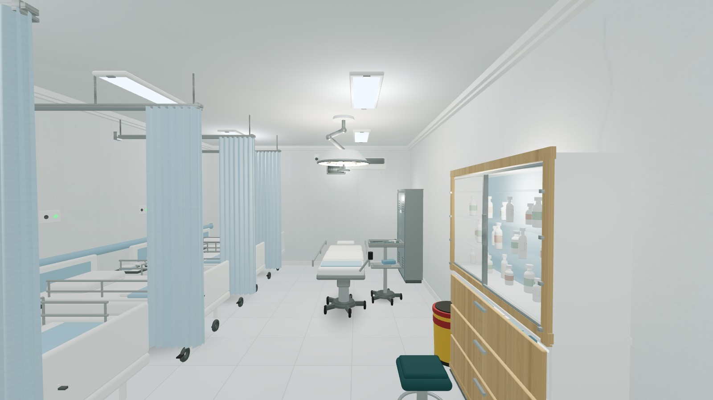

## 打开方式

```powershell
# 在 single-dorm 目录（推荐使用线程化的 serve.py）
python serve.py
# 合并预览并直接进医务室
http://127.0.0.1:8123/#infirmary
# 或从同页顶部切到「医务室」
http://127.0.0.1:8123/
# 独立入口（自动跳转）
http://127.0.0.1:8123/infirmary/
# 独立预览页
http://127.0.0.1:8123/infirmary/standalone.html
```

页面使用 ES Modules，必须通过 HTTP(S) 打开；`file://` 会显示明确提示。

## 空间

- **5.0 × 8.0 × 3.0 m**：门在南墙偏东（x=+1.15），进门右手是东墙洗手池与钢柜。
- **五张可移动病床**：1.95 × 0.92 m，床头靠西墙，床心 z=-3.15 / -1.60 / -0.05 / +1.50 / +3.05；白色被铺、浅蓝折叠毯、床头浅蓝嵌板、两侧金属护栏、四只带刹万向轮。
- **五道淡蓝隔帘**：z=-2.60 / -1.05 / +0.50 / +2.05 / +3.60；每道双片褶皱帘，打开时收拢到床尾过道，关闭时在中线合拢。
- **1 m 高浅蓝防撞扶手**：西墙 7.8 m，圆管 + 背板 + 端头 + 每 0.9 m 支架；五块医用气体面板在床头。
- **药柜 2.0 × 1.5 × 0.4 m**：上层三层玻璃 + 横拉双片玻璃门（西片可滑 0.735 m），放 21 个带抽象色条标签的白瓶与 3 个玻璃罐；下层三层可拉浅橡木抽屉，拉出 0.30 m 露出 12 件长方体包装。
- **洗手池**：0.56 × 0.88 m 不锈钢台面、单个 0.42 × 0.34 × 0.18 m 凹槽、鹅颈龙头、洗手液；钢制底柜；无边框 0.78 × 0.70 m 方镜（一次性 cube map 反射）；镜上方感应皂液器。
- **手术台**：1.85 × 0.64 m，三段软垫、护栏、五爪底座、脚轮；正上方天花板无影灯（双关节臂、Ø0.8 m 灯盘、6 透镜、淡金光晕）；旁边不锈钢器械托盘架 + 12 件器械。
- **其他**：黄身红盖医疗废弃物桶（踏脚 + 生物危害标识）、深青绿医生圆凳、西南角绿萝（9 藤 / 约 70 片心形叶 / 花架）、北墙高处空调 + 监控 + 显示屏组合、6 盏 LED 平板灯、四周边框极简石膏线。
- **白色木门**：0.95 × 2.18 m，东侧合页、西侧执手、双面门板线脚、绿色十字门牌；锁定，预留 `sceneId: corridor`。

## 交互

| 交互 | 行为 |
| --- | --- |
| `W A S D` | 移动（眼高恒定 1.80 m） |
| `Shift` | 加速（2.2 → 4.4 m/s） |
| 鼠标拖动 / 全屏鼠标 | 环顾（俯仰 ±83°，永不侧倾） |
| 右键 | 固定 / 解锁视线 |
| 中键 | 平滑回正 |
| `E` / 单击 | 隔帘开合、玻璃柜门横拉、三层药柜抽屉拉出、医疗废弃物桶开盖；门锁定提示 |
| `F11` / 右上按钮 | 全屏 |

## 性能

- 静态合批 **36 批 / 106,342 三角面**；hero 视野 **70 draw calls / 116,734 三角面**；各机位 23–70 draw calls。
- **14 张程序化贴图**，单张 ≤1024²，约 10 MB（含 mipmap）；一张 2048² 静态阴影；无后处理。
- **1600 × 900 · headless Edge/SwiftShader 实测 60 FPS**；九场景同页常驻时 headless 约 48–55 FPS。
- 碰撞：22 个碰撞体、0.30 m 玩家半径、0.06 m 子步进；床间 0.63 m 净距、主过道 2.6 m；跑动测试 0 穿透。
- 镜面：一次性 128 px cube map，不在每帧更新第二相机；无影灯光晕为 additive sprite，不使用 Bloom。

## 预览

| | |
|---|---|
| 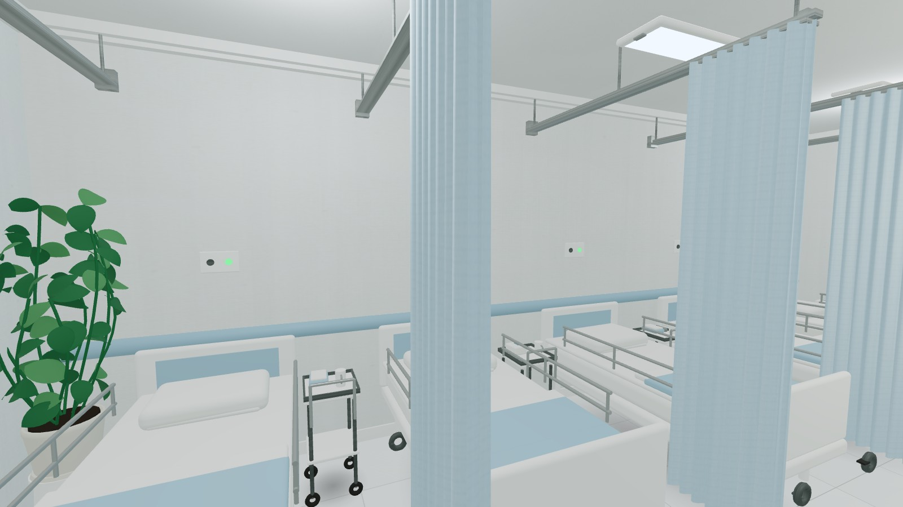 | 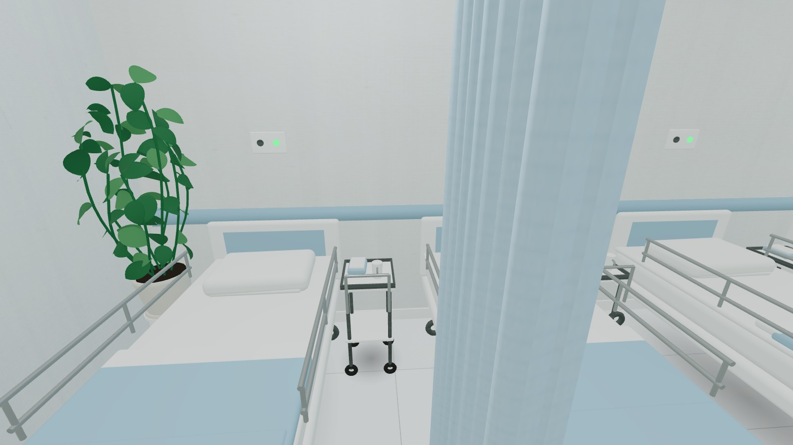 |
| 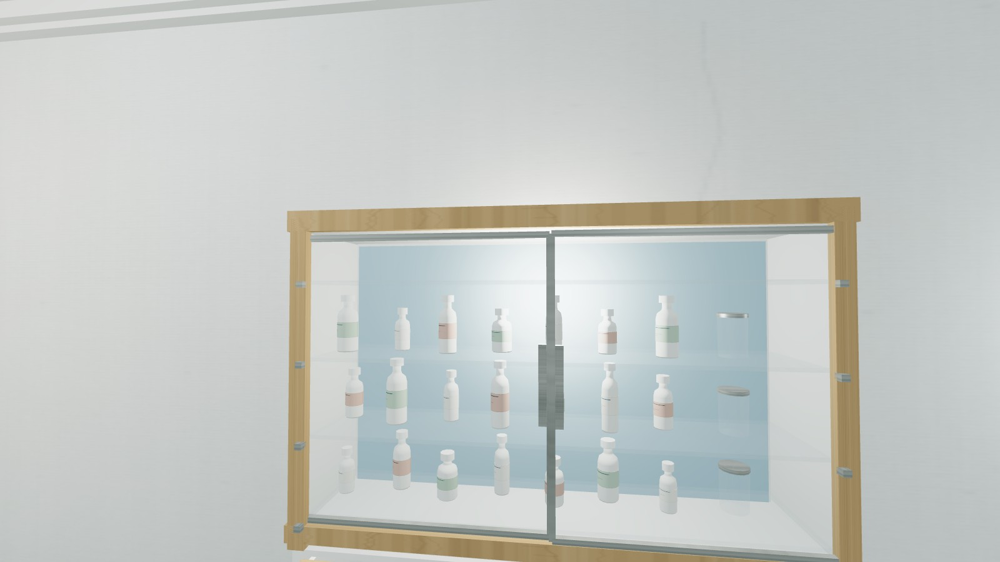 | 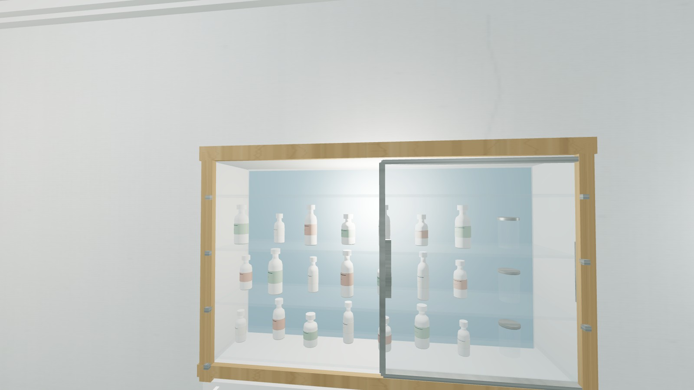 |
| 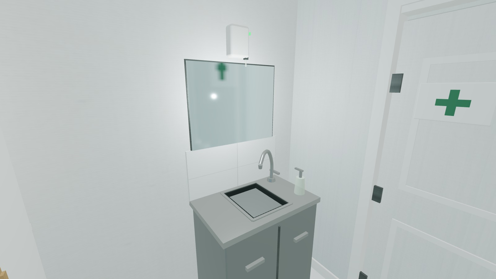 | 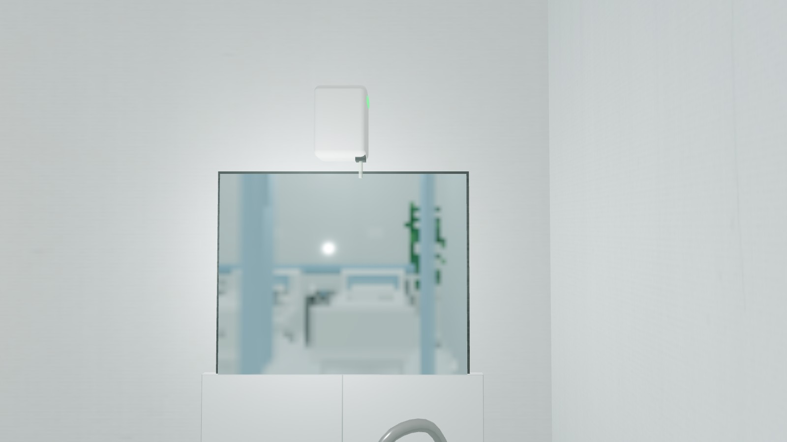 |
| 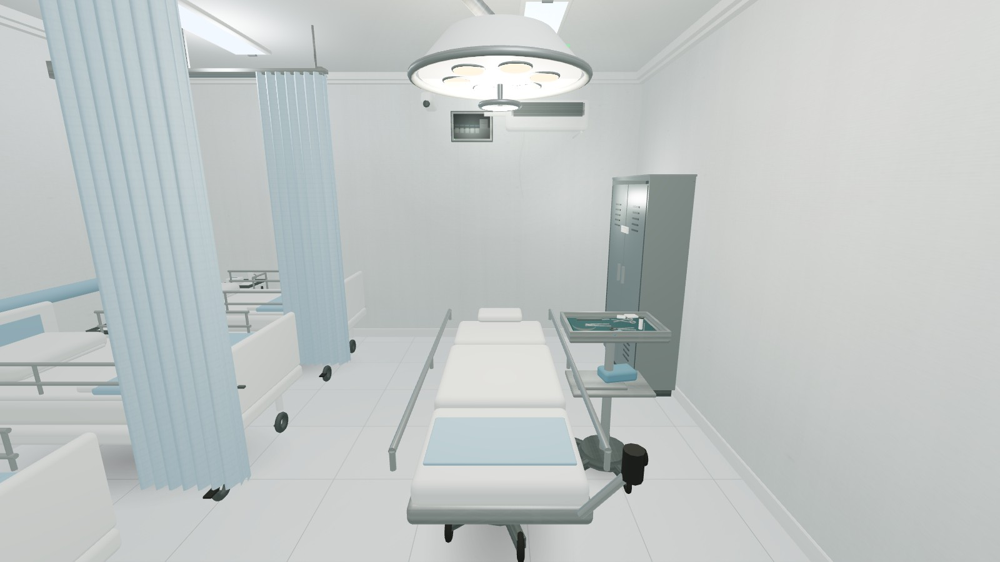 | 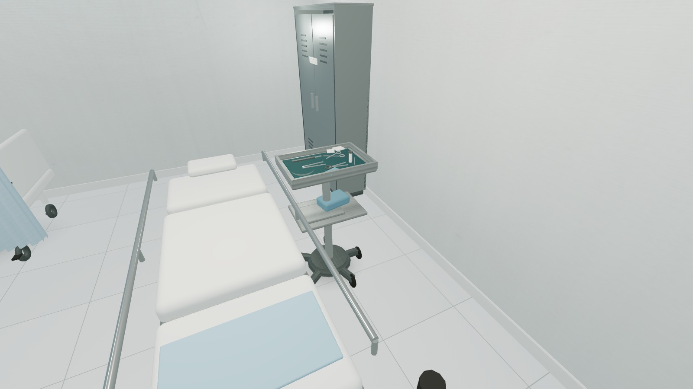 |
| 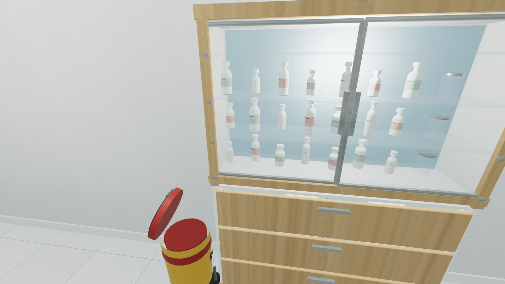 | 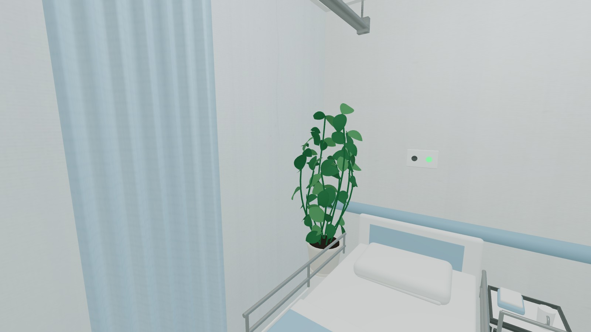 |
| 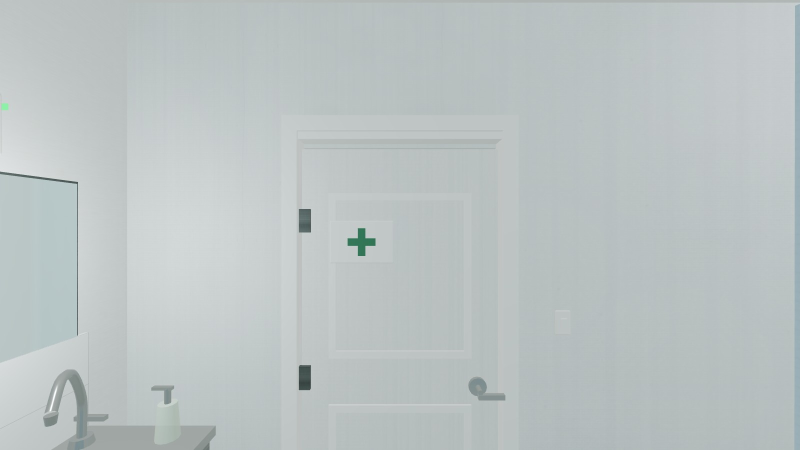 | 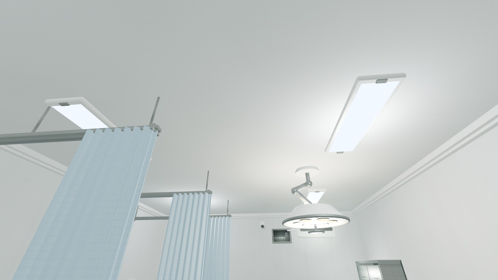 |

## 文件

```
infirmary/
├─ index.html                 # 自动跳转 /#infirmary
├─ standalone.html            # 独立预览页
├─ BRIEF.md                   # 场景简报（实现版）
├─ scene-spec.yaml            # 场景规格
├─ asset-list.md              # 资产清单
├─ VALIDATION.md              # 验收记录
├─ README.md
├─ preview/                   # 最终预览 JPG + motion-report.json
├─ tools/
│  ├─ check.mjs               # 独立页加载/统计
│  ├─ hub-check.mjs           # 合并页加载/注册
│  ├─ motion-test.mjs         # 移动/碰撞/交互/切换
│  ├─ capture.mjs             # 多机位截图
│  └─ eval.mjs                # CDP 求值小工具
└─ src/
   ├─ config.js               # 尺寸、床/帘/柜/手术台坐标、碰撞
   ├─ geometry.js             # 静态合批器 + 帘/叶/瓶/盘/底座
   ├─ textures.js             # 白色灰泥/瓷砖/钢/木/布/镜面环境
   ├─ materials.js            # 材质族与别名合并
   ├─ room.js                 # 墙地顶、门、石膏线、扶手、空调/监控/显示屏、洗手池/镜子
   ├─ furniture.js            # 病床、推车、药柜、钢柜、手术台、无影灯、托盘、桶、圆凳、绿萝
   ├─ curtains.js             # 五道双片隔帘
   ├─ scene.js                # 装配、灯光、镜面、碰撞、交互、统计
   ├─ player.js               # 第一人称移动/碰撞/步伐
   └─ standalone.js           # 独立页入口
```

## 验收

见 [VALIDATION.md](VALIDATION.md)：加载 0 报错、九场景切换后回医务室 0 报错、0 穿透、11 个交互、镜面反射、60 FPS。
