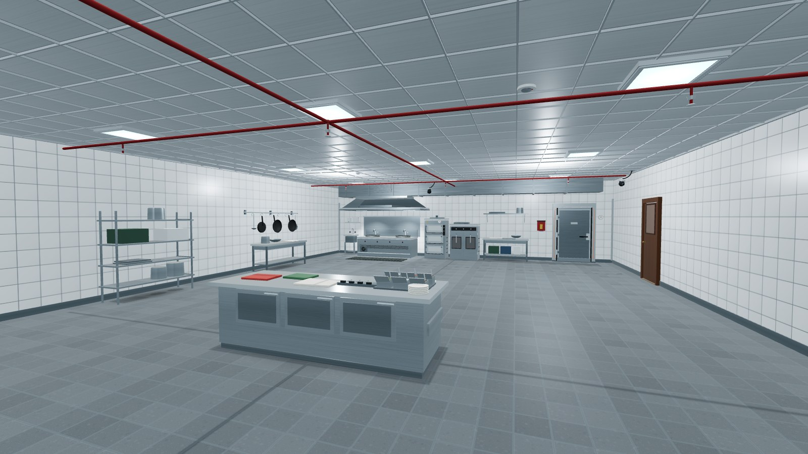
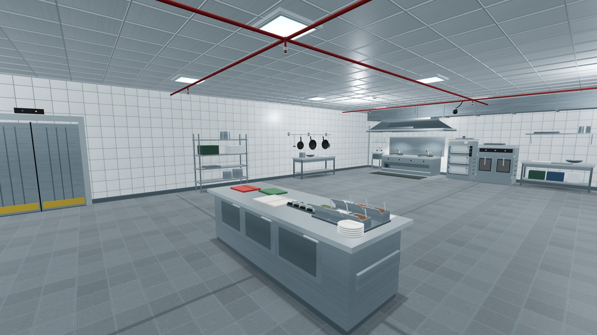
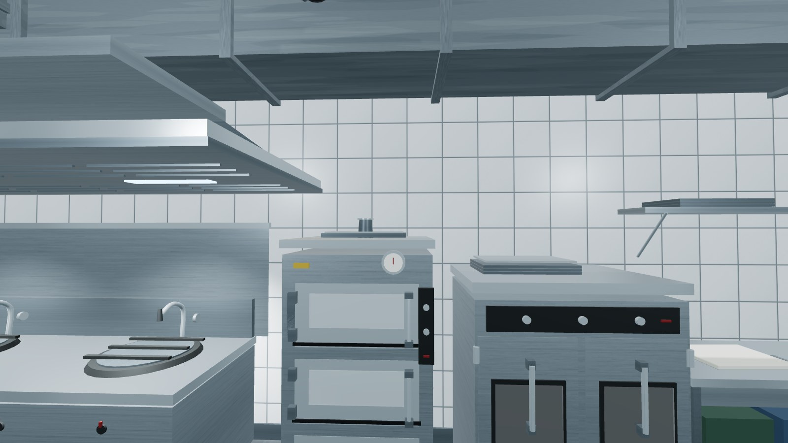
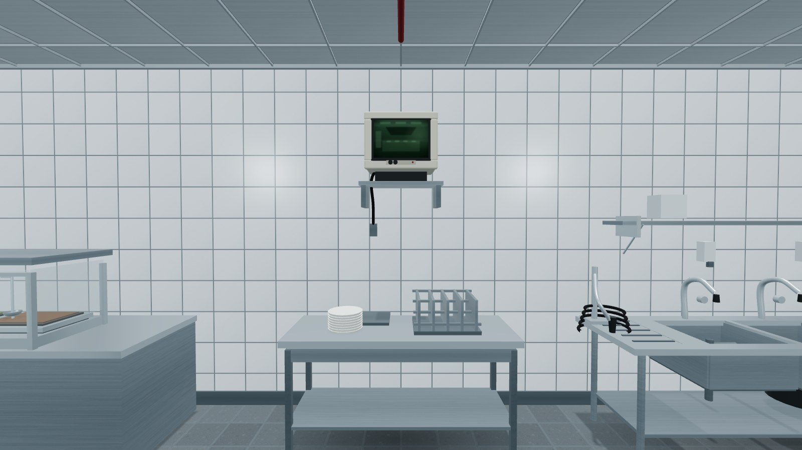
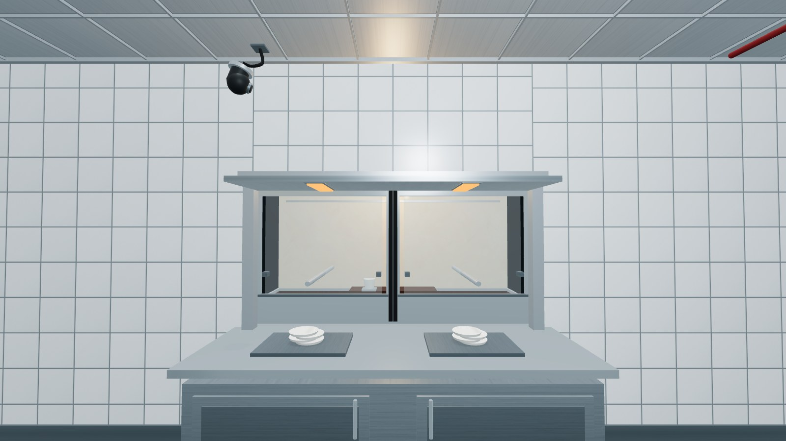
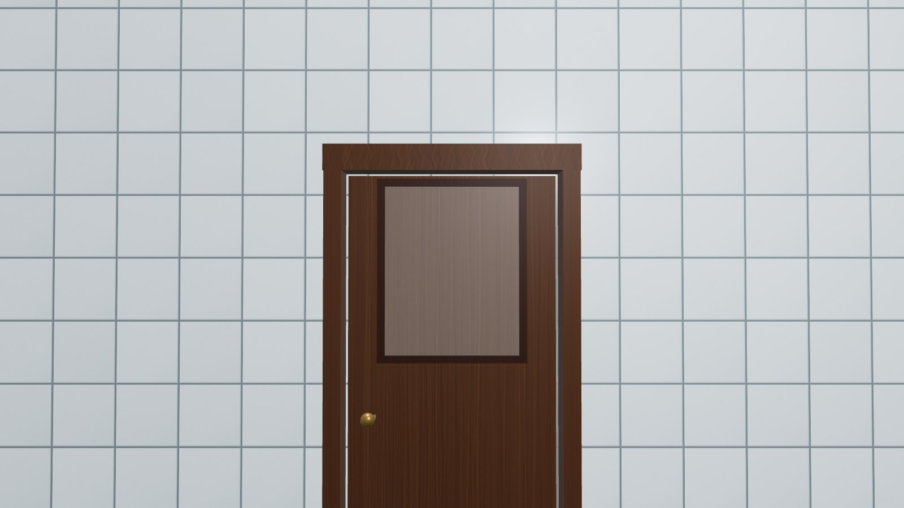
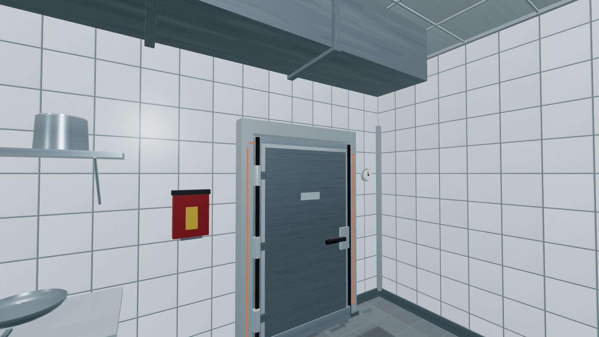
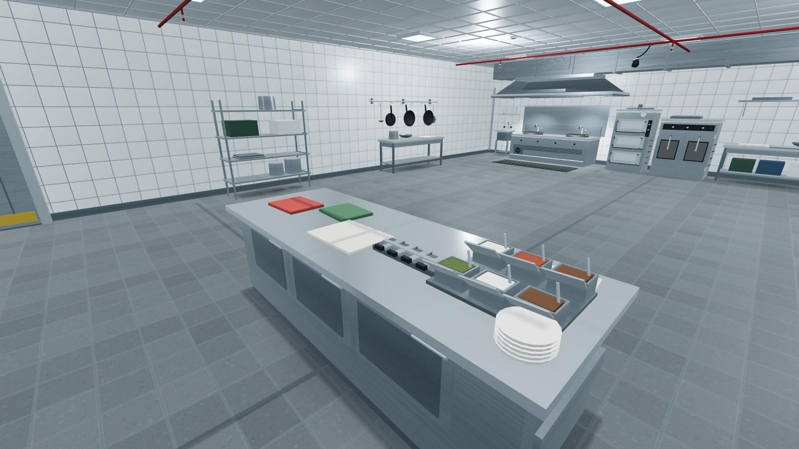
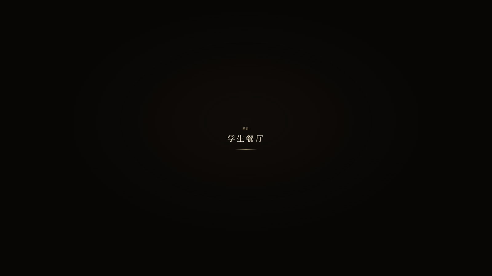

# 学生餐厅后厨 · 3D 场景

供后厨人员备餐、烹饪、清洗使用的商用厨房。**无人物、无文字、无自绘二维画作、无音频、无 CDN、无网络请求**；瓷砖、不锈钢、铝扣板、监控画面与全部灯光均在浏览器内程序化生成。

- 在线预览：**https://guanying37.github.io/single-dorm/#kitchen**
- 同页其他场景：**/（单人宿舍）** · **/#dining（学生餐厅）**
- 场景简报：[BRIEF.md](BRIEF.md) · 场景规格：[scene-spec.yaml](scene-spec.yaml) · 资产清单：[asset-list.md](asset-list.md)



> 12 × 22 m，净高 3.25 m，264 ㎡，恰为学生餐厅 792 ㎡ 的 **1/3**。进深与餐厅一致（22 m）。后厨回餐厅门在 **东墙 z = -7**；餐厅侧后厨门在 **东墙 z = 6.3、靠正门一端**，切场落点分别在各自门内。

## 快速进入

```text
http://127.0.0.1:8123/#kitchen
```

`kitchen/index.html` 会跳转到同一页面的 `#kitchen`。页面使用 ES Modules，**必须通过 HTTP(S) 打开**；`file://` 会显示明确提示，不会白屏。

## 空间与设备

| 区域 | 内容 |
| --- | --- |
| 房间 | 12.0 × 22.0 × 3.25 m；白色满铺墙砖、300 mm 防滑地砖、600 × 600 防潮铝扣板吊顶 |
| 中央岛台 | 3.0 × 1.0 × 0.92 m 双层不锈钢岛台；下柜、层板、踢脚、调平脚；红/绿/白分色案板、刀架 + 4 把刀、6 个开口不锈钢料盒（盐、糖、辣椒、香料、香草）、盘堆、抹布 |
| 烹饪区 | 双头商用猛火灶（铸铁炉圈、空 WOK 锅圈、旋钮、鼓风机格栅、双摆龙头；**锅中已移除**）、三门电蒸箱、双层烤箱、北墙备餐台与挂架 |
| 排烟 | 3.7 × 1.55 m 大型排烟罩；双层油烟过滤网、罩底任务灯、镀锌立管、横向主风管、法兰与吊杆 |
| 清洗区 | 3.2 m 三联不锈钢水槽（三盆、双沥水板、三口鹅颈龙头）、高压花洒 + 弹簧软管、厨余垃圾处理器、存水弯/排水管、地漏格栅、沥水盘碟台 |
| 备餐/售饭 | 3.6 m 不锈钢备餐台；2.35 m 保温售饭台、四格餐盆、玻璃防沫挡板、3 盏保温灯、4 把打菜勺、盘堆 |
| 出餐口 | 东墙 2.4 × 2.2 m 洞口，位于 **z = +5.5**；0.95 m 不锈钢传菜台；双开防撞门（钢框、透明观察窗、推杆、黑色防撞边）；外侧 1.65 m 暖光交接廊，无第二道门 |
| 回餐厅门 | 东墙 **z = -7**，与餐厅后厨门同款；1.0 × 2.2 m 橡木门、磨砂玻璃、黄铜球形把手、厚门套；**镜像铰链**，点击后黑屏切场回学生餐厅 |
| 货运电梯 | 西墙 1.7 × 2.2 m 双扇不锈钢货梯门、门套、召唤面板、楼层箭头灯、黄黑警示踢脚、门槛 |
| 冷库 | 北墙 1.3 × 2.2 m 厚重不锈钢冷库门、压紧把手、重型铰链、门底密封、防凝露加热丝、无数字表盘温度计 |
| 天花设备 | 15 盏 LED 防爆平板灯、9 个消防喷淋头、3 个烟感、4 台吸顶半球监控（黑色线缆分别对准出餐口、烹饪区、清洗区、回餐厅门） |
| 墙面陈设 | 西墙 2.8 m 不锈钢挂杆 + S 钩 + 炒锅/平底锅/漏勺/汤勺；三层储物架、锅具、烤盘、料桶；第二张西墙备餐桌；灭火器、灭火毯、手洗池、安全锥、防疲劳地垫 |
| 监控 | 墙面老式 CRT（灰白塑料壳、凸弧屏、淡绿荧光、扫描线、模糊后厨画面、支架 + 录像机 + 黑色线缆）；备餐台旁落地金属支架 CRT（米黄外壳、分屏喂入、顶部散热格栅） |

<table>
  <tr>
    <td></td>
    <td></td>
  </tr>
  <tr>
    <td></td>
    <td></td>
  </tr>
  <tr>
    <td></td>
    <td></td>
  </tr>
</table>





## 门与切场

- 餐厅侧 `door.kitchen`：位于餐厅 **东墙 z = 6.3**，在甜点画与东南角盆栽之间、靠正门一端；瞄准提示「进入后厨」，点击后黑屏切场到后厨，落点在后厨回餐厅门内 `(4.7, -7)`。
- 后厨侧 `door.dining`：位于 **东墙 z = -7**；瞄准提示「进入学生餐厅」，点击后黑屏切场回餐厅，落点在餐厅新门内 `(16.7, 6.3)`、面向大厅（yaw π/2）、`pitch = 0`。
- 切场遮罩显示「前往 / 目的地」，停留约 0.5 s 后淡出；切场期间锁定按键与视角。
- 后厨不再通过顶部标签以外的“任意点击”切换；标签切换保持原有的视角保存逻辑。

## 操作

| 输入 | 行为 |
| --- | --- |
| `W A S D` | 以当前视角方向在地面平移；眼高基准固定 1.80 m |
| `Shift` | 加速：**5.2 → 11.0 m/s**（旧的跑步速度现在是走路速度；跑步接近失控） |
| 鼠标拖动（非全屏） | 环顾 |
| 鼠标移动（全屏） | 指针锁定环顾，光标隐藏 |
| 右键 | 固定 / 解锁视线 |
| 中键 | 0.6 s 平滑回正 |
| `F11` / 右上按钮 | 全屏 |

- 俯仰限制 **±83°**，水平 360° 无上限；相机 `rotation.z` 恒为 0，**不侧翻、不倒置**。
- 走路/跑步有轻微垂直起伏与横向摆动；停止后平滑归位。基准眼高不变。
- 玩家为半径 **0.30 m** 的圆柱；子步进 ≤0.075 m，与墙体、岛台、灶台、水槽、售饭台、备餐台、冷库门、货梯、落地 CRT、垃圾桶、手洗池等 **19 个碰撞体**实时解算。11 m/s 跑动也不穿模；岛台/灶台边缘不卡死。
- 非全屏显示实时 FPS；全屏隐藏装饰性 HUD，只保留准星与提示。

## 接入同页系统

`single-dorm/src/hub.js` 同时持有宿舍、餐厅、后厨三个场景，同一时刻只渲染当前场景：

- 顶部第三个标签：**餐厅后厨**。
- `/#kitchen`：直达后厨；`/#dining`：餐厅；`/#dorm` 或 `/`：宿舍。
- 两个门通过 `transitionToScene()` 黑屏切场，使用门内落点；切场后视角朝房间内部、pitch 归零。
- 切走保存当前第一人称位置/朝向，清空按键，重置 frozen。
- `window.__PREVIEW__.setScene('kitchen')`、`.setView({x,z,yaw,pitch})`、`.getView()`、`.transitionToScene()`、`.getStats()` 可用于测试/截图。

## 餐厅侧同步改动

- **餐厅正门 `door.main` 已改为不能打开**：瞄准显示「正门 · 暂未开放」，点击只显示「正门 · 暂未开放（预留走廊切换）」，门扇保持关闭。
- `sceneId: 'corridor'` 已挂好，后续接走廊场景时把锁定改为切场即可。
- 餐厅后厨门 `door.kitchen` 位于 **东墙 z = 6.3、靠正门一端**，黑屏切场到后厨；后厨回餐厅门仍在东墙 z = -7。

## 性能

| 指标 | 值 |
| --- | --- |
| Draw calls | **23–43**（随视角变化） |
| 三角面 | **3.4–3.9 万** |
| 纹理 | **13 张程序化贴图**，单张 ≤ 512²；环境图 512 × 256 |
| 静态批次 | 按材质合并；场景稳定后不再产生几何 |
| 阴影 | 1 张 2048² 定向光深度图，方向垂直向下，**只烘焙一次** |
| 后处理 | 无 Bloom / SSAO / 后处理链 |
| 同步渲染 | 平均 **0.41 ms/帧**，最大 0.50 ms（GTX 1060 3GB、1600 × 900、10 次同步渲染） |
| 预算 | 移动机位 ≤45 万三角面 / ≤90 draw calls，当前用量约 **8.4% / 48%** |

> 浏览器窗口的 `requestAnimationFrame` 受刷新率与前后台调度影响；场景侧以 draw call、三角面和同步渲染耗时验收。

## 文件结构

```text
kitchen/
├─ index.html              # 跳转到 /#kitchen
├─ README.md
├─ BRIEF.md                # 场景简报
├─ scene-spec.yaml         # 机器可读规格
├─ asset-list.md           # 资产清单
├─ VALIDATION.md           # 验收记录
├─ preview/                # 14 张 1600 × 900 JPG
├─ tools/                  # CDP 截图、交互/碰撞/移动测试脚本
└─ src/
   ├─ config.js            # 12 × 22 尺寸、机位、门、碰撞体、天花设备
   ├─ textures.js          # 墙砖/地砖/铝扣板/不锈钢/镀锌/CRT 画面
   ├─ materials.js         # 冷色 PBR 材质 + 橡木门材质
   ├─ geometry.js          # 几何/合批工具 + 矩形棱台 + 弧面 CRT
   ├─ room.js              # 墙/地/顶、出餐口、回餐厅门、冷库、货梯、排烟、喷淋、监控
   ├─ equipment.js         # 岛台、灶、蒸箱、烤箱、水槽、售饭台、挂杆、地垫
   ├─ props.js             # 两台 CRT、支架、线缆、动画扫描带
   ├─ player.js            # 第一人称移动、碰撞、步伐起伏
   └─ scene.js             # 装配、灯光、环境、碰撞、阴影、更新
```

## 本地运行

```powershell
cd single-dorm
python -m http.server 8123 --bind 127.0.0.1
# http://127.0.0.1:8123/#kitchen
```

或双击 `single-dorm/start-preview.cmd`。不要直接双击 `index.html`（`file://` 会拦截 ES Modules）。

## 已知边界

1. 本场景只做**移动机位**；没有固定 ADV 机位。
2. 出餐口防撞门、回餐厅门、冷库门、货梯门为静态闭合状态；出餐口外侧为 1.65 m 暖光交接廊，遵守“门后不套门”。
3. 回餐厅门是**点击切场**，不做开门弧线动画；黑屏遮罩承担转场。
4. CRT 画面是抽象、模糊、无文字的程序化监控影像。
5. 所有材质均由 CanvasTexture 生成，没有外部图片、字体或网络请求。
6. 无人物、无音频；不生成脚步声或环境音。
