# 生活区二层休息厅

弹丸论破同人 · 3D 场景集里的第 6 个场景：**生活区二层的公共休息厅**。纯静态、可离线运行的 Three.js 场景，无人物、无文字、无音频、无 CDN、无网络请求；几何、程序化贴图与全部灯光都在浏览器内生成。

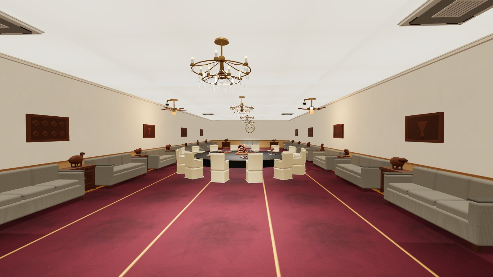

## 打开方式

```powershell
# 在 single-dorm 目录（推荐使用线程化的 serve.py）
python serve.py
# 同页预览并直接进休息厅
http://127.0.0.1:8123/#lounge
# 或从同页顶部切到「二层休息厅」
http://127.0.0.1:8123/
# 独立入口（自动跳转 /#lounge）
http://127.0.0.1:8123/lounge/
```

页面使用 ES Modules，必须通过 HTTP(S) 打开；`file://` 会显示明确提示。

## 空间

- **31.7 × 10.0 m，净高 3.6 m，317 ㎡**；长轴 : 短轴 = 19 : 6（用户指定比例）。
- 地面：**紫红满铺地毯**，每 2 m 一道暖黄条纹，四周 0.35 m 内缩黄色边线；大门门槛黄铜压条。
- 墙面：白色灰泥；**1.0 m 以下橡木墙裙**（底板、竖向壁板、压条、踢脚、1.0 m 硬木帽线）。
- 天花：3.6 m 平顶 + 中央 3.74 m 通长灯槽（宽 5.8 m），灯槽内 4 道横梁；周圈两级顶角线。
- 门：西短墙 **2.8 × 2.6 m 双开大门**（橡木 + 磨砂玻璃上亮 + 黄铜推杆），门外 2.6 m 深楼梯厅预留段；北/南长墙各一扇 **1.0 × 2.2 m 宿管门**，门边装刷卡检测机。

## 主要陈设

| 类别 | 内容 |
|---|---|
| 天花 | **5 盏水晶吊灯**（沿中轴 6.34 m 间距，白光）；**2 台老式黄光吊扇**，每台同座挂 1 台半球监控；**4 台嵌入式中央空调**（四向出风）；另 **2 台端部半球监控** |
| 墙面 | 东墙 **Ø1.10 m 圆形挂钟**（钟面 12 等分、时间可调）；西墙大门上方横向木雕日轮；南北长墙各 5 幅木雕挂板 |
| 地面 | 紫红地毯、暖黄条纹、黄色边线 |
| 家具 | **Ø5 m 圆桌**（黑桌布、8 条车木腿）居中；**14 把高背沙发椅**（奶白亚麻椅套、包脚、滚边）；**19 组灰色沙发**沿墙（南北各 8、东 1、西 2）；**16 个胡桃木条案** |
| 桌面 | 2 副国际象棋、1 副跳棋、1 副围棋、1 组纸牌与筹码；胡桃木“三环结”中心雕件 + 2 件小木雕 |
| 工艺品 | 15 件条案木雕（胸像 / 马 / 鸟 / 狮 / 抽象结，5 种变体轮流）、桌面 3 件、墙面 10 幅木雕挂板 + 门头 1 幅日轮 |

## 三扇门与宿管刷卡

- **大门** `door.main`：双扇同开同合，向厅内开 100°，动态碰撞随门扇更新；门外楼梯厅预留段含石地面、边柜、黄铜空白牌、两盏壁灯与暖光，不放第二道门。
- **宿管门** `door.supervisor.male / female`：锁定；按 E 提示「男生/女生宿管处 · 需刷学生平板」，把手轻晃。
- **检测机** `reader.male / female`：宿管门旁 1.32 m 高，含卡槽、红/绿指示灯、小屏与镜头；按 E 触发红灯闪烁 + 提示「检测器 · 请刷学生平板（平板尚未接入）」。**平板数据暂不接入**，只保留验证机器与反馈。

## 桌面棋牌

- 两张 0.58 m 国际象棋盘（黑白各 18–19 枚，按进行中的局面摆放）。
- 0.50 m 跳棋盘 + 红黑各 12 枚（部分叠成王棋）。
- 19 路围棋盘（0.54 m）+ 34 枚黑白棋子。
- 扇形摊开的 9 张纸牌、3 摞筹码、木制牌盒。
- 胡桃木“三环结”中心雕件（约 0.7 m 高，双层圆底座 + 黄铜嵌线）与 2 件小木雕。

## 交互

| 输入 | 行为 |
|---|---|
| `E` / 单击大门 | 开 / 合双扇门 |
| `E` / 单击宿管门或检测机 | 锁定提示与红灯反馈，不切场 |
| `W A S D` | 移动（眼高恒定 1.80 m） |
| `Shift` | 加速（5.2 → 11.0 m/s） |
| 鼠标拖动 / 全屏鼠标 | 环顾（俯仰 ±83°，永不侧倾） |
| 右键 | 固定 / 解锁视线 |
| 中键 | 平滑回正 |
| `F11` / 右上按钮 | 全屏 |
| 调试 API | `window.__LOUNGE__.setClock(h, m, s)`（同页为 `window.__PREVIEW__.setClock`，休息厅为当前场景时生效） |

## 性能

- 同页六场景常驻，休息厅激活时 **1600 × 900 · 51–84 draw calls / 16.4–23.6 万三角面 / 23 个纹理对象**（随视角与透明物件变化）；独立页 14 个纹理对象。
- **37 个静态合批**；一张 2048² 静态阴影（只由垂直向下主光投影）；无后处理、无 Bloom/SSAO。
- 测试机（可见 Edge，硬件渲染）**58–60 FPS**；门扇/吊扇/钟针为动态小组，不参与阴影烘焙。
- 移动：0.30 m 玩家半径、0.075 m 子步进；圆桌为圆形碰撞（r=2.5 m），14 把椅子独立 OBB，沙发/条案/门扇/墙/门外边柜全部有碰撞。

## 验收摘要

- 8 方向持续行走 4 s 全部留在边界内；桌边停在 `x=-2.8`，关闭的大门停在 `x=-15.65`；开门后可走进楼梯厅（`x=-17.99`）。
- 宿管门与检测机均返回锁定提示；挂钟 `setClock(3,45,10)` 后继续走秒。
- 详细记录：[VALIDATION.md](VALIDATION.md) · 场景规格 [scene-spec.yaml](scene-spec.yaml) · 资产清单 [asset-list.md](asset-list.md)

## 预览

| | |
|---|---|
| 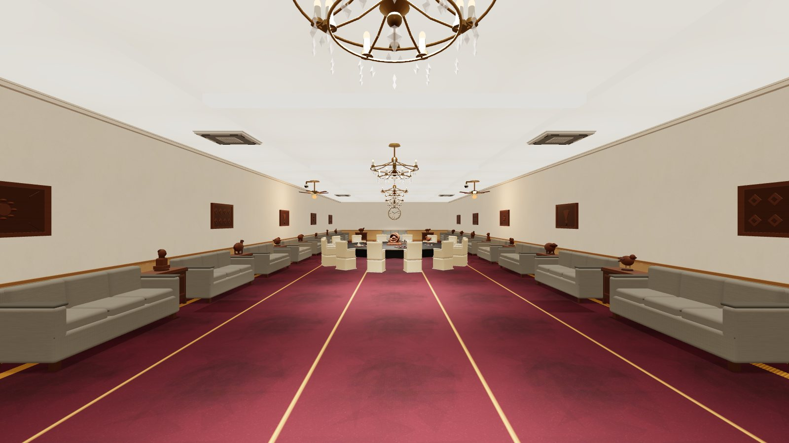 | 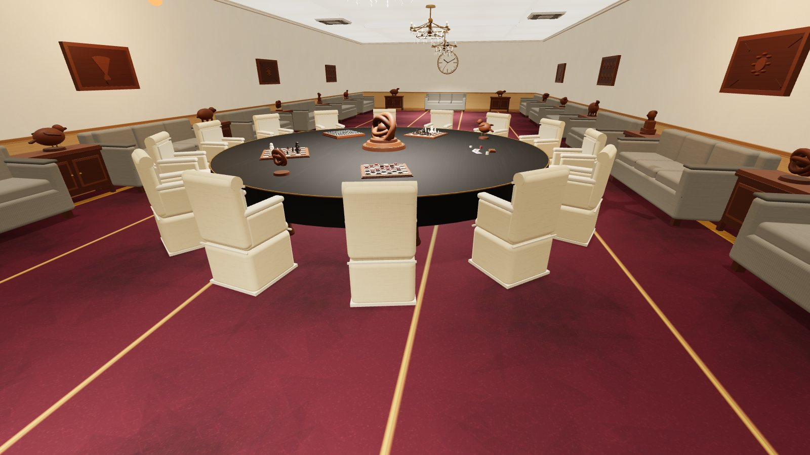 |
| 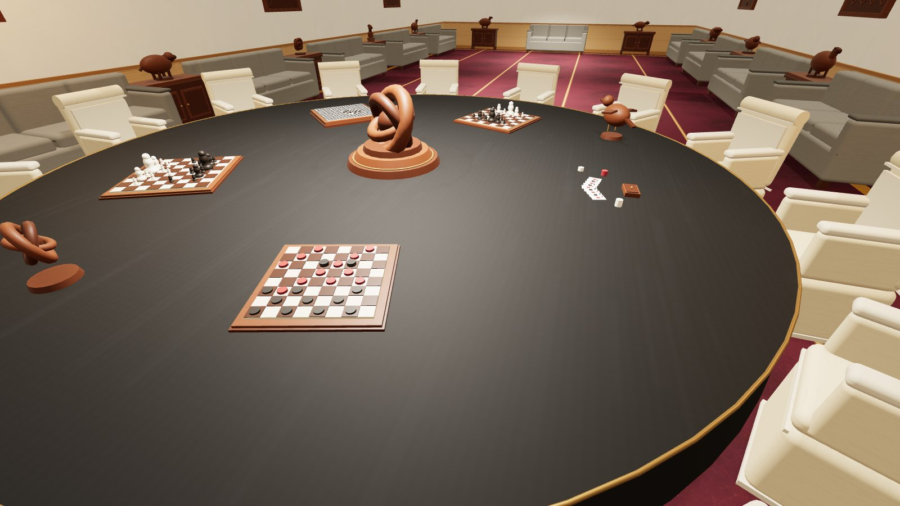 | 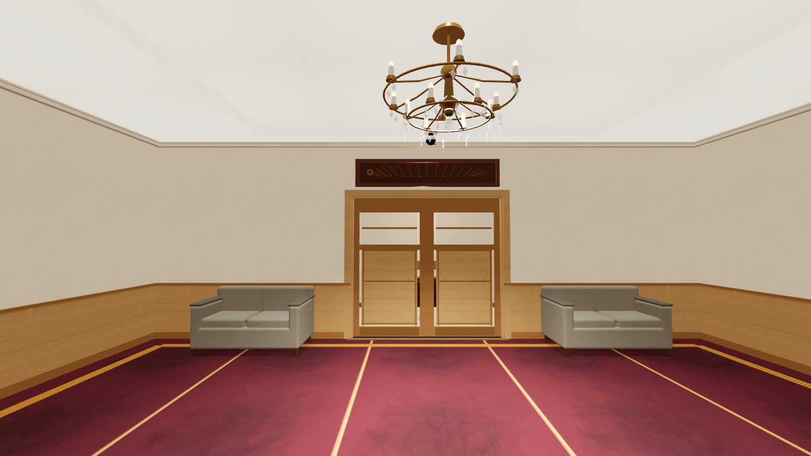 |
| 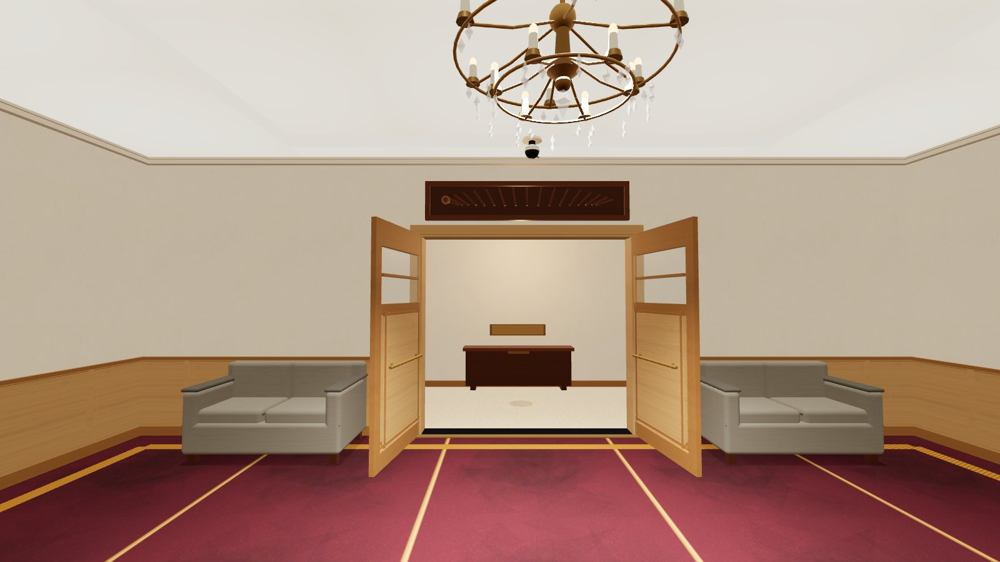 | 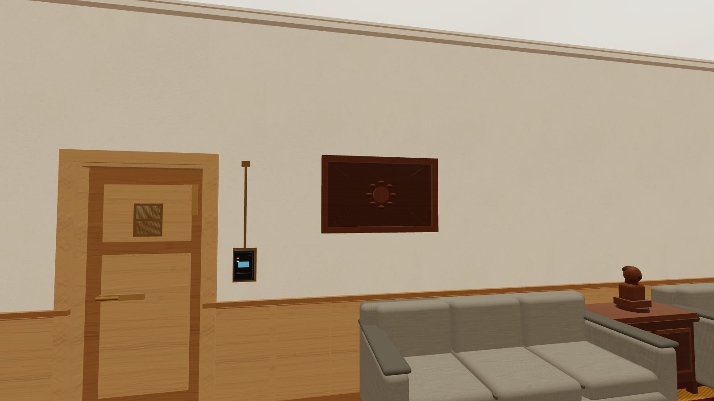 |
| 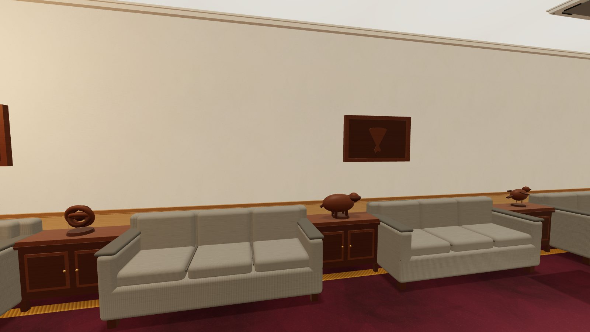 | 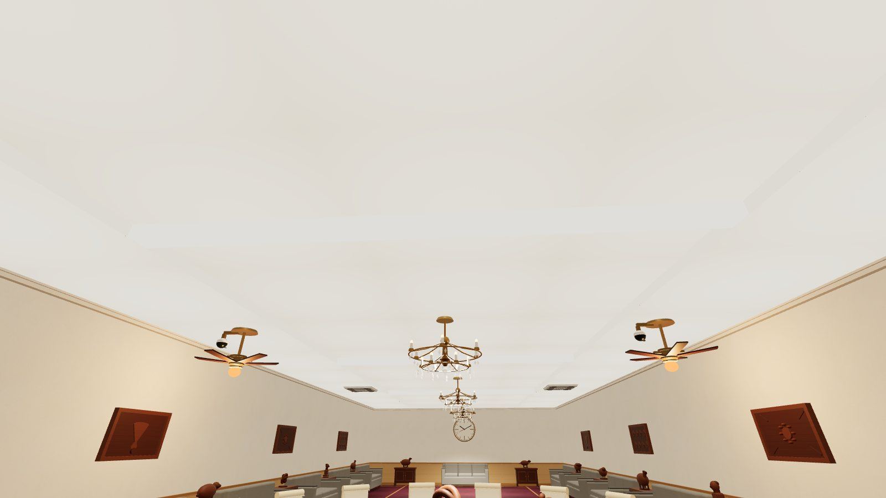 |
| 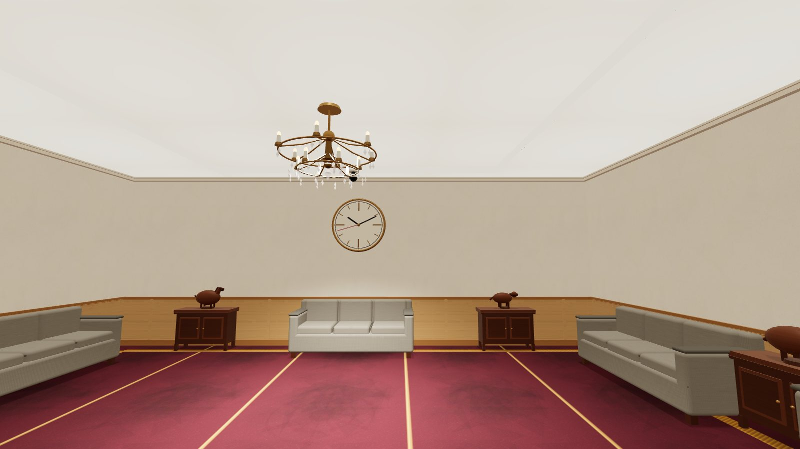 | 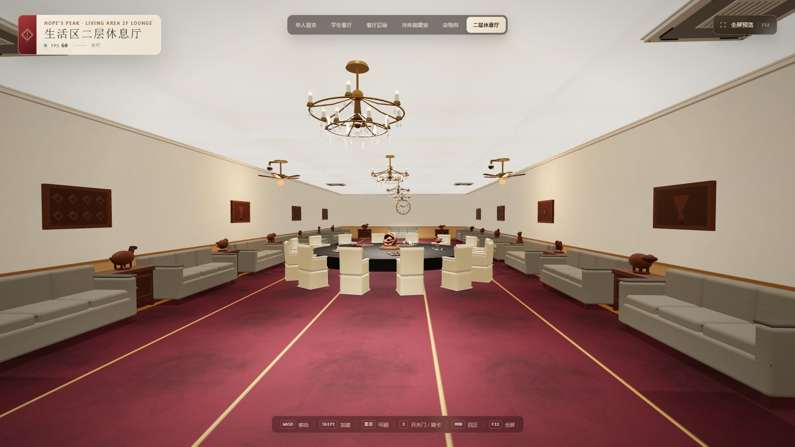 |

## 文件

```
lounge/
├─ index.html              # 自动跳转 /#lounge
├─ standalone.html         # 独立预览页
├─ BRIEF.md                # 场景简报
├─ scene-spec.yaml         # 场景规格（移动机位 / 灯光 / 资产 / 预算）
├─ asset-list.md           # 资产清单（复用 / 新增 / 统计）
├─ VALIDATION.md           # 验收记录（移动、碰撞、门、刷卡、挂钟、性能）
├─ preview/*.jpg           # 14 张最终预览
├─ preview/motion-report.json  # 移动 / 碰撞 / 交互原始报告
├─ tools/
│  ├─ check.mjs            # 加载与控制台检查
│  ├─ capture.mjs          # 独立页确定性截图
│  ├─ capture-hub.mjs      # 同页六场景最终截图
│  ├─ motion-test.mjs      # 固定步长移动 / 碰撞 / 门 / 刷卡 / 挂钟测试
│  └─ eval.mjs             # 预览页表达式调试
└─ src/
   ├─ config.js            # 尺寸、桌/椅/沙发/条案、门、天花、挂钟、移动参数
   ├─ textures.js          # 12 张程序化贴图（灰泥/地毯/木纹/桌布/亚麻/沙发布/石材/环境）
   ├─ materials.js         # 材质槽
   ├─ room.js              # 墙地顶、墙裙、三扇门、检测机、木雕挂板、门外楼梯厅
   ├─ furniture.js         # 圆桌、高背椅、沙发、条案、木雕、中心雕件
   ├─ games.js             # 国际象棋 ×2、跳棋、围棋、纸牌与筹码
   ├─ decor.js             # 水晶吊灯 ×5、吊扇 + 监控 ×2、端部监控 ×2、空调 ×4、挂钟
   ├─ scene.js             # 装配、灯光、碰撞、交互、接触阴影、统计
   ├─ player.js            # 第一人称移动（零侧倾、固定眼高、轻步伐）
   ├─ collision.js         # 圆形玩家 vs AABB / OBB
   └─ utils.js             # 几何、合并与静态合批
```

## 制作依据

按仓库内 `skills/danganronpa-adv-3d` 的场景生产线执行：先写简报与规格，再由 kit 拼房间；单一垂直主光负责全部投影；移动机位独立验收；桌面棋牌与木雕全部为三维几何，不使用文字贴图或自绘二维画作。
