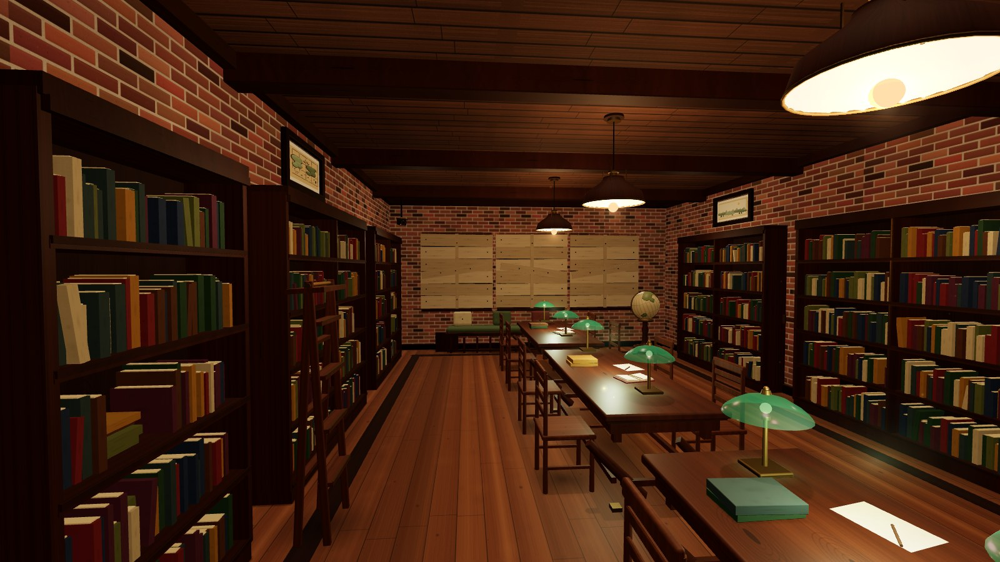
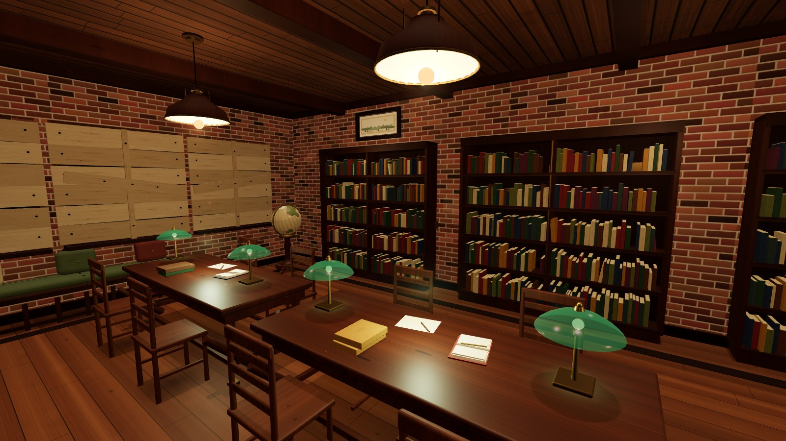
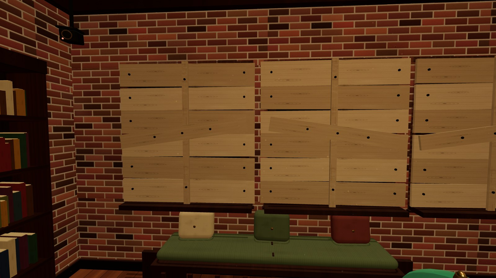
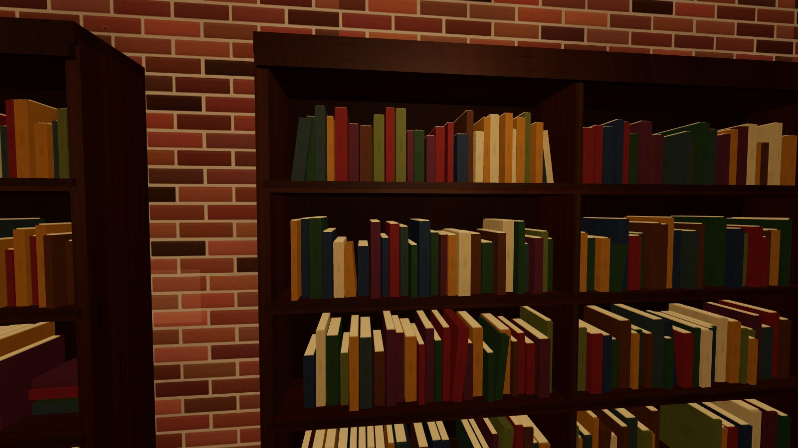
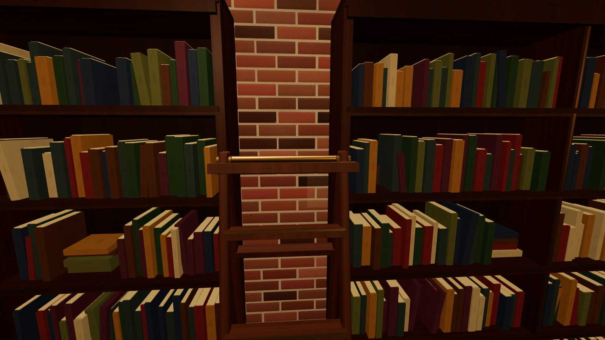
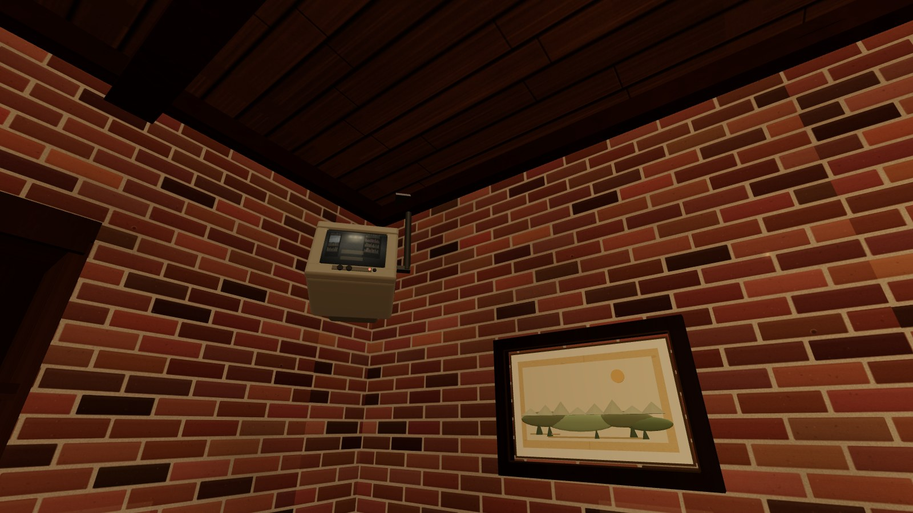
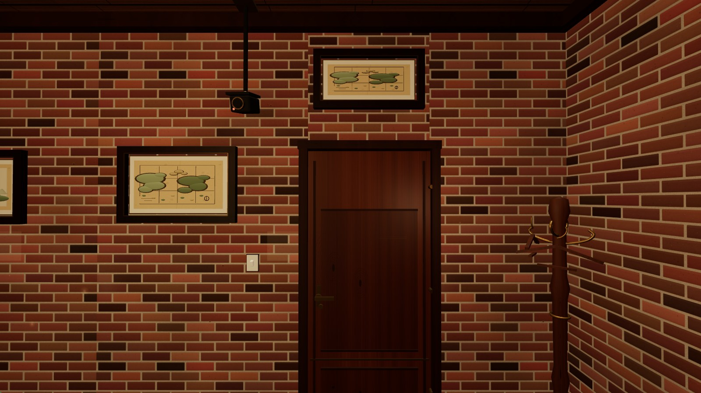
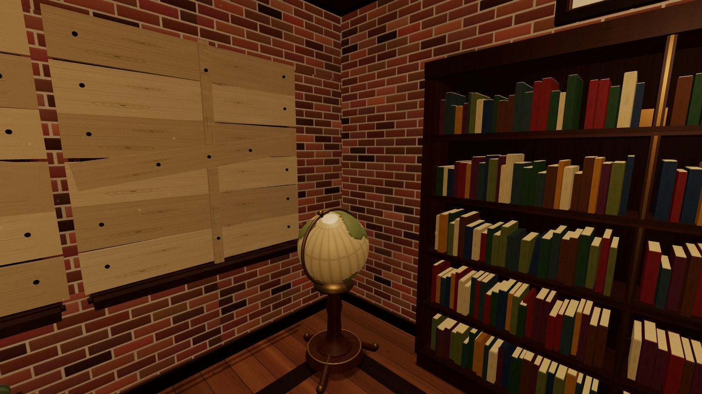
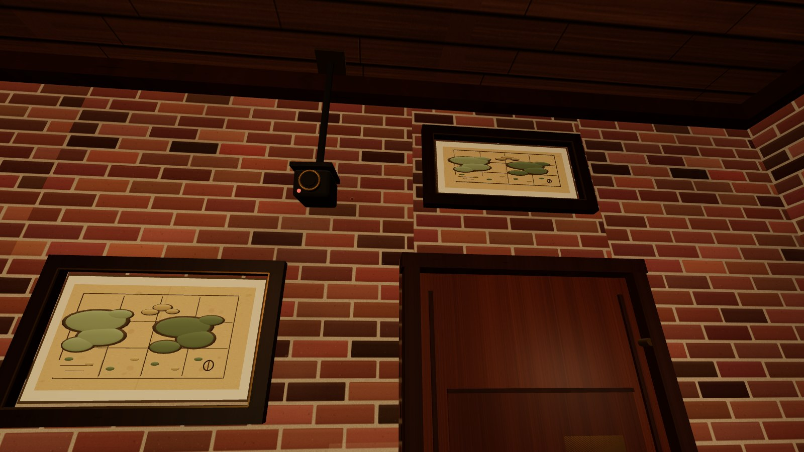

# 阅览室（Reading Room）

生活区 1F 北侧 F 位的阅览室：**6.25 × 10.00 m，比例严格 5 : 8，62.5 ㎡，净高 3.30 m**。棕色木板天花与同色木地板、红砖墙、六组深棕实木书架、三张长条阅读桌与十把木靠背椅、六盏绿玻璃罩阅读灯、三盏木质锥罩工业吊灯。

北墙三扇窗**已用木板完全封死**（每扇 6 块生木板 + 竖压条 + 斜撑 + 黑铁钉 + 近黑深腔，参考单人宿舍的封窗做法），室内没有窗光，全部照明来自灯具；东北角落地地球仪、门后衣帽架、收在书架缺口里的木制人字梯、东南角 CRT 监控显示屏，以及**新增的西北吊顶角与门上方两台监控摄像**。

**无人物、无文字 / 可读标签、无自绘二维画作、无音频、无 CDN、无网络请求**；几何、贴图、灯光与地板花纹全部在浏览器内程序化生成。



## 空间

| 方位 | 内容 |
| --- | --- |
| 北墙 | 三扇 1.42 × 1.62 m 窗洞**完全封死**：每扇 6 块浅色生木板（几乎无缝）+ 1 根竖压条 + 1 根斜撑 + 三排黑铁钉；木板后是近黑深腔，没有玻璃、没有窗外景色；窗下 2.45 × 0.52 m 软垫长凳 |
| 南墙 | 1.0 × 2.2 m 实木门（0.98 × 2.18 门扇、四块凹板、黄铜执手/门牌/踢脚铜板，**锁定**）；门东侧吊灯开关；门上方新增监控摄像；西南角衣帽架 |
| 西墙 | 5 跨深棕书架（2 + 2 + 1）；两组之间收着人字梯；书架上方挂复古地图浅浮雕 |
| 东墙 | 5 跨书架（2 + 2 + 1）；东北角落地地球仪（车木立柱 + 宽木底盘 + 三弯脚 + 铜托碗 + 黄铜子午圈）；书架上方挂风景浅浮雕 |
| 天花 | 棕色木板 + 4 道横梁 + 胡桃檐口；三盏木锥罩吊灯；西北吊顶角新增监控摄像 |
| 地面 | 棕色拼板木地板 + 0.16 m 深胡桃镶嵌边框 + 4 个 45° 转角方块 |

- 书架：0.34 m 深 × 2.36 m 高，6 层板，前挡边与檐口；约 **1 188 本** 书（9 种书脊布色、书口纸页、烫金条、平叠书、倾斜书、黄铜书立）。
- 阅读桌：2.4 / 2.4 / 1.8 m 三张，0.95 m 宽、0.76 m 高，方锥腿、望板、横撑、铜脚套；每桌两盏绿玻璃罩阅读灯、一本摊开的书、一摞书、一张纸与一支铅笔。
- 椅子：10 把木靠背椅，4 + 4 + 2，独立碰撞。
- 窗下长凳：深绿绒面坐垫 + 米色/绿色/酒红抱枕 + 布包扣，凳下藏着几本书；头顶是被木板封死的窗。
- 地球仪：球体 Ø0.58 m，**落在木底盘/三弯脚/车木立柱/黄铜托碗上**，不再悬空；大陆、极地、经纬线用**顶点色**画出（没有位图），缓慢自转。
- 人字梯：高 1.72 m，4 级踏面 + 顶部平台 + 黄铜防滑条与铰链；`E` 开合。
- 监控：东南角 CRT（凸弧屏 + 滚动扫描带 + 录像红灯 + 云台）、西北吊顶角枪机、门上方枪机；三处红色录像灯同步呼吸。
- 墙面：5 幅装裱 3D 浅浮雕——3 幅复古地图（大陆、岛屿、经纬网、罗盘、图签）与 2 幅风景（山脊、丘陵、树、河、太阳），没有文字、没有位图。

## 灯光

北窗封死后，室内是**纯灯具照明**：

- **唯一投影主光垂直向下**（2048² 静态阴影，烘焙一次）；影子方向始终向下。
- 三盏木质锥罩吊灯（罩口 2.44 m，暖光灯泡）——每个吊灯一盏点光，作为主光的视觉解释。
- 六盏绿玻璃罩阅读灯：绿玻璃自发光、罩口光晕、桌面绿色光池与三盏桌心点光。
- 四盏书架走道暖补光 + 一盏门口/衣帽架补光，保证书脊与入口可读；监控屏幕与录像红灯自发光。
- 无窗光、无日光方向光、无 Bloom / SSAO、无后处理；曝光 1.16。

关灯变体：吊灯全灭时保留桌灯、书架补光、屏幕与红灯；桌灯全灭时保留吊灯与书架补光。见 [lamps-off.jpg](preview/lamps-off.jpg) 与 [bankers-only.jpg](preview/bankers-only.jpg)。

## 性能

| 项 | 数值 |
| --- | --- |
| 静态合批 | **52 批 / 120,626 三角面** |
| 实际渲染（hero） | **80 draw calls / 140,180 三角面** |
| 视角范围 | 42–80 draw calls / 76,572–140,180 三角面 |
| 程序化贴图 | 15 张（单张 ≤1024²，约 14.4 MB 含 mipmap） |
| 阴影 | 1 张 2048²，单次烘焙；动态物体不投影 |
| 后处理 | 无 |
| 帧率 | **1600 × 900 · GTX 1060 3GB · D3D11：干净环境 60 FPS（quality 1）**；多场景并行截图时共享 GPU 会跌到 30–50 FPS（同环境杂物间对照也只有 33–47 FPS） |
| 碰撞 | 28 个碰撞体、0.30 m 玩家半径、0.06 m 子步，全部测试 0 穿透 |

移动机位预算 ≤450k 三角面 / ≤90 draw calls；本场景在预算内且仍有约 60% 余量。

## 操作

| 输入 | 行为 |
| --- | --- |
| `W A S D` | 移动（眼高固定 1.80 m） |
| `Shift` | 加速（2.6 → 5.4 m/s） |
| 鼠标拖动 / 全屏鼠标 | 环顾（俯仰 ±83°，零侧倾） |
| 右键 | 固定 / 解锁视线 |
| 中键 | 平滑回正 |
| `E` | 开关吊灯 / 阅读桌绿灯；开合人字梯；门锁定提示 |
| `F11` / 右上按钮 | 全屏 |

## 交互

| id | 行为 |
| --- | --- |
| `door.readingroom` | 锁定；提示「阅览室门 · 暂未开放（预留走廊切换）」；`sceneId: corridor` |
| `light.switch` | 三盏吊灯开/关；关灯后桌灯、书架补光、屏幕与红灯仍可辨 |
| `lamp.tables` | 六盏绿玻璃罩阅读灯开/关（罩体自发光 + 桌面绿光池 + 点光） |
| `ladder` | 人字梯开合（0.055 → 0.185 rad，两级框架绕顶部铰链） |

## 预览

| | |
|---|---|
|  |  |
|  |  |
|  |  |
|  |  |

更多截图：`preview/` 下共 19 张（hero / hero-ui / tables / window / bench / globe / shelf-west / books / ladder / ladder-open / monitor / camera / door / coatrack / lamp-close / ceiling / floor / lamps-off / bankers-only）。

## 文件

```text
readingroom/
├─ index.html              # 自动跳转 ../#readingroom；file:// 下有提示
├─ README.md / BRIEF.md / scene-spec.yaml / asset-list.md / VALIDATION.md
├─ preview/                # 19 张 JPG + check-report.json / motion-report.json / fps.json
├─ tools/
│  ├─ capture.mjs          # 18 个视角 + HUD 的确定性截图
│  ├─ shot.mjs             # 单视角快速截图
│  ├─ check.mjs            # 加载 / 交互 / 场景切换 / 性能
│  ├─ motion-test.mjs      # 移动 / 碰撞 / 俯仰 / 步伐 / 交互
│  └─ gpu-check.mjs        # 可见 Edge 的真实 FPS 与 HUD
└─ src/
   ├─ scene.js             # 装配、灯光、碰撞、交互、CRT/地球仪/尘埃更新
   ├─ config.js            # 尺寸、布局、封窗、摄像机、机位、碰撞体、内容计数
   ├─ room.js              # 砖墙、封死北窗、门、天花、吊灯、三处监控、开关、墙面浮雕
   ├─ shelves.js           # 书架、约 1 188 本书、人字梯
   ├─ furniture.js         # 桌、椅、绿灯、窗下长凳、地球仪（落地立柱/托碗）、衣帽架、桌面道具
   ├─ props.js             # 尘埃、吊灯/桌灯光晕
   ├─ player.js            # 第一人称移动与碰撞
   ├─ textures.js / materials.js / geometry.js
   └─ config.js
```

## 本地运行

在 `single-dorm/` 目录下：

```powershell
python serve.py
# 直接进入阅览室：http://127.0.0.1:8123/#readingroom
# 或任意静态服务器：python -m http.server 8123
```

> 页面使用 ES Modules，必须通过 HTTP(S) 访问；直接双击 `readingroom/index.html`（`file://`）会显示「需要通过本地服务器打开」的提示。

## 验收与已知边界

- 验收记录：[VALIDATION.md](VALIDATION.md)；简报：[BRIEF.md](BRIEF.md)；规格：[scene-spec.yaml](scene-spec.yaml)；资产：[asset-list.md](asset-list.md)。
- 本场景为**移动机位**，没有固定机位；如果剧情需要固定 ADV 镜头，应另补 shot 并单独验收。
- 门锁定，走廊未建；`sceneId: corridor` 已预留。
- 设计图 A-01 的 F 条带为 15.48 × 5.4 m；建成体量按 5:8 取 6.25 × 10.0 m，进深大于概念条带，这是已知的图纸/模型偏差，下一轮图纸更新时统一（详见 BRIEF §2 / §9）。
- 北窗完全封死，没有窗外景色/日光；木板是静态合并几何，暂时不能拆开。书、地图、风景均为风格化 3D 几何；没有可读书名、没有位图。
- 地球仪已修复为落地立柱 + 宽底盘 + 铜托碗（旧版立柱建在了房间原点，所以球体看起来悬空）；两台新增枪机是静态模型，红灯呼吸、不做真实云台扫视。
