# 住宿区 2F

按设计图集 **A-02「住宿区 2F」** 修正后的宿舍层：**56.4 × 30.4 m**，包含北侧 10 间男生宿舍、南侧 8 间女生宿舍、北 / 东 / 南三面 2.4 m 走廊、西侧男女淋浴与厕所、右下角楼梯间与电梯、东走廊中段的铁栅栏门，以及一处通往现有「生活区二层休息厅」的双开门。

**范围约定**：宿舍、淋浴间、厕所、N 杂物间、电梯井不建内部，只保留门 / 门套 / 门禁；**楼梯间按需求做成真实空间**（8 级踏步、上层平台、铁链、下层防火门）。M 大厅不重建，从北走廊的一樘双开门切到已有休息室，落点在休息室大门外的楼梯厅。

## 平面与修正

| 区域 | 位置 / 尺寸 | 说明 |
| --- | --- | --- |
| 男生宿舍 A–J | 北侧，x 0.3–49.5，z 0.3–5.9 | 10 间，4.8 × 5.6 m 开间；只做走廊侧门，门后不建 |
| 北走廊 | x 0.3–56.1，z 5.9–8.3 | 净宽 2.4 m；南墙西端是男淋浴 / 男厕所门与休息室入口 |
| 女生宿舍 O–V | 南侧，x 0.3–39.66，z 24.5–30.1 | 8 间；只做走廊侧门 |
| 南走廊 | x 0.3–56.1，z 22.1–24.5 | 净宽 2.4 m；北墙是女淋浴 / 女厕所门 |
| 东走廊 | x 49.5–51.9，z 8.3–24.5 | 连接北 / 南走廊；中段 z = 15.5 是铁栅栏门 |
| 男生淋浴 / 男厕所 | 北走廊南墙，x = 2.5 / 7.14 | 两扇 1.0 × 2.2 m 门，**朝男生宿舍一侧**；门后预留 |
| 女生淋浴 / 女厕所 | 南走廊北墙，x = 2.5 / 7.14 | 两扇 1.0 × 2.2 m 门，**朝女生宿舍一侧**；门后预留 |
| 楼梯间 | 右下角，x 51.9–56.1，z 24.5–30.1 | 南走廊南墙上的 1.4 × 2.2 m 防火门；8 级踏步、上层平台、铁链、下层防火门；门可开合，初始开启 |
| 电梯 | 楼梯间上方，x 51.9–56.1，z 16.0–21.3 | 东走廊东墙上的双扇电梯门 + 呼叫面板；不建井道 |
| N 杂物间 | 右上角，x 51.9–56.1，z 0.3–5.9 | 保留；北走廊北墙上的金属门，不建内部 |
| 休息室入口 | 北走廊 z = 8.3，x = 10.2 | 一樘 2.8 × 2.6 m 双开门；按 E 切到已有休息室大门外的楼梯厅 |
| 铁栅栏门 | 东走廊 z = 15.5 | 2.4 m 宽栅栏，中间 1.0 m 门扇；学生平板开启 |

**删掉**：洗衣房、东南角女生储物间、右侧屋面 / 设备平台。**保留**：N 杂物间。大厅左下角的穿模属于原图问题，未处理。

### 与 A-02 的差异

- 楼梯间与电梯移到 **右下角同一柱网**：楼梯在下（z 24.5–30.1），电梯在上（z 16.0–21.3），中间隔南走廊；不再按原图并排。
- 男生淋浴 / 男厕所两扇门都开向北走廊；女生两扇都开向南走廊；不再是套间共用一扇门。
- 男女区之间用 **铁栅栏 + 中间铁门**，位于东走廊中段，不再用实墙。
- M 大厅不建家具，也不重建体量；改为北走廊西端的一樘门，送到现有休息室大门外。
- 所有门后空间不建，详见「范围约定」。

## 门与交互

| id | 位置 | 状态 / 行为 |
| --- | --- | --- |
| `door.room.b01`–`b10` | 北走廊北墙 | 关闭；E 提示「男生宿舍 01…10 · 暂未开放」 |
| `door.room.g01`–`g08` | 南走廊南墙 | 关闭；E 提示「女生宿舍 01…08 · 暂未开放」 |
| `door.shower.male` | 北走廊南墙 x = 2.5 | 关闭；「男生淋浴室 · 预留空间，暂未开放」 |
| `door.wc.male` | 北走廊南墙 x = 7.14 | 关闭；「男厕所 · 预留空间，暂未开放」 |
| `door.shower.female` | 南走廊北墙 x = 2.5 | 关闭；「女生淋浴室 · 预留空间，暂未开放」 |
| `door.wc.female` | 南走廊北墙 x = 7.14 | 关闭；「女厕所 · 预留空间，暂未开放」 |
| `storage.n` | 北走廊北墙 x = 54 | 关闭；「N 杂物间 · 需管理员钥匙」 |
| `door.stair` | 南走廊南墙 x = 54 | 可开合，初始开启；8 级踏步下行，梯口铁链封住；E 开 / 关 |
| `elevator.call` | 东走廊东墙 z = 17.95 | 锁定；「电梯 · 需管理员刷卡」 |
| `portal.lounge` | 北走廊 z = 8.3，x = 10.2 | 双开门；E 切到休息室大门外的楼梯厅 |
| `gate.iron` | 东走廊 z = 15.5 | 学生平板验证后 E 开启 / 关闭；92° 开启；动态碰撞 |

共 **27 个可交互对象**（18 扇宿舍门 + 4 扇湿区门 + N 门 + 楼梯门 + 电梯呼叫 + 1 个休息室入口 + 铁栅栏门）。除铁栅栏门和楼梯间防火门外，所有门都保持关闭；休息室入口只做切场，不是可穿行的门洞。

## 学生平板

- 全局状态在 `single-dorm/src/tablet.js`，默认 **已解锁**，持久化在 `localStorage`（`dsh.studentTablet.unlocked`）。
- 顶栏状态显示「平板 · 已解锁」；锁定后变红字「平板 · 未解锁」。
- 解锁时，铁栅栏门按 E 打开；锁定时按 E 提示「铁栅栏门 · 需刷学生平板」。
- 调试：`window.__PREVIEW__.tablet.lock()` / `.unlock()` / `.set(true|false)`；URL 参数 `?tablet=0` 或 `?tablet=1`。
- 独立页：`window.__RESIDENCE__.tablet` 同样可用。
- 本轮接线范围：**住宿区铁栅栏门 + 顶栏全局状态**。休息厅旧场景里的平板提示保持原逻辑，后续再统一改造。

## 运行

```text
同页预览：http://127.0.0.1:8123/#residence
独立预览：http://127.0.0.1:8123/residence/standalone.html
```

操作：WASD 移动，Shift 加速，鼠标环顾，E 开门 / 刷卡，MMB 回正，F11 全屏。

## 性能

- 独立页 hero：**38 draw calls / 14,052 三角面 / 27 静态合批 / 27 个交互 / 8 个纹理对象**（2026-11-21，1600 × 900）。
- 同页 hub：加载全部 10 个场景时 40 个纹理对象；hero 约 38 calls / 14k tris；**1600 × 900 预热后约 50–60 FPS**（独立页 60 FPS）。
- 18 盏走廊 / 门厅点光 + 1 盏垂直向下投影主光；无后处理；阴影 2048²；`shadowMap.autoUpdate = false`。

## 预览

| | |
| --- | --- |
| 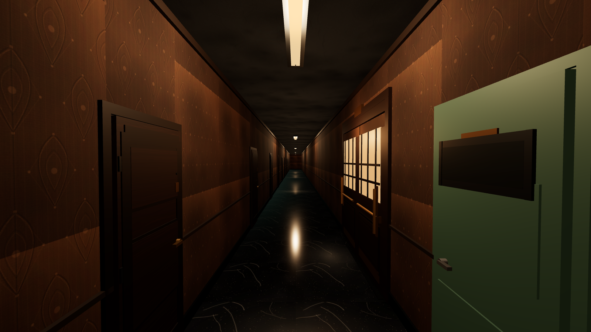 | 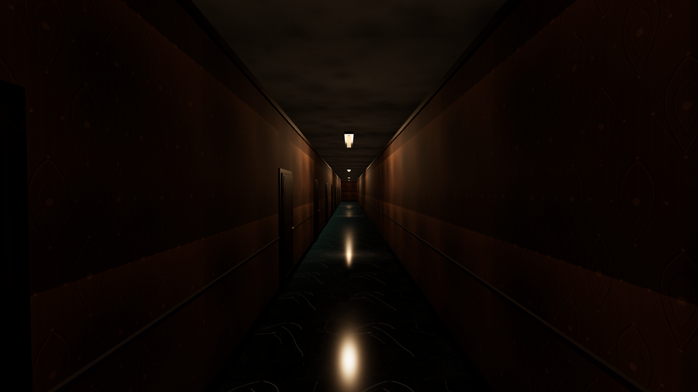 |
| 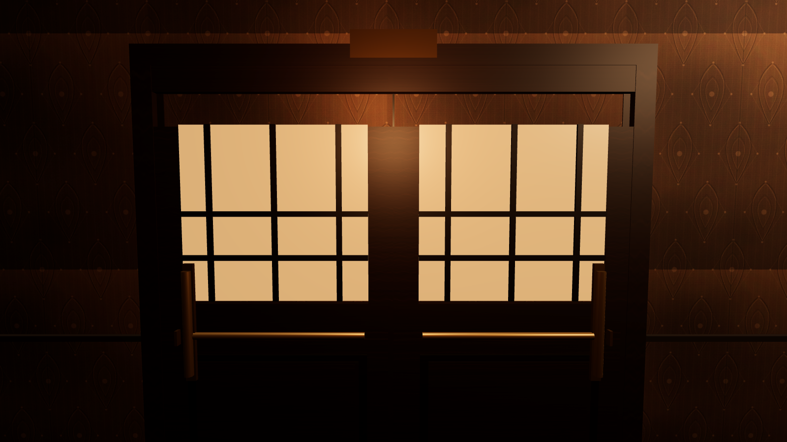 | 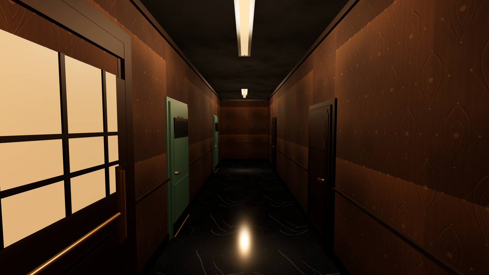 |
| 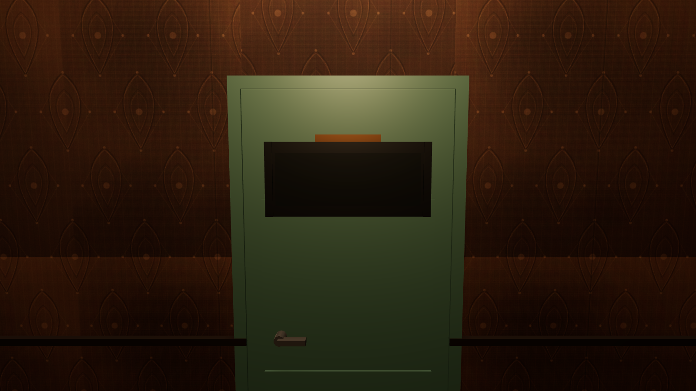 | 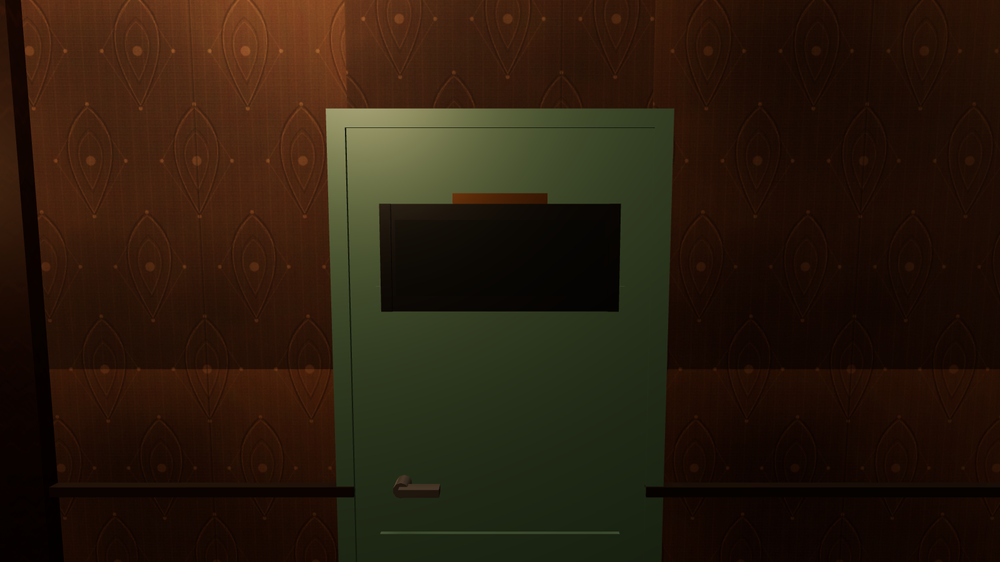 |
| 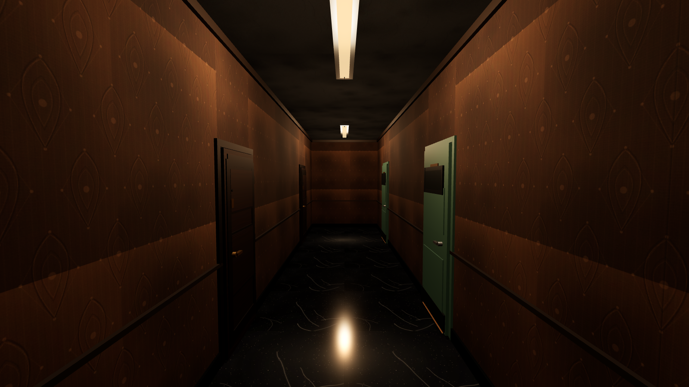 | 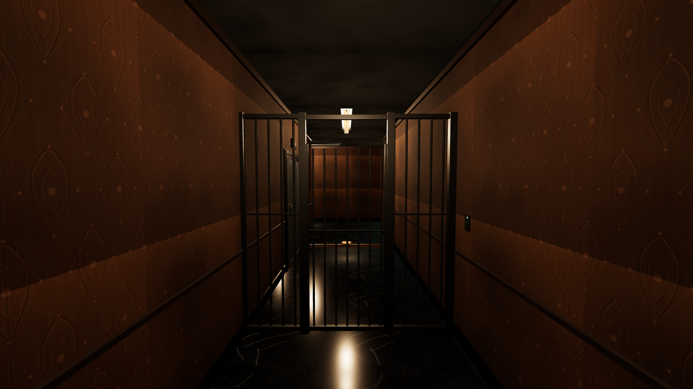 |
| 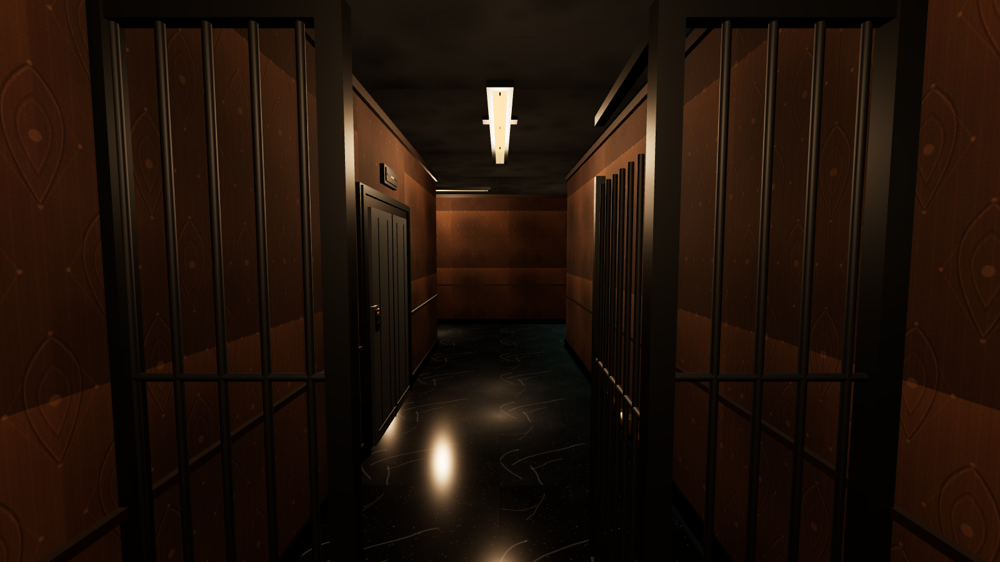 | 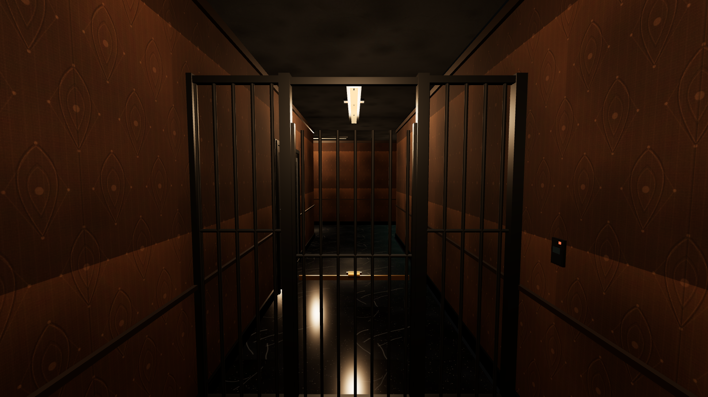 |
| 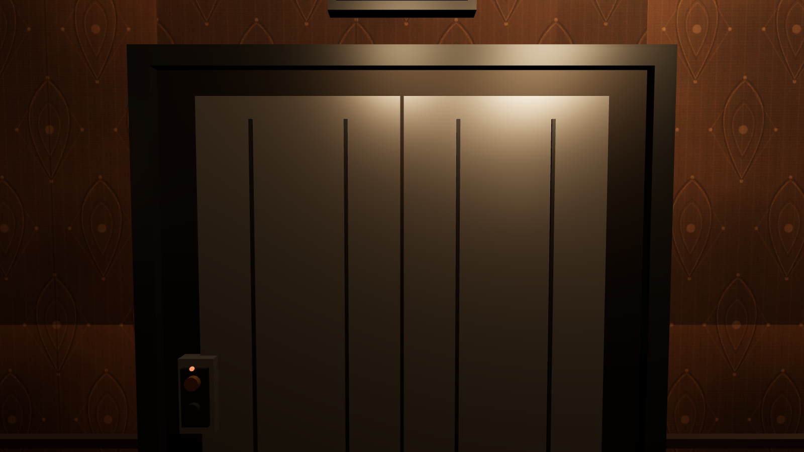 | 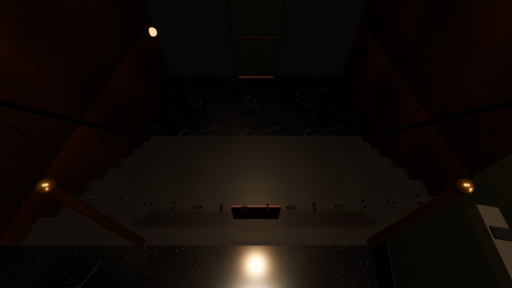 |
|  | 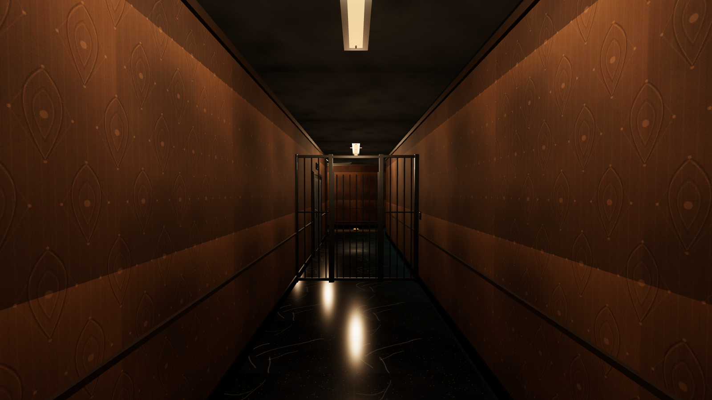 |
| 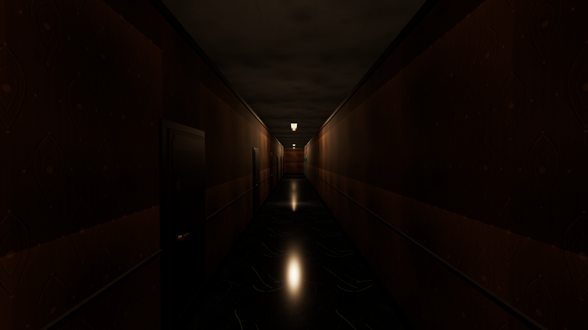 | 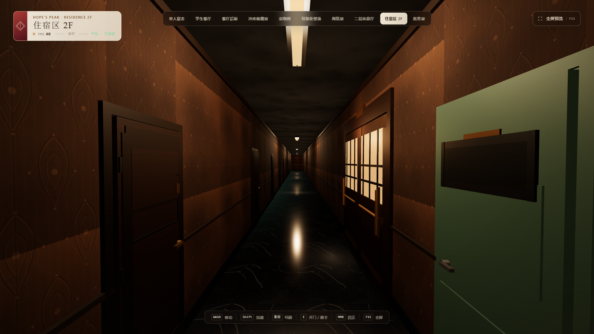 |

## 文件与工具

```text
residence/
├─ index.html / standalone.html
├─ src/
│  ├─ config.js      # 全部坐标、门、灯光、起点
│  ├─ build.js       # 墙 / 地 / 顶 / 门套辅助
│  ├─ room.js        # 走廊壳、18 扇宿舍门、4 扇湿区门、休息室门、灯具
│  ├─ core.js        # 铁栅栏 + 平板门、电梯门、楼梯门、N 门、读卡器
│  ├─ scene.js       # 场景工厂、碰撞、交互、平板同步
│  ├─ player.js      # 第一人称移动
│  ├─ textures.js / materials.js
│  └─ main.js
├─ tools/check.mjs   # 无报错 + 截图
├─ tools/capture.mjs # 确定性机位
└─ preview/final/
```

```powershell
node tools/check.mjs
node tools/capture.mjs final 9222
$env:VIEWS="hero,gate,lift"; node tools/capture.mjs final 9222
```

更多：[场景简报](BRIEF.md) · [场景规格](scene-spec.yaml) · [资产清单](asset-list.md) · [验收记录](VALIDATION.md)

## 未建 / 预留

- 10 间男生宿舍、8 间女生宿舍的室内。
- 男生 / 女生淋浴间的淋浴位、洗手台；男 / 女厕所的洁具与隔断。
- N 杂物间的货架与内部。
- 电梯井道与轿厢；楼梯间已建，未做下层空间。
- 洗衣房、东南角女生储物间、右侧屋面 / 设备平台（按修正删除）。
