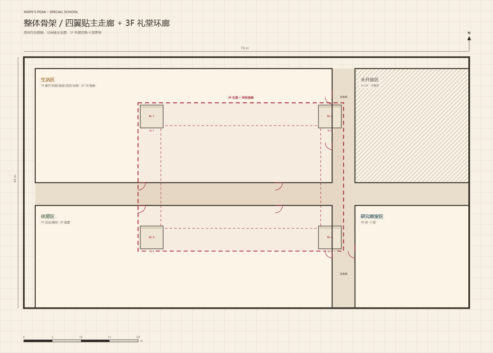

# 特殊学园 · 多层概念平面

Canvas 概念户型图，用于 3D 建模前的关系确认，不是施工图。



- 全页预览：[preview/page.jpg](preview/page.jpg)
- 页面：`http://127.0.0.1:8123/school-plan/`

## 整体

- 四个翼楼：生活区、休憩区、研究教室区、未开放区。
- 1F / 2F 翼楼贴主走廊，房间互相接触；只保留 4 m 主走廊。
- 3F 中央礼堂；礼堂四周 **环形走廊**。
- 环廊四角为 **4 座客梯出口 + 楼梯间**。
- 4 部客梯均停靠 1F / 2F / 3F；每层都能到达 3F 礼堂环廊。

## 生活区

### 1F

- 餐厅进食区：8 张 6 人桌。
- 后厨 18 × 14 m：灶台/烟罩、冷库、清洗/洗碗、操作岛台、货梯、传菜口。
- 配套厕所。
- 医务室。
- 洗衣房。
- 杂物室（被铺/杂物）。
- 楼梯间。
- 电梯预留空间。

传菜口直接连餐厅；后厨货梯独立。

### 2F

- **男生宿舍 10 间**，靠北墙（B01–B10）。
- **女生宿舍 8 间**，靠南墙（G01–G08）。
- **男生洗浴室、女生洗浴室**两间，靠北墙，与男生宿舍同侧。
- 男生厕所依赖洗浴室，不另设独立男厕。
- **女生独立厕所**，位于南侧，**无窗**。
- 女生宿舍区南墙不开窗。
- 女生储藏、女生洗衣、楼梯、客梯、储藏。

## 休憩区

### 1F

- 综合运动区。
- 器材室。
- 乒乓球 2 台。
- 更衣 / 卫生间。
- 休息 / 饮水。

### 2F

- 画室 A / B / C。
- 画材储藏。
- 展示 / 休息。
- 楼梯 / 客梯。

## 研究教室区

- 1F：研究教室 01–05，准备室，卫生间。
- 2F：研究教室 06–10，储藏。
- 共 10 间。

## 未开放区

- 1F / 2F 只留结构轮廓与封堵门洞，不布置家具。

## 礼堂 3F

- 中央礼堂：舞台、座席、门厅。
- 四周一圈环形走廊。
- 四角：EL-1 / EL-2 / EL-3 / EL-4 四部客梯出口。
- 每部客梯旁设楼梯间。
- 环廊可绕礼堂一周。

## 暂定尺度

| 项 | 尺寸 |
|---|---|
| 总平面 | 78 × 44 m |
| 生活区 | 52 × 20 m / 层 |
| 休憩区 | 52 × 18 m / 层 |
| 研究教室区 | 20 × 18 m / 层 |
| 未开放区 | 20 × 20 m / 层 |
| 3F 礼堂 | 36 × 26 m |

## 使用

纯 Canvas + 经典脚本，可直接双击 `index.html`；也可走本地服务器：

```powershell
# single-dorm/ 目录
python -m http.server 8123 --bind 127.0.0.1
# http://127.0.0.1:8123/school-plan/
```

点击任意图纸放大，支持滚轮/按钮缩放、拖拽平移、Esc 关闭。
