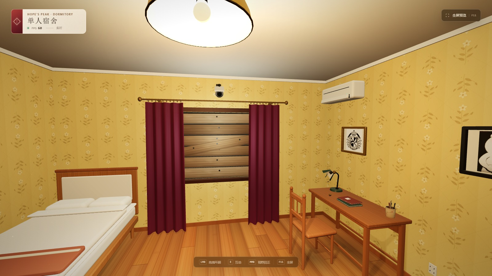
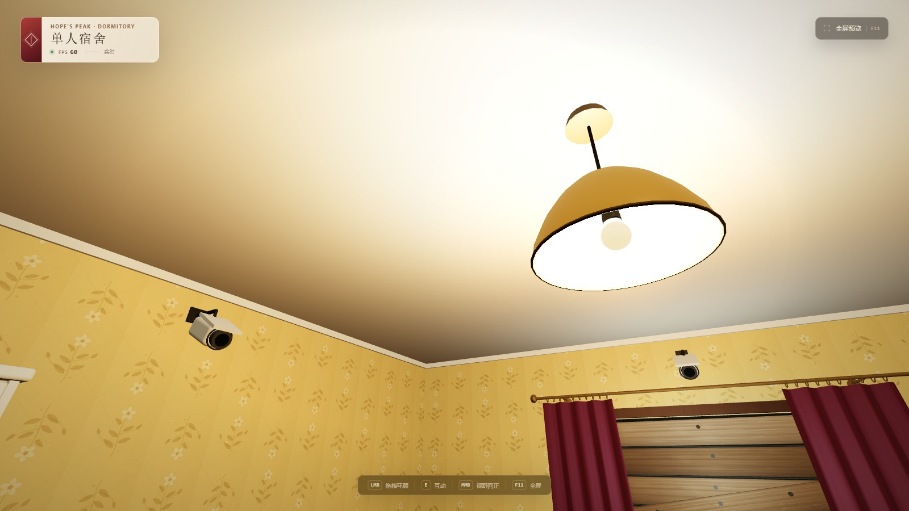
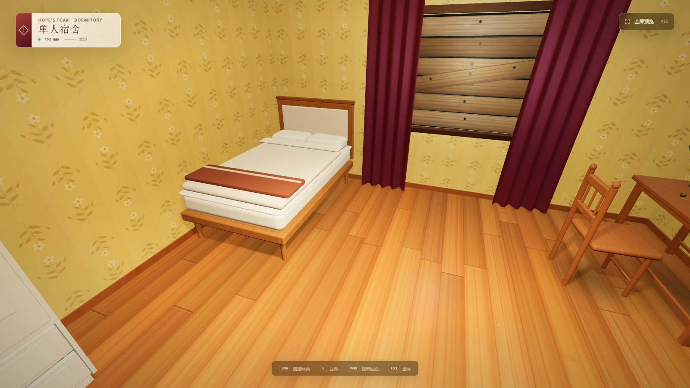
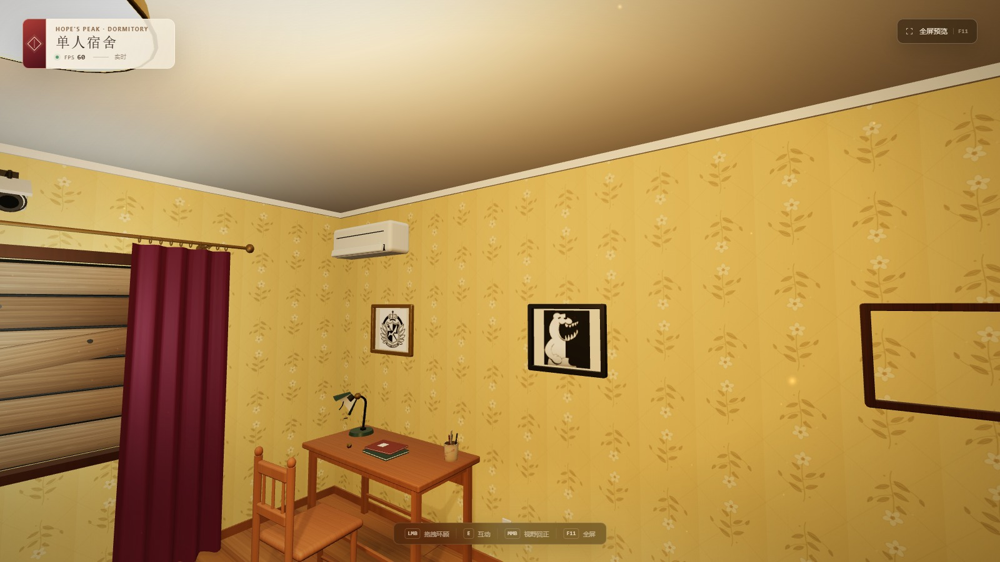
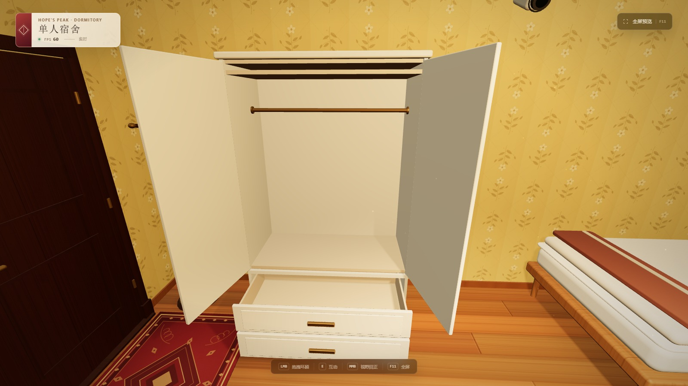

# 单人宿舍 · 3D 场景预览

> 同站另一场景：[学生餐厅](dining/) —— 共用同一套预览 UI，右上角可互相切换。
>
> **本地打不开？** 不要直接双击 `index.html`（ES Modules 会被 `file://` 拦截）。双击 `start-preview.cmd`，或在当前目录运行 `python -m http.server 8123 --bind 127.0.0.1`，再打开 http://127.0.0.1:8123/。

一间温暖明亮的单人宿舍：黄色花纹墙纸、白色床品、红色门厅地毯——以及一扇被六块旧木板和铁钉彻底封死的窗。场景用于 ADV 预览，全部几何与程序化贴图在浏览器内生成；两张画使用用户提供的参考图（本地 WebP），无 CDN、无网络请求。

## 预览



本机实时预览地址：

**http://127.0.0.1:8123/**

如果想在另一台机器或重新启动服务器，请在项目目录执行：

```powershell
# 项目根目录下
python -m http.server 8123 --bind 127.0.0.1
```

或使用 Node：

```powershell
npx serve . -l 8123
```

页面使用 ES Modules，需要通过 HTTP 访问，直接双击 `index.html`（`file://`）不会加载 Three.js 模块。









## 操作

### 非全屏

- 按住左键拖动：环顾房间（固定站位，不移动相机）。
- 中键：视角回正，使用平滑过渡动画。
- 鼠标悬停家具 / 按 `E` / 单击：开关柜门、抽屉。
- 左上角实时显示 FPS。
- `F11` 或右上角「全屏预览」：进入全屏。

### 全屏

- 鼠标指针隐藏。浏览器允许时，点击全屏按钮或按 `F11` 会自动捕获鼠标。
- 如果浏览器拒绝自动捕获，画面顶部会显示「点击画面捕获鼠标 · 360° 环顾 · 右键固定视野」，点击一次即可；此后水平视角不再受屏幕边缘限制。
- 移动鼠标：360° 环顾房间。水平 Yaw 不设角度上限，也不会在 ±180° 处卡住或回弹。
- 左键：仅捕获鼠标；不再固定视野。
- 右键：固定 / 解除固定视野（固定后移动鼠标不再改变视角）。
- 中键：平滑动画回正。
- 按 `E`：与准星指向的家具互动。
- `ESC`：先退出鼠标锁定，再次按 `ESC` 退出全屏。
- HUD 会自动隐藏；交互提示与准星保留。

## 场景内容

| 区域 | 内容 |
| --- | --- |
| 房间 | 4.8 m × 5.6 m × 2.8 m，木地板、白色天花板、7 cm 木质踢脚线、白色顶角线 |
| 窗 | 被 6 块风化松木板 + 1 根斜撑用铁钉封死，紫红色窗帘；窗框和深色窗洞保留层次 |
| 墙面 | 程序化无缝黄色花枝墙纸；使用参考图的希望峰学园校徽画与黑白熊画、真正镂空的空画框，三幅等距且无遮挡 |
| 照明 | 黄色搪瓷吊灯；唯一实时投影光位于吊灯下沿，垂直照向地面。其余为低强度暖色补光、环境光与窗缝冷光，均不投影 |
| 安防 | 老式 CRT 小屏幕、四台壁装监控相机：东墙 CRT 上方、南墙门上方、西墙床侧上方、北墙封窗上方各一台，全部朝房间内部俯拍；叠加视野覆盖床、书桌、门厅、衣橱等主要区域，约占房间可视空间的 80% 以上 |
| 门厅 | 深棕色木质门、衣帽架、红色花纹地毯、白色衣橱、底部 200 mm 架空的四层鞋柜 |
| 休息区 | 1.2 m × 2 m 单人床，白色床垫、两只白枕、白色被子和整齐搭在床尾的锈红盖毯 |
| 学习区 | 老式木书桌与纺锤背椅、损坏的绿色台灯、花鸟纹木笔筒（含尺子与三支签字笔）、两本笔记本 |

家具均按真实起居尺度建模，门板和抽屉的开启弧线、抽屉行程均预留了空间，开启时不会与床、地毯、其他柜体或固定墙体穿插。

## 性能与实现

- 稳态渲染：**67 draw calls / 约 44,818 triangles / 14 textures / 70 geometries**。
- 本机 GTX 1060 3GB 实测：1280×720、1920×1080、2560×1440 均为 **约 60 FPS**（含同时打开全部柜门与抽屉）。
- 运行文件约 **958 KB**（含本地参考画、Three.js 与全部源码），文档截图另计。
- 所有不带动画的家具、墙体、线脚、书桌道具等使用**静态几何合批**（按材质与阴影标记合并）。
- 四台监控一墙一台，使用贴墙短臂支架，不再集中吊装在吊顶同一侧，视野更均匀地朝房间内部展开。
- 唯一投影光为吊灯下沿的宽角 SpotLight，目标垂直向下；可见灯具位置与影子来源重合，不再有东南向平行光造成的反向投影。
- 全局只有一张静态阴影贴图；只有柜门/抽屉运动时才会重新烘焙阴影。
- 除两张用户提供的参考画（本地 WebP，共约 56 KB）外，其余贴图均为 Canvas 程序生成；无字体文件、无网络请求。
- 不包含 `TextGeometry` 或 3D 字体模型；DOM UI 使用系统字体。校徽参考图本身保留了原图的印字。
- 自适应分辨率（仅在检测到持续低帧率时降低像素比）作为低端设备兜底。
- 取景相机固定于 `(0.02, 1.855, 0.92)`，瞳孔高度约 1.86 m；俯仰角限幅，不会翻转。

### 截图 / 文档模式

在 URL 后加 `?capture=1` 会启用 `preserveDrawingBuffer` 并固定最高渲染分辨率，方便自动截图。普通游玩不会启用该选项，不会承担相应开销。

## 后续接入游戏

场景构建与页面控制器解耦：

```js
import * as THREE from 'three';
import { SingleDormScene } from './src/scene.js';

const renderer = new THREE.WebGLRenderer({ antialias: true });
const dorm = new SingleDormScene({
  renderer, // 用于生成环境反射和静态阴影；也可省略并自行管理
  maxAnisotropy: renderer.capabilities.getMaxAnisotropy(),
  // 可选：预加载好的两张参考画 HTMLImageElement；
  // 未提供时回退到程序化画作。
  referenceArt: { crestImage, monokumaImage },
});
const camera = new THREE.PerspectiveCamera(70, innerWidth / innerHeight, 0.035, 45);
camera.rotation.order = 'YXZ';
camera.position.copy(dorm.cameraHome.position);
camera.rotation.set(dorm.cameraHome.pitch, dorm.cameraHome.yaw, 0);

renderer.render(dorm.scene, camera);

// 游戏循环
function tick(dt, elapsed) {
  dorm.update(dt, elapsed);
  renderer.render(dorm.scene, camera);
}
```

常用接口：

```js
dorm.scene                       // THREE.Scene
dorm.cameraHome                  // { position, yaw, pitch, fov }
dorm.interactives                // 互动条目
dorm.toggleInteractive(id)       // 切换柜门 / 抽屉
dorm.setInteractive(id, true)    // 指定开/关
dorm.getInteractiveState()       // 状态快照
dorm.update(dt, elapsed)         // 动画与 CRT LED 更新
dorm.dispose()                   // 释放几何、材质、贴图和环境图
```

互动 ID：

- `wardrobe-door-left` / `wardrobe-door-right`
- `wardrobe-drawer-upper` / `wardrobe-drawer-lower`
- `shoe-cabinet-door-left` / `shoe-cabinet-door-right`

## 目录

```text
single-dorm/
├─ index.html
├─ styles.css
├─ src/
│  ├─ main.js          # 渲染器、第一人称视线、全屏、FPS、互动的 DOM 绑定
│  ├─ scene.js         # 可复用场景工厂、灯光、环境、接触阴影、互动调度
│  ├─ room.js          # 房间尺度、墙面、踢脚线、门、封窗、吊灯、空调、通风口、监控
│  ├─ furniture.js     # 宿舍家具与书桌道具、柜门/抽屉互动
│  ├─ materials.js     # 共享 PBR 材质
│  ├─ textures.js      # 程序化 Canvas 贴图、参考画嵌入与图案
│  ├─ optimize.js      # 静态几何合批
│  └─ utils.js         # 几何缓存与小型建模工具
├─ assets/art/
│  ├─ crest.webp        # 用户提供的校徽参考画
│  └─ monokuma.webp     # 用户提供的黑白熊参考画
├─ preview/
│  ├─ hero.jpg
│  ├─ cameras.jpg
│  ├─ lighting.jpg
│  ├─ art-cameras.jpg
│  └─ wardrobe-open.jpg
├─ vendor/
│  ├─ three.module.min.js
│  ├─ three.core.min.js
│  ├─ RoundedBoxGeometry.js
│  └─ THREE-LICENSE.txt
└─ README.md
```

预览页面里的 `window.__DORM_PREVIEW__` 提供场景、相机、渲染器、视角回正、互动与帧率读取，便于后续嵌入游戏或自动化验收。
