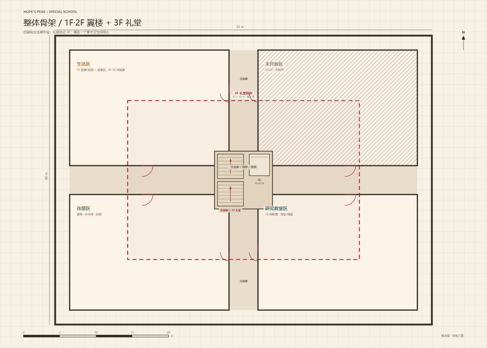

# 特殊学园 · 校区概念平面

根据手绘草图与新增要求整理的 Canvas 概念户型图，用于 3D 建模前的空间确认，不是施工图。



- 全页预览：[preview/page.jpg](preview/page.jpg)

## 草图对应关系

| 草图 | 本图 |
|---|---|
| `first floor + second floor` | 四个翼楼均为 1F + 2F |
| 中央虚线框 / 礼堂 | **3F 中央礼堂**（1F/2F 主走廊 + 大楼梯） |
| 左上 `宿舍` | **生活区**：1F 厨房/后厨 + 餐厅进食区、2F 16 间寝室 |
| 右上 `未开放(不作制)` | 未开放区：1F/2F 封堵，只留轮廓与厕所核心 |
| 左下 `休憩区` | 休憩区：锻炼、乒乓球、运动杂物间 |
| 右下 `研究教室区` | 研究教室区：1F 01–05，2F 06–10，共 10 间 |
| 下方箭头 `third floor` | 主走廊大楼梯：1F → 2F → 3F 礼堂 |

## 竖向关系

| 层 | 内容 |
|---|---|
| 1F | 生活区（厨房/后厨 + 餐厅进食区 + 卫生间核心）、休憩区（运动 + 乒乓球 + 杂物 + 卫生间）、研究教室 01–05、未开放区 |
| 2F | 生活区（16 间寝室）、休憩区（健身 + 乒乓球 + 储藏）、研究教室 06–10、未开放区 |
| 3F | 中央礼堂（舞台/座席/门厅/卫生间核心），由 2F 大楼梯与客梯到达 |

- 除礼堂外，所有区域都是两层。
- 礼堂在最上层；1F/2F 中央为主走廊、大楼梯与客梯（1F/2F/3F）。
- 图纸上的虚线框是 3F 礼堂在总平面上的投影，不是 1F/2F 的实体房间。
- 卫生间集中：每个区域只设一个核心，放在 1F；2F 不再逐层复制。

## 生活区与厨房关系

- 现有厨房/后厨模型为 **18 × 14 m**，放在生活区 **1F**。
- 东侧传菜口接**餐厅进食区**；西侧货梯；北侧冷库；南侧清洗；中央操作岛台。
- 1F 厨房东侧设一个集中的卫生间核心；2F 为 **16 间寝室**，不再重复布置 WC，使用 1F 核心。
- 不再逐层多点布置 WC。

### 餐厅进食区

- 现有餐厅 **36 × 22 m** 作为生活区 1F 的进食区，单独一张大图。
- 西侧传菜口接厨房，东侧入口；8 张 6 人桌。
- 与厨房的关系是“厨房 → 传菜口 → 进食区”，而不是把餐桌塞进后厨。

## 休憩区

- 1F：综合锻炼区、乒乓球 2 台、运动杂物间、更衣/淋浴、厕所、休息/饮水。
- 2F：健身房、乒乓球 2 台、器材储藏、更衣/淋浴、休息/拉伸；卫生间核心在 1F。
- 运动杂物间放球、网、器材、垫子；两层都有。

## 研究教室区

- 1F：研究教室 **01–05**，准备室、厕所。
- 2F：研究教室 **06–10**，器材储藏；卫生间核心在 1F。
- 共 **10 间**；每层 5 间，围绕中央走廊。
- 卫生间核心只在 1F，2F 不重复。

## 未开放区

- 1F/2F 均斜线填充，只留结构轮廓与封堵门洞；1F 封堵一个 WC 核心，2F 不重复。
- 不布置家具，不作可玩空间。

## 中央礼堂（3F）

- 北侧舞台；中央座席 8 排 × 8；南侧门厅。
- 门厅一处集中的卫生间核心；控制室；2F 大楼梯与客梯到达。
- 3F 其余翼楼为屋面/挑空，不布置房间。

## 暂定尺度

| 项 | 尺寸 |
|---|---|
| 总平面 | 52 × 40 m |
| 单个翼楼 | 22 × 16 m / 层 |
| 中央礼堂 | 32 × 22 m |
| 现有厨房/后厨 | 18 × 14 m |
| 餐厅进食区 | 36 × 22 m |
| 主走廊 | 4 m 宽 |
| 楼梯 / 客梯核心 | 8 × 8 m |

这些是按草图与现有模型推的概念值，可调。

## 页面内容

- 整体骨架：四翼楼 + 中央主走廊/大楼梯 + 3F 礼堂投影。
- 竖向剖面：1F/2F 翼楼 + 3F 礼堂 + 大楼梯。
- 分区户型：生活区、生活区餐厅进食区、休憩区、研究教室区、未开放区各 1F/2F 或单张大图；礼堂 3F 一张。
- 「下载总图 PNG」「打印 / PDF」。

## 使用

纯 Canvas + 经典脚本，可以直接双击 `index.html`；也可走本地服务器：

```powershell
# single-dorm/ 目录
python -m http.server 8123 --bind 127.0.0.1
# http://127.0.0.1:8123/floorplan/
```

## 待确认

1. 3F 礼堂是否通高/需要二层看台？
2. 现有餐厅 36 × 22 m 是否就作为生活区进食区，还是另建一个小餐厅？
3. 大楼梯是单跑、双跑，还是楼梯 + 电梯？
4. 生活区 2F 的 16 间寝室是否保持这个密度？
5. 研究教室 10 间是否够，是否还要实验室/准备室？
6. 未开放区是否需要保留可通行门洞，还是完全封死？
