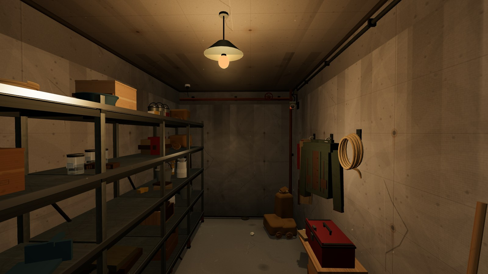
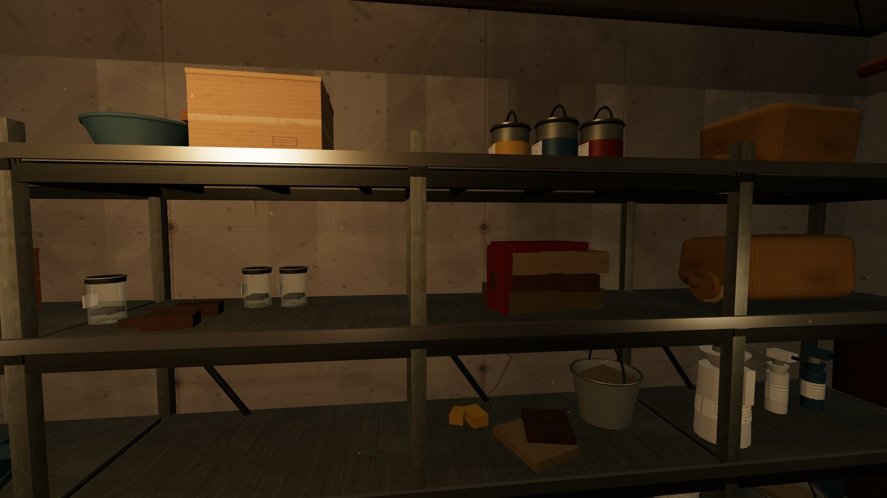
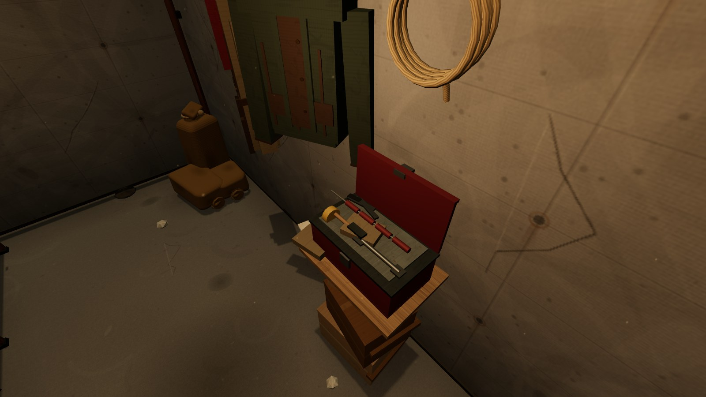
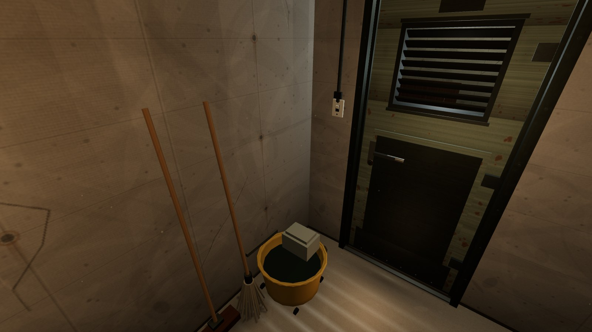
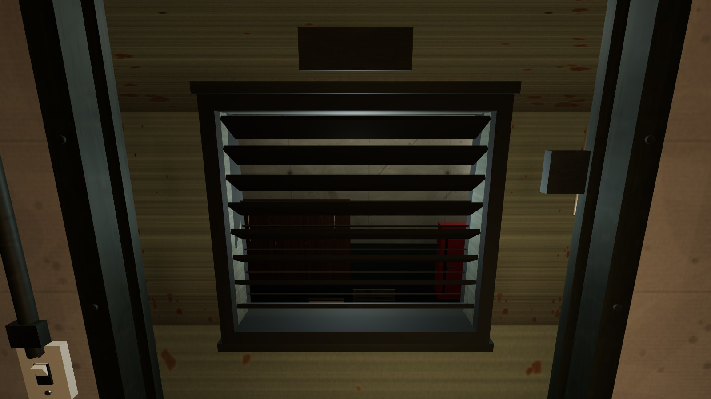
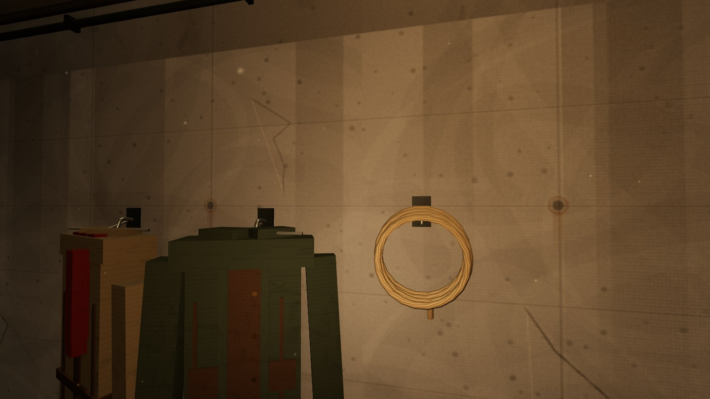
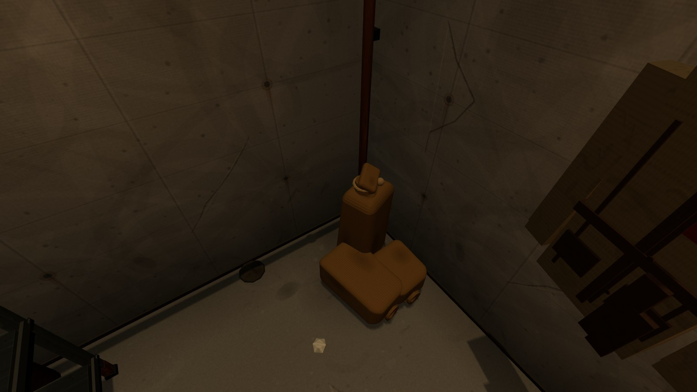
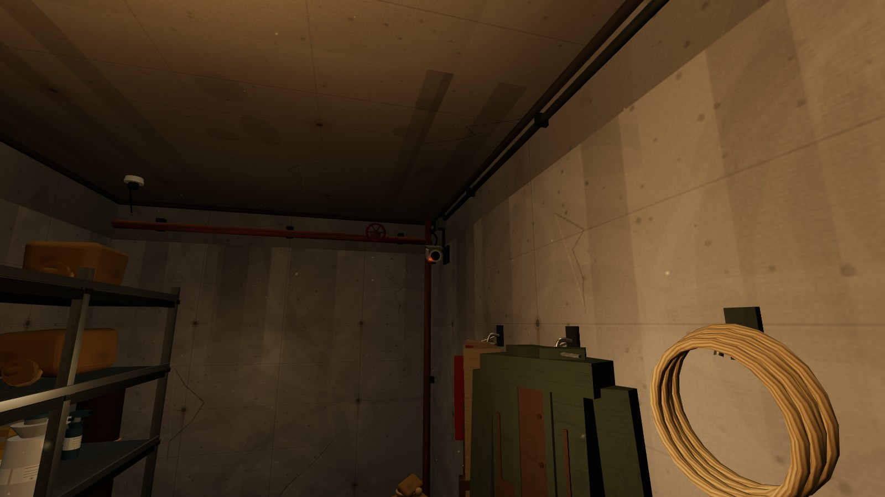
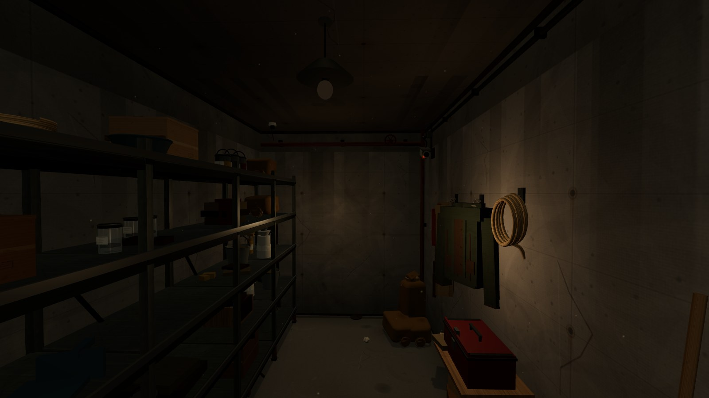

# 杂物间

弹丸论破同人 · 3D 场景集里的第 5 个场景：**生活区 1F 的旧杂物间**。纯静态、可离线运行的 Three.js 场景，无人物、无文字、无音频、无 CDN、无网络请求；几何、程序化贴图与全部灯光在浏览器内生成。



## 打开方式

```powershell
# 在 single-dorm 目录（推荐使用线程化的 serve.py）
python serve.py
# 合并预览并直接进杂物间
http://127.0.0.1:8123/#storage
# 或从同页顶部切到「杂物间」
http://127.0.0.1:8123/
# 独立入口（自动跳转）
http://127.0.0.1:8123/storage/
```

页面使用 ES Modules，必须通过 HTTP(S) 打开；`file://` 会显示明确提示。

## 空间

- **2.4 × 4.8 × 2.7 m，11.52 ㎡**：宽 : 深 = **1 : 2**，窄长、压低、无窗。
- 西墙整面 **五层旧角钢货架**：0.56 m 深 × 3.70 m 长 × 2.02 m 高，4 跨、10 根立柱；层板前挡边、加强筋、斜撑、锈脚完整。
- 南墙 **0.9 × 2.06 m 旧钢门**：暗绿旧漆、掉漆锈边、踢脚板、三只合页、执手锁、门东侧顶灯开关；门上半部是 **0.5 × 0.44 m 百叶通风口**。
- 门外 1.7 m 走廊切片：奶油墙 + 墨绿墙裙、塑胶地面、顶灯、笼式壁灯、红色灭火器箱、空白告示板、黄色防滑牌；**只可看，不可进入**。
- 东墙：两台挂钩上的旧外套 / 工作服、一盘麻袋绳、扫把与拖把、拖把桶、纸箱堆与开盖工具箱。
- 北墙：三只麻袋、卷起的地毯、锈水管与红色阀门、线管。
- 天花：毛坯混凝土板 + 明装线管 + 接线盒 + 一盏裸灯泡（搪瓷罩 + 吊线）；东北角 **旧枪机监控**，红点呼吸并慢速扫视。
- 地面：整间污渍水泥地、地漏格栅、裂缝、纸屑、灰团、扫痕。

## 门上的百叶：里看外、外看不进

百叶是真实开洞的 8 片下斜叶片，不是贴图。站在门内侧略低头，可以通过叶片间隙看到走廊的墙面、红色灭火器箱与黄色防滑牌；从走廊侧向里看则被叶片挡住。

- 水平探针测试：室内 21 条探针中 **16 条**越过门平面；走廊 21 条探针中 **0 条**进入室内。
- 截图：[vent.jpg](preview/vent.jpg) · [door.jpg](preview/door.jpg)

## 陈设

| 族 | 内容 |
| --- | --- |
| 清洁 | 扫把、拖把、拖把桶（带压水器）、水桶 ×5、簸箕、刮水器、喷壶 ×3、清洁剂桶、抹布、海绵 |
| 工具 | 可开盖修理工具箱（托盘随盖抬升）、4 螺丝刀、扳手、锤子、钳子、卷尺 |
| 仓储 | 麻袋 ×5、绳圈 ×3、纸箱 ×6、油漆罐 ×5、玻璃罐 ×3、旧报纸捆、木垫板 |
| 衣物 | 深绿旧外套、米色工作服、红围巾、3 件折叠衣物 |
| 安防 | 墙装旧监控 ×1（红色录制灯 + 绿电源灯 + 慢速云台） |
| 走廊 | 灭火器箱、空白告示板、笼式壁灯、顶灯、防滑牌 |

## 交互

| 交互 | 行为 |
| --- | --- |
| `E` / 单击门 | 锁定提示「杂物间门 · 暂未开放（预留走廊切换）」，不切场 |
| `E` / 单击工具箱 | 开/合盖；开盖时托盘上抬 0.075 m，露出 8 件工具 |
| `E` / 单击顶灯开关 | 开/关裸灯；关灯后仍保留百叶/走廊光与监控红点，可继续行走 |
| `W A S D` | 移动（眼高恒定 1.80 m） |
| `Shift` | 加速（2.0 → 4.2 m/s） |
| 鼠标拖动 / 全屏鼠标 | 环顾（俯仰 ±83°，永不侧倾） |
| 右键 | 固定 / 解锁视线 |
| 中键 | 平滑回正 |
| `F11` / 右上按钮 | 全屏 |

## 性能

- 静态合批 **50 批 / 30,724 三角面**；hero 视角 **74 draw calls / 32,212 三角面 / 27 个纹理对象**；视角变化 34–74 draw calls。
- **19 张程序化贴图**，单张 ≤512 × 1024，约 11 MB（含 mipmap）；一张 1024² 静态阴影；无后处理。
- **1600 × 900 · GTX 1060 · 稳定 60 FPS**（可见 Edge 实测）；同页五场景常驻，切换不重载。
- 碰撞：10 个碰撞体、0.30 m 玩家半径、0.06 m 子步进，3 s 冲刺测试全部 0 穿透。

## 预览

| | |
|---|---|
|  |  |
|  |  |
|  |  |
|  |  |

更多：[场景简报](BRIEF.md) · [场景规格](scene-spec.yaml) · [资产清单](asset-list.md) · [验收记录](VALIDATION.md)

## 文件

```
storage/
├─ index.html              # 自动跳转 /#storage
├─ BRIEF.md                # 场景简报
├─ scene-spec.yaml         # 场景规格（移动机位 / 灯光 / 资产 / 预算 / 验收）
├─ asset-list.md           # 资产清单（复用 / 新增 kit / one-off / 统计）
├─ VALIDATION.md           # 验收记录（移动、碰撞、交互、百叶、性能）
├─ preview/*.jpg           # 13 张预览
├─ preview/motion-report.json  # 移动/碰撞/交互/百叶原始报告
├─ preview/fps.json        # 可见 Edge 的 GPU / FPS / draw calls
├─ tools/
│  ├─ check.mjs            # 加载与控制台检查
│  ├─ motion-test.mjs      # 移动 / 碰撞 / 视角 / 交互 / 百叶 / 五场景切换
│  ├─ capture.mjs          # 确定性截图（inspect / final）
│  └─ gpu-check.mjs        # 可见 Edge 的 FPS 与 HUD 截图
└─ src/
   ├─ config.js            # 尺寸、门/百叶、货架、灯光开关、摄像、碰撞、移动参数
   ├─ textures.js          # 19 张程序化贴图（混凝土/钢/木/纸箱/麻布/布/绳/旧漆/光带…）
   ├─ materials.js         # 62 个材质槽
   ├─ room.js              # 墙地顶、门与百叶、门外走廊、裸灯、线管、水管、监控、开关
   ├─ shelf.js             # 五层角钢货架（4 跨 × 10 立柱）
   ├─ clutter.js           # 清洁/工具/麻袋/绳/纸箱/衣物/工具箱与开盖托盘
   ├─ props.js             # 地面百叶光带、门缝光、灯泡光晕、尘埃
   ├─ scene.js             # 装配、灯光、碰撞、接触阴影、交互、百叶探针、统计
   └─ player.js            # 第一人称移动（零侧倾、固定眼高、轻步伐）
```

## 制作依据

按仓库内 `skills/danganronpa-adv-3d` 的场景生产线执行：先写简报与规格，再由 kit 拼房间；单一垂直主光负责全部投影；移动机位独立验收。百叶单向视线用真实几何 + 水平探针验证，而不是贴图。详见 [BRIEF.md](BRIEF.md) 与 [VALIDATION.md](VALIDATION.md)。
